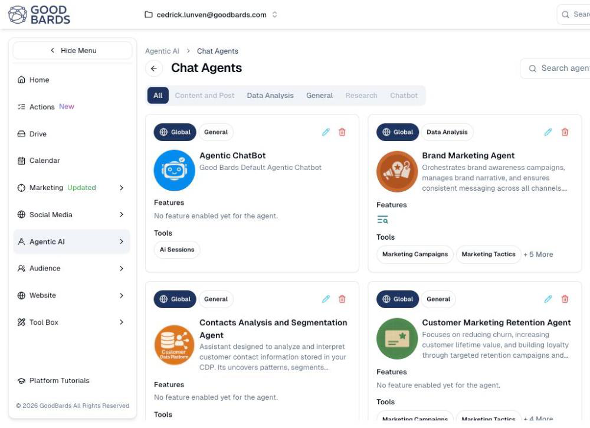

# Chat Agents

Assistants you can hold a conversation with — each one set up for a particular
kind of marketing work.

## What it's for

A chat agent is an AI assistant you talk to in plain language. Rather than one
general-purpose chatbot, GoodBards gives you several, each pointed at a different
job: one that understands your brand narrative, one that reads your contact data,
one that looks after retention.

Agents know your business. They can draw on your Brand Kit and, depending on the
tools they are given, on your campaigns, contacts and analytics.

## Before you start

Chat agents are not available on every plan. If **Agentic AI** does not appear in
your sidebar, your plan does not include agents — speak to your account contact.

## How to start a chat

1. In the sidebar, choose **Agentic AI → Chat Agents**.
2. Browse the agents, or use **Search agents…** to find one by name.
3. Choose the agent that fits what you need, and start typing.

## Reading an agent card

Each card tells you what the agent is and what it can reach:

| On the card | What it means |
| --- | --- |
| **Global** / **Local** | *Global* agents are provided by GoodBards. *Local* agents were created inside your own account. |
| **Category** | The kind of work it is for — General, Data Analysis, Content and Post, Research, Chatbot. |
| **Description** | What the agent is designed to do. |
| **Features** | Capabilities switched on for it. Some agents show *No feature enabled yet*. |
| **Tools** | What it can actually reach — Marketing Campaigns, Google Analytics, Google Trends and so on. |

!!! tip "Tools are the part that matters"
    Two agents with similar descriptions can behave very differently depending on
    their tools. An agent with **Google Analytics** in its tool list can answer
    questions about your traffic; one without it cannot.

## Filtering by category

The buttons under the title narrow the list: **All**, **Content and Post**,
**Data Analysis**, **General**, **Research**, **Chatbot**. A greyed-out category
has no agents in it.

## Creating your own

**+ Create New Agent** builds an agent for your account, which appears as
**Local**. Your plan sets how many custom agents you may have.

## Good to know

- **Agents are not identical.** Pick by tools, not by name.
- **An agent only knows what its tools reach.** If it cannot see your contacts, it
  cannot answer questions about them.
- **Global agents are maintained for you.** They may gain capabilities over time
  without you changing anything.

---

*Still stuck? [Contact support](../contact.md).*
