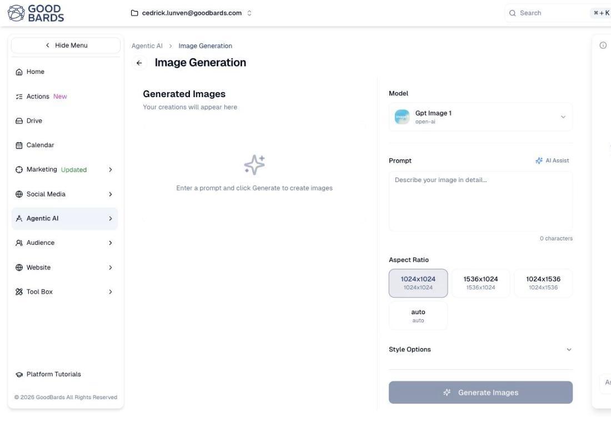

# Image Generation

Create images for campaigns, posts and emails by describing what you want.

## What it's for

Marketing needs images constantly, and stock photography rarely fits. Describe
the image you need and GoodBards creates it — no design software, no photo
shoot.

Generated images are useful for social posts, email headers and campaign
visuals. They are less suited to anything needing your actual products or
people.

## How to generate an image

1. In the sidebar, choose **Agentic AI → Image Generation**.
2. Describe what you want in **Prompt**. Detail helps.
3. Pick an **Aspect Ratio**.
4. Open **Style Options** if you want more control over the look.
5. Choose **Generate Images**.

Your images appear under **Generated Images** on the left.

## Choosing an aspect ratio

| Ratio | Shape | Good for |
| --- | --- | --- |
| **1024x1024** | Square | Instagram posts, profile images. |
| **1536x1024** | Landscape | Email headers, website banners, LinkedIn. |
| **1024x1536** | Portrait | Stories, vertical mobile formats. |
| **auto** | Chosen for you | When you are not sure. |

Pick the ratio for where the image will be used. Cropping a square image into a
banner afterwards usually spoils the composition.

## Writing a good prompt

Be specific about subject, setting, style and mood. *"A flat-lay of tropical
fruit on a pale marble table, bright daylight, minimal styling"* gives a far
better result than *"fruit picture"*.

!!! tip "AI Assist writes the prompt for you"
    **AI Assist**, above the prompt box, expands a rough idea into a fuller
    description. Useful when you know what you want but not how to describe it.

## Choosing a model

**Model** at the top sets which AI generates the image. The default comes from
your company's [AI Settings](../settings/ai-settings.md); change it here to use
a different one for this image.

## Good to know

- **Generation uses credits.** Each image counts against your allowance — see
  [Usage & Billing](../settings/tenant-usage.md).
- **Expect to iterate.** The first result is rarely the one you use. Adjust the
  prompt and generate again.
- **Check faces, hands and text.** AI images still get these wrong, and mistakes
  are more obvious to your audience than to you.
- **Do not generate real people or brands.** Images resembling identifiable
  people or another company's branding carry legal risk.

---

*Still stuck? [Contact support](../contact.md).*
