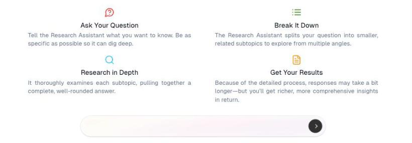

# Research Assistant

Ask a question about a market, competitor or topic, and get a researched answer
back.

## What it's for

Some questions need more than a quick answer — *what are the main loyalty
programmes among Singapore F&B chains, and how do they differ?* The Research
Assistant works through questions like that properly rather than replying off the
top of its head.

Use it for market scans, competitor comparisons and background before a campaign.
For quick drafting, a [chat agent](chat-agents.md) is faster.

## How to request research

1. In the sidebar, choose **Agentic AI → Research Assistant**.
2. Type your question in the box at the bottom.
3. Send it, and wait — this takes longer than an ordinary chat reply.

## How it works

The assistant takes four steps, which is why it is slower and better than a
single answer:

| Stage | What happens |
| --- | --- |
| **Ask Your Question** | You describe what you want to know. Be specific. |
| **Break It Down** | Your question is split into smaller subtopics to explore from several angles. |
| **Research in Depth** | Each subtopic is examined and the findings pulled together. |
| **Get Your Results** | You get a fuller, more rounded answer than a quick reply would give. |

!!! tip "Specific questions get better research"
    *"Tell me about coffee"* produces something bland. *"How do specialty coffee
    brands in Singapore position themselves against chains, and what do they
    charge?"* gives the assistant something to work with.

## Chat History

**Chat History**, at the top right, holds your previous research. Worth checking
before asking again — someone may already have researched the same ground.

## Good to know

- **Responses take a while.** The screen says so, and that is the trade-off for
  depth. Ask, then come back to it.
- **Research costs credits.** More than a simple chat, because it runs several
  searches. See [Usage & Billing](../settings/tenant-usage.md).
- **Verify anything load-bearing.** Check facts you plan to publish — prices,
  statistics and competitor claims especially.
- **It is a starting point.** Use the research to inform your own judgement, not
  to replace it.

---

*Still stuck? [Contact support](../contact.md).*
