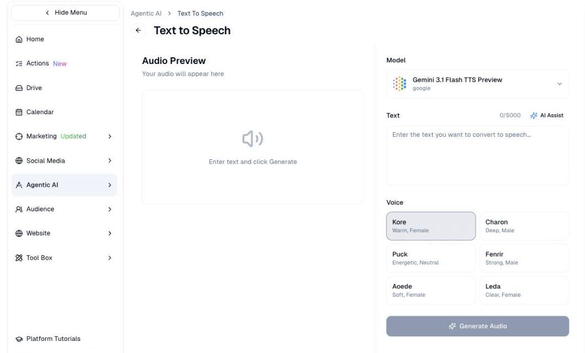

# Text to Speech

Turn written copy into spoken audio, in a voice you choose.

## What it's for

Some audiences listen rather than read. Text to Speech produces audio from your
written copy — useful for video voiceovers, social clips, accessible versions of
written content, and audio ads.

You write the script; the platform reads it aloud.

## How to generate audio

1. In the sidebar, choose **Agentic AI → Text to Speech**.
2. Paste or type your script into **Text**. The limit is 5,000 characters.
3. Pick a **Voice**.
4. Choose **Generate Audio**.

Your audio appears under **Audio Preview** on the left.

## Choosing a voice

Each voice has a short description of how it sounds:

| Voice | Character |
| --- | --- |
| **Kore** | Warm, female |
| **Charon** | Deep, male |
| **Puck** | Energetic, neutral |
| **Fenrir** | Strong, male |
| **Aoede** | Soft, female |
| **Leda** | Clear, female |

Match the voice to the content. *Energetic* suits a product launch; *warm* or
*soft* suits something more considered.

!!! tip "Pick one voice and stay with it"
    If audio becomes a regular part of your marketing, using the same voice each
    time makes it recognisable. Switching voices between clips sounds like
    different companies talking.

## Writing for the ear

Copy that reads well on a page often sounds wrong aloud. Shorter sentences work
better, and it is worth reading your script out before generating it.

**AI Assist**, above the text box, can help adapt written copy into something that
sounds natural spoken.

## Good to know

- **5,000 characters is roughly five minutes.** Longer scripts need splitting.
- **Listen before you publish.** Check names, acronyms and any local place names —
  these are where pronunciation goes wrong.
- **Generation uses credits.** See [Usage & Billing](../settings/tenant-usage.md).
- **Say if audio is synthetic** where your audience would reasonably expect a real
  person.

---

*Still stuck? [Contact support](../contact.md).*
