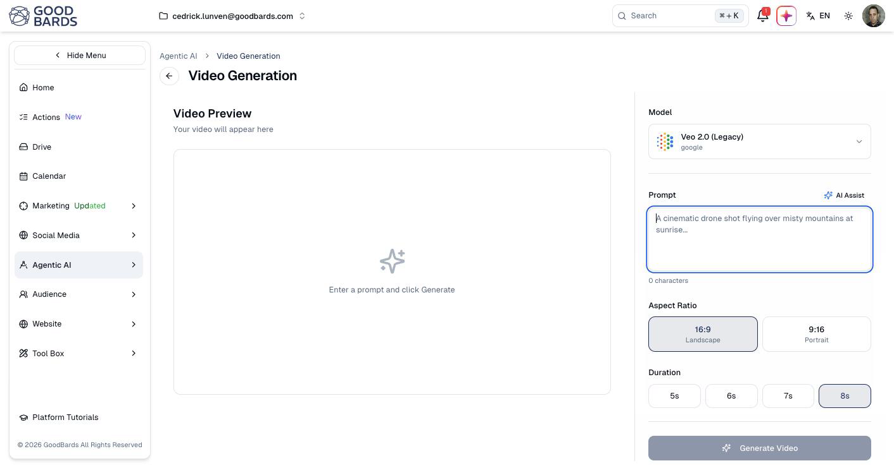

# Video Generation

Create short video clips from a written description.

## What it's for

Short video performs well on social, and producing it normally means a camera, an
editor and a week. This generates a clip from a description instead — useful for
social posts, ad creative and background footage.

Clips are short by design: a few seconds, suited to social rather than long-form
storytelling.

## How to generate a video

1. In the sidebar, choose **Agentic AI → Video Generation**.
2. Describe the clip you want in **Prompt**.
3. Pick an **Aspect Ratio** and a **Duration**.
4. Choose **Generate Video**.

Your clip appears under **Video Preview** on the left.

## Aspect ratio

| Ratio | Use it for |
| --- | --- |
| **16:9 Landscape** | YouTube, website embeds, presentations. |
| **9:16 Portrait** | Stories, Reels, TikTok — anything watched on a phone held upright. |

Choose before generating. Cropping landscape footage into portrait afterwards cuts
the sides off your subject.

## Duration

Clips run from **5s** to **8s**. Shorter is usually better on social, where the
first two seconds decide whether anyone keeps watching.

## Writing a good prompt

Describe the shot the way you would brief a videographer — subject, movement,
setting, light. The placeholder on screen is a good model: *a cinematic drone shot
flying over misty mountains at sunrise*.

**AI Assist** above the prompt box expands a rough idea into a fuller description.

## Good to know

- **Video costs more than images.** Generation is slower and uses more credits —
  see [Usage & Billing](../settings/tenant-usage.md).
- **Expect several attempts.** Getting the motion right usually takes a few tries,
  so allow time before a deadline.
- **Watch for artefacts.** Faces, hands and text are where AI video still fails.
  Watch the clip fully before publishing.
- **Add captions.** Most social video is watched with the sound off.

---

*Still stuck? [Contact support](../contact.md).*
