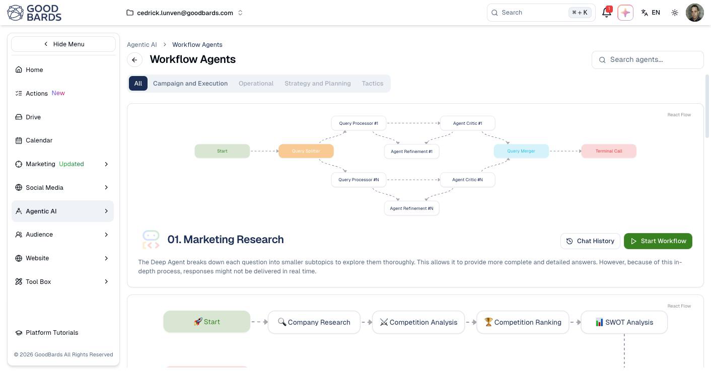

# Workflow Agents

Multi-step jobs that run themselves — research, analysis and planning that would
take you an afternoon.

## What it's for

A [chat agent](chat-agents.md) answers a question. A **workflow agent** carries
out a whole process: researching a company, comparing it with competitors,
ranking them, and producing a SWOT analysis — each step feeding the next.

You start it and come back to the result.

## How to run a workflow

1. In the sidebar, choose **Agentic AI → Workflow Agents**.
2. Browse the workflows, or filter by category.
3. Read the diagram to see what it will do.
4. Choose **Start Workflow**.

## Reading the diagram

Each workflow shows its steps as a flow chart, so you can see what happens before
you start it. A company research workflow, for example, runs:

**Start → Company Research → Competition Analysis → Competition Ranking → SWOT
Analysis**

Some workflows fan out and rejoin — splitting a question into parts, working on
each separately, then merging the findings. That is why they take longer than a
single answer and produce a more thorough one.

!!! tip "Read the diagram first"
    The flow chart tells you what the agent will actually do. If the steps do not
    match what you need, a different workflow — or a chat agent — may suit you
    better.

## Categories

Filter with the buttons under the title: **All**, **Campaign and Execution**,
**Operational**, **Strategy and Planning**, **Tactics**. A greyed-out category
has no workflows in it.

Use **Search agents…** to find one by name.

## Chat History

**Chat History** on each workflow holds previous runs. Worth checking before
starting a fresh one — a colleague may have run the same analysis last month.

## Good to know

- **Results are not instant.** These run several steps in sequence; expect to come
  back to them.
- **Workflows use more credits than a chat.** Each step costs. See
  [Usage & Billing](../settings/tenant-usage.md).
- **Check the output before acting on it.** A workflow producing competitor
  analysis is a starting point for your judgement, not a decision.

---

*Still stuck? [Contact support](../contact.md).*
