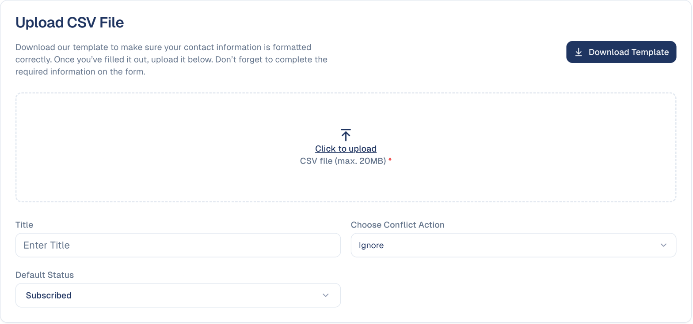
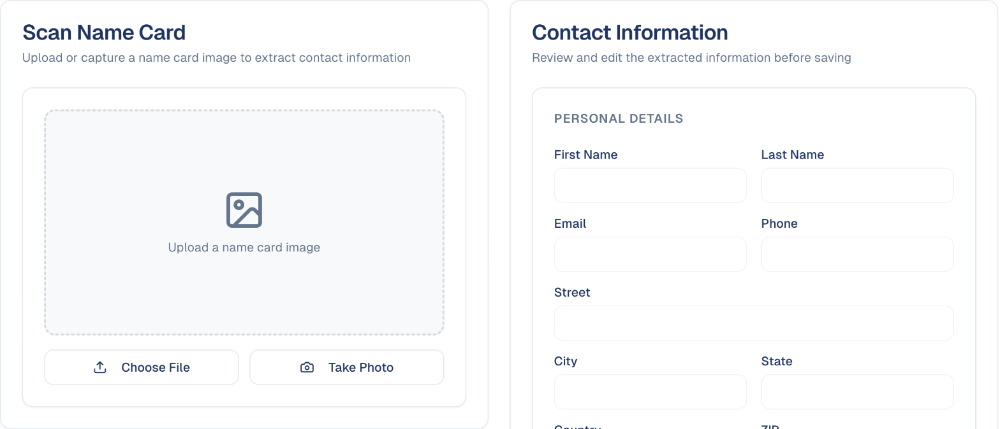

# Adding contacts

Bring people into your audience: one at a time, from a spreadsheet, or from a
business card.

## What it's for

Most contacts arrive on their own, from your forms, events and chatbot. The rest
you add yourself: the list from a trade show, a client's customer file, the cards
you collected at a meeting. Each way below creates proper contacts, with their
consent and where they came from recorded.

## Before you start

- Your company's **privacy statement**, under **Brand & Context → General
  Information → Privacy Statements**. Every import is linked to the statement the
  people agreed to.

## Add one contact

In **Audience → Contacts**, on the **Details List** tab, choose **Add Contact**
and fill in the form.

## Import a spreadsheet

1. In **Audience → Contacts**, open the **Import Jobs** tab, then **Bulk Add
   Contacts → From a CSV file**.
2. Choose **Download Template** and put your contacts in it, one per row. The
   columns and the values they accept are explained in
   [Contacts → Prepare your CSV file](contacts.md#prepare-your-csv-file).
3. Upload the file, give the import a **Title**, and choose:
    - **Choose Conflict Action**: what to do when an email address already exists
      (for example **Ignore** it).
    - **Default Status**: the status of the imported contacts.

    

4. Under **Additional Details**, say where the contacts come from (a campaign and
   tactic, or another source), add **Tags** and **Owners**, and pick the
   **Privacy Statement** they agreed to. Choose **Upload**.
5. The job appears on the **Import Jobs** tab as **READY TO START**. Nothing is
   imported yet: check the job, then choose **Start** and confirm with **Start
   import**.
6. When the job shows **COMPLETED**, your contacts are in. If it shows
   **INCOMPLETE**, open it with **View** and choose **Download logs** to see
   which rows were rejected and why. See
   [Import Jobs](contacts.md#import-jobs).

## Import from Pipedrive

Once Pipedrive is connected (see [Pipedrive](../settings/connectors/pipedrive.md)),
**Bulk Add Contacts → From Pipedrive** imports your Pipedrive contacts directly,
with the same choices as a spreadsheet: conflict action, default status, tags
and privacy statement. Until Pipedrive is connected, the option shows as **Not
connected**.

## Scan a business card

1. In **Audience → Contacts**, open the **Card Scanner** tab.
2. Choose **Take Photo**, or **Choose File** for a picture you already have.
3. GoodBards reads the card and fills in the **Contact Information**. Check it,
   correct anything misread, and save.

## Good to know

- **Only import people who agreed to hear from you.** Set the **Default Status**
  to match what they agreed to: choose **Subscribed** only for people who gave
  marketing consent. Under Singapore's PDPA and similar laws, consent cannot be
  assumed.
- **The conflict action handles existing contacts.** It decides what happens to a
  row whose contact is already in your audience.
- **Tag every import.** A tag such as `trade-show-2026` lets you find, segment
  and follow up that group later.

---

*Still stuck? [Contact support](../contact.md).*
