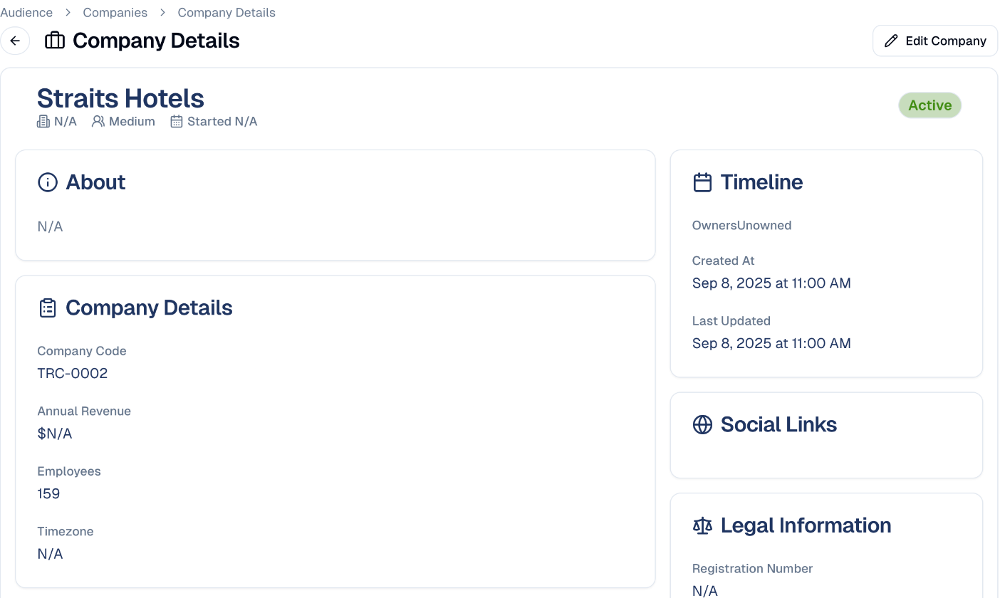
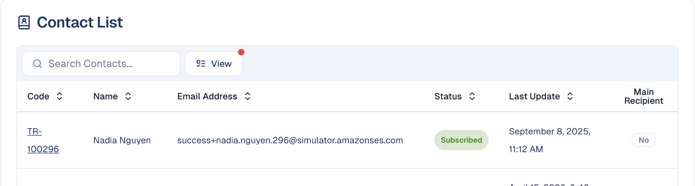

# Companies

The organisations your contacts work for — and how complete your picture of them
is.

## What it's for

In B2B marketing the company matters as much as the person. Several contacts may
work at the same organisation, and a decision usually involves more than one of
them.

Companies group your contacts by the organisation they belong to, so you can see
account-level activity rather than isolated individuals.

## Reading the Companies home

**Audience → Companies** opens on **Home**, which summarises your data rather
than listing organisations.

**Total Companies**, top left, shows how many organisations you hold.

**Data quality**, next to it, is your clean-up list for accounts. Each tile
counts the companies that need attention, with their share of the total; hover
it to read what it checks, and choose it to open the list filtered to those
companies:

- **No contacts** — organisations nobody at your company can reach. Add or link
  a contact.
- **Under 5 contacts** — accounts below the number of contacts you aim for. On
  the filtered list, change the number in the filter chip above the table to
  use your own target.

In the **Details List**, the **Contacts** column shows how many contacts each
company has; sort on it to see the thinnest accounts first. The assistant in the
top bar answers the same questions in plain words, for example *companies with
fewer than 5 contacts* or *top 10 companies by clicks in the last 30 days*; see
[Asking the assistant](contacts.md#asking-the-assistant).

## Database Health

The charts below score how complete your data is:

- **Company Database Count** — how it has grown.
- **Database Growth** — the rate of growth.
- **Field Completeness** — the percentage of fields filled in. Low completeness
  limits how well you can segment.
- **Distribution by Industry** — which sectors you hold. Companies with no
  industry set show as *Unknown*.
- **Distribution by Company Size** — the spread from small to large.

The letter badge beside **Database Health** grades your data overall, and the
small line next to it shows the score over the last 90 days. Treat a low grade
as a prompt to fill in missing fields rather than a problem with the platform.
**Engagement**, further down, grades how much your accounts interact with you.

## Adding companies

On the **Details List** tab, choose **Add Company**. Link contacts to it from
the company field of each contact.

## A company's page

Choose a company's code in the **Details List** to open its page.

| Section | What it shows |
| --- | --- |
| **About** and **Company Details** | The description, code, annual revenue, employees and timezone. |
| **Location** | Country, city and address. |
| **Custom Fields** | Your own company fields, such as a gifting budget. |
| **Timeline** | Owners, and when the record was created and last updated. |
| **Social Links** and **Legal Information** | Social profiles, registration number and legal entity type. |
| **Contact List** | The people who work there, with their status, and which one is marked as the **main recipient**. |

Choose **Edit Company** to change the details.

## The other tabs

| Tab | What it holds |
| --- | --- |
| **Details List** | All your companies, with owners; assign owners in bulk with **Assign Owners**. |
| **Segments** | Saved filters over companies, for example *hotels in Singapore*. |
| **Custom Fields** | Your own company fields. Same as for contacts: see [Custom Fields](contacts.md#custom-fields). |
| **Custom Lists** | The value lists for Select fields. See [Custom Lists](contacts.md#custom-lists). |

## Good to know

- **Unknown industry limits targeting.** You cannot segment by a field you have
  not filled in.
- **Link contacts to companies.** An unlinked contact cannot be counted towards
  the account they work for.
- **Nominate a main contact.** It is who the platform treats as your route into
  that organisation.

---

*Still stuck? [Contact support](../contact.md).*
