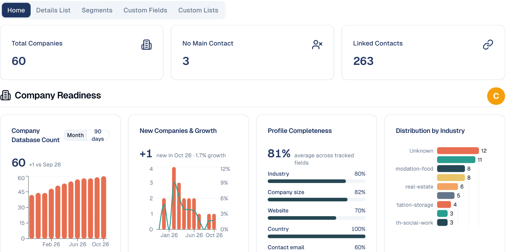

# Companies

The organisations your contacts work for — and how complete your picture of them
is.

## What it's for

In B2B marketing the company matters as much as the person. Several contacts may
work at the same organisation, and a decision usually involves more than one of
them.

Companies group your contacts by the organisation they belong to, so you can see
account-level activity rather than isolated individuals.

## Reading the Companies home

**Audience → Companies** opens on **Home**, which summarises your data rather
than listing organisations.

| Tile | What it tells you |
| --- | --- |
| **Total Companies** | How many organisations you hold. |
| **No Main Contact** | Companies with nobody nominated as the primary contact. |
| **Linked Contacts** | Contacts successfully attached to a company. |

!!! warning "No Main Contact is the number to fix"
    A company with no main contact means you have the organisation but no named
    person to approach. If this figure is close to your total, your account data
    is not yet usable for outreach.

## Company Readiness

The charts below score how complete your data is:

- **Company Database Count** — how it has grown.
- **Database Growth** — the rate of growth.
- **Field Completeness** — the percentage of fields filled in. Low completeness
  limits how well you can segment.
- **Distribution by Industry** — which sectors you hold. Companies with no
  industry set show as *Unknown*.
- **Distribution by Company Size** — the spread from small to large.

The letter badge beside **Company Readiness** grades your data overall. Treat a
low grade as a prompt to fill in missing fields rather than a problem with the
platform.

## Adding companies

Add them directly, or let them arrive with your contacts — importing contacts
that include a company name creates the organisations for you.

## Other tabs

| Tab | What it holds |
| --- | --- |
| **Details List** | Individual company records. |
| **Segments** | Saved filters over companies. |
| **Custom Fields** | Extra fields you add. |
| **Custom Lists** | Your own groupings. |

## Good to know

- **Unknown industry limits targeting.** You cannot segment by a field you have
  not filled in.
- **Link contacts to companies.** An unlinked contact cannot be counted towards
  the account they work for.
- **Nominate a main contact.** It is who the platform treats as your route into
  that organisation.

---

*Still stuck? [Contact support](../contact.md).*
