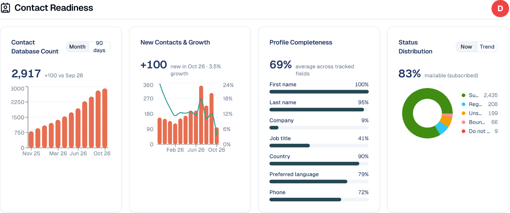
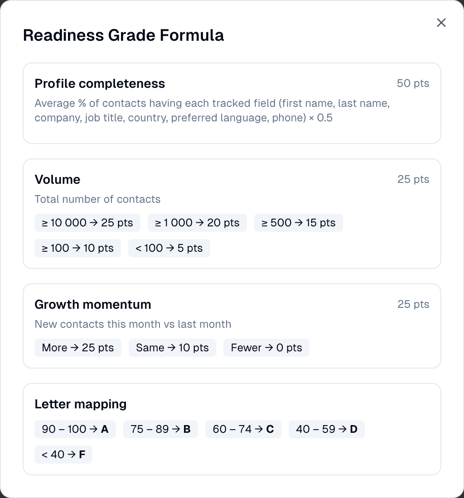
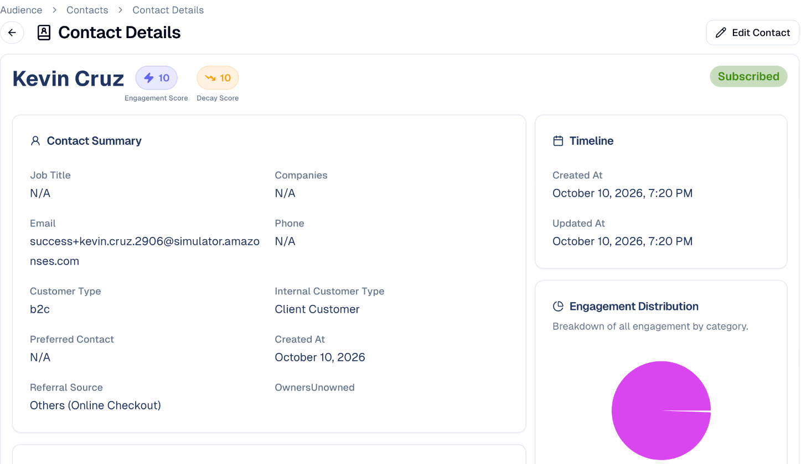
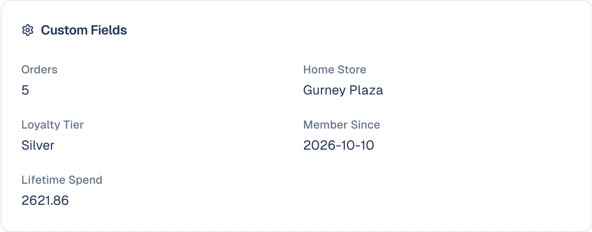
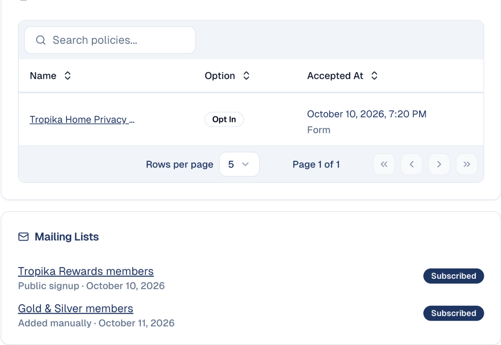
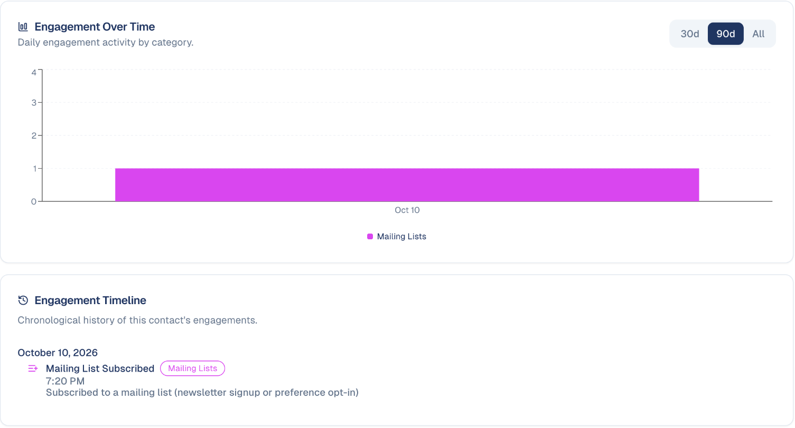
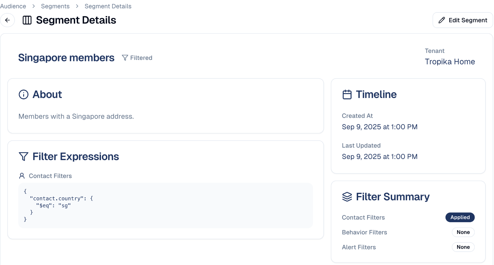
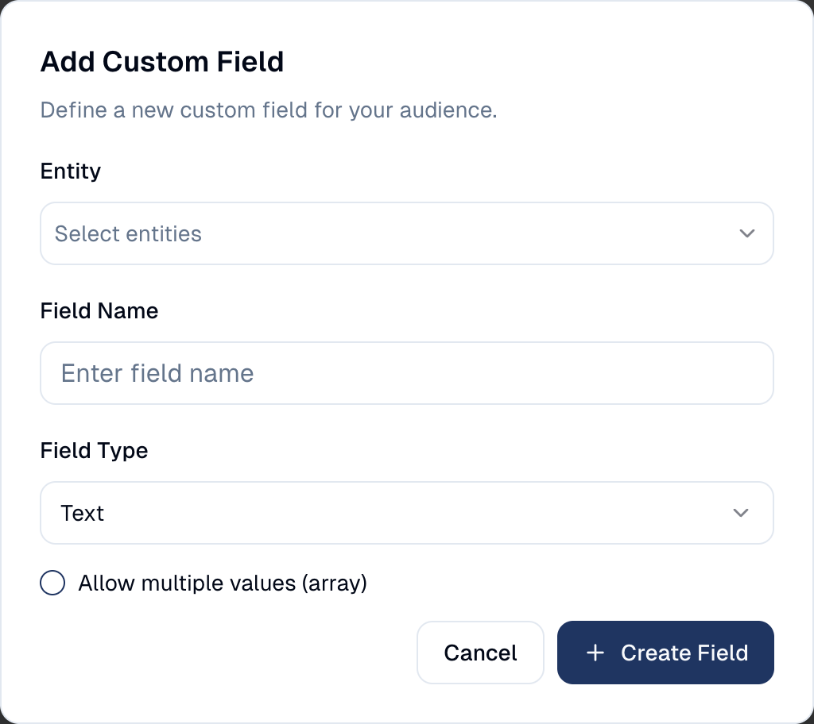
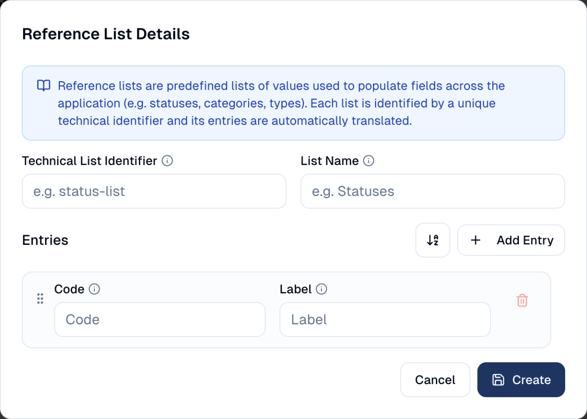

# Contacts

The people you market to — how to add them, keep their details current, and group
them into segments.

## What it's for

Every email you send and every form someone fills in comes back to a contact.
Contacts are the centre of the platform: get them right and the rest of your
marketing has something to work with.

## Adding contacts

There is more than one way, depending on how many you have:

| Method | Use it when |
| --- | --- |
| **Add one at a time** | You met someone and want them in straight away. |
| **Import** | You have a list to bring across. Progress shows under **Import Jobs**. |
| **Card Scanner** | You came back from an event with a stack of business cards. Scan them and the details are read for you. |
| **Forms** | Someone signs up themselves. See [Forms](../marketing/forms.md). |

## Reading the Contacts home

**Audience → Contacts** opens on the **Home** tab, which summarises your database
rather than listing individuals.


**Total Contacts**, top left, shows how many contacts you hold. The gauge fills
as you approach your plan's limit and turns orange, then red, near it. On a plan
without a limit, it shows the number alone.

The **Status distribution** card, under **Database Health**, shows how those
contacts split between statuses:

- **Subscribed** — contacts who have agreed to hear from you.
- **Regular** — contacts with no marketing consent yet: you can work with them,
  but not email them marketing.
- **Unsubscribed**, **Bounced** and **Do not contact** — people you must not
  email.

!!! warning "Subscribed is the number that matters"
    A large database is not much use if most of it has unsubscribed. Only
    **Subscribed** contacts can receive marketing email.

!!! info "Bounced and Do not contact are set for you"
    When a marketing email cannot be delivered, GoodBards reads the reply from
    the recipient's mail server. An address that does not exist, or whose server
    rejects the message outright, becomes **Bounced** at once. A temporary
    problem (full mailbox, message too large, content refused) only adds a note
    to the contact; after three sends that bounce this way, the contact becomes
    **Bounced** too. A recipient who reports your email as spam becomes
    **Do not contact**. Both statuses stop every further send, and the reason
    stays in the contact's engagement timeline and notes.

**Data quality**, next to it, is your clean-up list. Each tile counts the
contacts that need attention, with their share of your database. Hover a tile to
read exactly what it checks:

- **No company** — people you cannot count towards an account.
- **Missing info** — contacts missing an email, phone or country: records you
  cannot reach or segment. Email and phone are only checked when your role can
  see them.
- **No owner** — nobody is responsible for them.
- **Possible duplicates** — pairs of records with the same first and last name.
  Review them before merging anything.

Choose a tile to open the list filtered to exactly those rows; a chip above the
table shows the filter and the count, with a cross to clear it. A tile with
nothing to fix shows **All good**.

### The grades

**Database Health** grades how usable your database is, and **Engagement** how
much your contacts interact with you. Each is a score out of 100 shown as a
letter: **A** (90–100), **B** (75–89), **C** (60–74), **D** (40–59) or **F**
(below 40). Choose the grade to see its formula.

Beside each grade, a small line shows the score over the last 90 days, with how
many points it gained or lost. Hover the line to read the score on a given day.
It builds up day by day.

!!! tip "Why the Database Health line can jump"
    Part of the score compares this month's new contacts with last month's. On
    the first days of a month the comparison starts again, so the line can drop
    even though nothing got worse. The score also steps up as your database
    passes 100, 500, 1,000 and 10,000 contacts.





| Grade | Made of |
| --- | --- |
| **Database Health** | **Profile completeness** (50 points): how many contacts have a first and last name, company, job title, country, preferred language and phone. **Volume** (25 points): how many contacts you hold. **Growth momentum** (25 points): new contacts this month against last month. |
| **Engagement** | **Engaged share** (50 points): contacts with a score of 40 or more. **Reach** (25 points): contacts with any engagement at all. **Depth** (25 points): the average score per contact. |

To raise database health, fill in the missing details (an import with the
**Overwrite** conflict action can complete existing contacts). To raise
engagement, send your contacts something worth opening. See
[Lead scoring](lead-scoring.md).

Companies have the same two grades, built from company data. See
[Companies](companies.md).

## Finding individual contacts

The **Details List** tab lists every contact: their code, name, owner, email,
status and last update.


- Search by name or email, and choose the columns to show with **View**.
- The **Company** column shows the account a contact is linked to (a **+1**
  badge means more than one; hover to see them all). Sort on it to group
  contacts by company, or to bring the unlinked ones to the top.
- Each contact can have **owners**, the colleagues responsible for them. Filter by
  owner, or select contacts and choose **Assign Owners**. Depending on their role,
  a colleague may only see the contacts they own.
- **Export As CSV** downloads the list; **Add Contact** creates one.
- Click a contact's code to open their record: details, custom fields, mailing
  lists, and the history of every email, form and event.

### Asking the assistant

On the Contacts and Companies pages, the assistant in the top bar answers
questions about your audience, in plain words:

- *Which contacts have no company?*
- *Find Jon Tan from DBS, I am not sure of the spelling.*
- *Who opened the last newsletter but never clicked?*
- *Who went cold in the last six months?*
- *Top 10 companies by clicks in the last 30 days.*

It reads the same data as the screens, under the same rules: it only sees the
contacts you can see, it never shows an email or phone your role cannot see, and
it does not edit anything. When you open a contact's record, "this contact" in
your question means that person. Each answer states the rule it applied (for
example *contacts with no positive engagement in the last 180 days*), so you can
check it before acting.

## A contact's page

Choose a contact's code in the list to open their page: everything GoodBards
knows about them, in one place.



| Section | What it shows |
| --- | --- |
| **Scores** | The engagement score and the decay score next to the name. See [Lead scoring](lead-scoring.md). |
| **Contact Summary** | Job, companies, email, phone, customer type, preferred contact method, referral source and owners. |
| **Location** | Country, city, address and timezone. |
| **Custom Fields** | Your own fields, such as a loyalty tier or a home store. |
| **Policies** | The privacy statements the contact accepted, when, and how (for example through a form). This is your proof of consent. |
| **Mailing Lists** | The lists they belong to, how they joined (public sign-up, added manually) and whether they are still subscribed. |
| **Events** and **Form submissions** | The events they registered for and the forms they filled in. |
| **Social Links**, **Referral Info**, **Tags** | Their social profiles, where they came from, and your tags. |
| **Engagement Over Time** and **Engagement Timeline** | Every open, click, form, registration and subscription, day by day and in order. |







### Editing a contact

Choose **Edit Contact** at the top right. The form has the personal details,
address and timezone, job and companies, subscription status, social handles,
referral source, preferred contact method, customer type, privacy statement,
mailing lists, tags and **Contact Notes**. Choose **Save Contact** when done.

- **Notes** keep what your team knows that fits no field: *met at the Mid Valley
  styling clinic*. Choose **Add Note**.
- **Adding a mailing list here subscribes the contact straight away.** Only do it
  for people who agreed.
- **Owners** can be changed here by an administrator. See
  [Users, roles & permissions](../settings/users-roles.md#contact-ownership).

## Segments

A **segment** is a saved filter — a rule that decides who belongs, evaluated when
you use it, so it stays current as contacts change.


To create one, open the **Segments** tab and choose **Add Segment**, then set
the rule. A segment can filter on contact details (such as country or job title),
on behaviour (what contacts did) and on alerts.

Choose a segment's name to open it: its description, its filters, a summary of
which kinds of filter are applied, and the list of contacts it holds right now.
**Edit Segment** changes the rule.



Useful segments look like:

- *Singapore members* — everyone in one market
- *Corporate buyers* — one type of customer
- *Bangkok launch list* — the people from one event

!!! tip "Segments beat one-off filters"
    If you find yourself applying the same filter repeatedly, save it as a
    segment. Give it a description too — in six months you will not remember
    what the rule was.

## Mailing Lists

Lists people subscribe to, for example from a sign-up form. See
[Mailing lists](mailing-lists.md).

## Card Scanner

Photograph a business card, or upload a picture of one: GoodBards reads it and
fills in a new contact for you to check and save. See
[Adding contacts](adding-contacts.md#scan-a-business-card).

## Custom Fields

The details GoodBards does not hold by default, but your business needs: a
loyalty tier, a preferred store, a renewal date.

1. Open the **Custom Fields** tab, then create a field.
2. Give it a **Field Name** and a **Field Type**:

    | Type | Holds |
    | --- | --- |
    | **Text** | Free text. |
    | **Number** | A number, for example a budget. |
    | **Date** | A date, for example a renewal date. |
    | **Boolean** | Yes or no. |
    | **Select** | A value from a list you define under **Custom Lists**. |

    Tick **Allow multiple values** when a contact can have several, for example
    several preferred stores.

3. Choose whether it applies to **Contact**, **Company** or both, under
   **Entity**, then **Create Field**.



The field then appears on every contact's page and in the contact form, and can
be shown as a column in the **Details List** with **View**.

!!! warning "Deleting a field deletes its values"
    Removing a custom field removes the values stored in it for every contact.
    It cannot be undone.

## Custom Lists

The lists of values used by **Select** custom fields: statuses, categories,
types. Example: a *Store* list with *Jurong Point*, *Mid Valley* and
*CentralWorld*.

1. Open the **Custom Lists** tab, then **Add Reference List**.
2. Give it a **Technical List Identifier** (letters, digits, `-` and `_`, for
   example `store`) and a **List Name**.
3. Add the entries with **Add Entry**, each with a code and a label. Drag them to
   reorder, or sort them alphabetically.



Write names and labels in English: GoodBards translates them automatically into
the other languages of the app.

## Import Jobs

Every spreadsheet import, with its status and how many rows were processed, so
you can check that an import went through. Start a new one with **Bulk Add
Contacts**. See [Adding contacts](adding-contacts.md#import-a-spreadsheet).

### An import happens in two steps

Uploading a file does **not** import anything yet. You first create the job,
then you start it:

1. **Create the job.** Choose **Bulk Add Contacts → From a CSV file**, upload
   your file and fill in the form, then choose **Upload**. The job appears in
   the list as **READY TO START**. No contact has been created or changed.
2. **Start the job.** In the job's row, choose **Start**, then **Start import**
   to confirm. GoodBards reads the file row by row and creates or updates the
   contacts. Once started, an import cannot be stopped.

Until you start it, you can still **Delete** the job, for example if you picked
the wrong file or the wrong **Default Status**, and create a new one.

### Job statuses

| Status | What it means |
| --- | --- |
| **READY TO START** | The file is uploaded but not imported. Choose **Start**. |
| **COMPLETED** | Every row was imported. |
| **INCOMPLETE** | The import ran, but some rows were rejected. Open the job with **View** to see which. |
| **FAILED** | The file could not be read at all, for example because it has no header row. |

**View** opens the job's summary: rows processed, imported and failed, the
choices made when it was created, and **Download logs**, which explains line by
line why a row was rejected. **Download original file** gives back the file you
uploaded, so you can fix it and import again.

Deleting a job removes it from the list. The contacts it imported stay.

### Prepare your CSV file

The easiest start is **Download Template** in the **Bulk Add Contacts** form:
it holds every column, including one for each of your
[custom fields](#custom-fields), and an example row to replace.

Here is a short example you can copy, or
[download it](../../files/contacts-import-sample.csv):

```csv
email,customerCode,firstName,lastName,phone,status,customerType,customerTypeInternal,jobTitle,companyName,city,country,timezone,preferredContactMethod,tags,notes,engagementType,engagementDate
mei.tan@example.com,,Mei,Tan,+6591234567,subscribed,b2b,client-customer,Marketing Manager,Lion City Retail,Singapore,Singapore,Asia/Singapore,email,trade-show-2026;vip,Met at booth 12,event-attended,2026-09-24 14:30
arif.rahman@example.com,CUS00102,Arif,Rahman,+60123456789,regular,b2b,target-potential-customer,Head of Growth,Kopi Digital,Kuala Lumpur,Malaysia,Asia/Kuala_Lumpur,whatsapp,trade-show-2026,,,
linh.nguyen@example.com,,Linh,Nguyen,,,b2c,,,,Ho Chi Minh City,Vietnam,Asia/Ho_Chi_Minh,email,,,,
```

Linh's `status` is empty, so she gets the **Default Status** chosen for the job.

The rules of the file:

- **The first row holds the column names**, spelled exactly as below, capitals
  included (`firstName`, not `First Name`). A column whose name is not
  recognised is treated as a custom field, so a misspelt `Email` column is not
  read as the email address.
- **Keep only the columns you need**, in any order. Every row must have as many
  cells as the header row, even when they are empty.
- **Separate cells with commas**, and put a cell in double quotes if it contains
  a comma: `"Tan, Mei"`.
- **Save as UTF-8.** In Excel, choose **CSV UTF-8 (Comma delimited)**, so that
  accents and Chinese, Thai or Vietnamese characters come through.
- **Codes are written in lower case**, exactly as listed below: `subscribed`,
  not `Subscribed`.

### The columns

| Column | What to put in it |
| --- | --- |
| `email` | The contact's email address. This is how GoodBards recognises a contact who is already in your audience. |
| `customerCode` | Your own reference for the contact, for example from your CRM. Must be unique. Left empty, the email address is used. A row needs at least an `email` or a `customerCode`. |
| `firstName`, `lastName` | The contact's name. |
| `birthDate` | Date of birth, as `YYYY-MM-DD`: `1982-03-03`. |
| `secondaryEmail`, `phone`, `secondaryPhone` | Other ways to reach them. Write phone numbers with the country code: `+6591234567`. |
| `status` | Whether you may email them. See [Accepted values](#accepted-values). |
| `customerType` | `b2b` (a business contact) or `b2c` (a consumer). |
| `customerTypeInternal` | Your relationship with them. See [Accepted values](#accepted-values). |
| `timezone` | Their time zone, as a city name: `Asia/Singapore`, `Asia/Jakarta`, `Asia/Bangkok`. |
| `jobTitle` | Their job title. |
| `companyCode`, `companyName` | Their company. A company that does not exist yet is created and linked to the contact. |
| `street`, `city`, `state`, `country`, `zipCode` | Their address. |
| `linkedin`, `facebook`, `twitter`, `instagram` | Their social media profiles. |
| `preferredContactMethod` | How they prefer to be contacted. See [Accepted values](#accepted-values). |
| `tags` | Tags for this contact, separated by a semicolon: `trade-show-2026;vip`. |
| `notes` | Free text, added as a note on the contact. |
| `engagementType`, `engagementDate` | Something the contact did, to record in their history. Fill in both or neither. The date is `YYYY-MM-DD HH:MM`: `2026-09-24 14:30`. See [Accepted values](#accepted-values). |
| *your custom fields* | One column per custom field, named as in **Download Template**. |

### Accepted values

The columns below only accept the codes listed. A row with any other value is
rejected, and the job ends as **INCOMPLETE**. An empty cell is always accepted.

**`status`**: whether you may send them marketing email.

| Code | Shown as | Meaning |
| --- | --- | --- |
| `subscribed` | Subscribed | They agreed to receive your marketing emails. **Only Subscribed contacts are emailed.** |
| `regular` | Regular | No marketing consent yet. You can work with them, but not email them marketing. |
| `unsubscribed` | Unsubscribed | They opted out. |
| `do-not-contact` | Do not contact | They must not be contacted at all. |
| `invalid-email` | Bounced | Their address does not work. GoodBards usually sets this itself when an email bounces. |

Left empty, a new contact gets the **Default Status** you chose for the job.

**`customerTypeInternal`**: your relationship with the contact.

| Code | Shown as |
| --- | --- |
| `target-potential-customer` | Target (Potential Customer) |
| `client-customer` | Client/Customer |
| `partner` | Partner |
| `strategic-alliance` | Strategic Alliance |
| `technology-partner` | Technology Partner |
| `reseller-channel-partner` | Reseller/Channel Partner |
| `distributor` | Distributor |
| `supplier-vendor` | Supplier/Vendor |
| `competitor` | Competitor |

**`customerType`**: `b2b` or `b2c`.

**`preferredContactMethod`**: `email`, `phone-call`, `sms-text-message`,
`whatsapp`, `facebook-messenger`, `push-notifications`, `direct-mail`,
`in-person-visit` or `do-not-contact`.

**`engagementType`**: the most useful for an import are `event-registered`,
`event-attended`, `form-filled` and `list-subscribe`. Email engagements
(`email-sent`, `email-delivered`, `email-opened`, `email-clicked`,
`email-unsubscribe`) are also accepted, for history brought over from another
tool.

### When a contact already exists

A row whose `email` is already in your audience is handled by the job's
**Choose Conflict Action**:

- **Ignore**: the contact's details are kept as they are. The row's `notes` are
  still added, and the contact still receives the job's tags, source and
  privacy statement.
- **Overwrite**: every cell you filled in replaces the contact's current value.
  Empty cells leave the current value unchanged, so an import never erases
  data.

## Good to know

- **Segments update themselves; mailing lists do not.** A segment re-evaluates its
  rule each time; a mailing list stays as you built it.
- **Watch your plan limit.** The Total Contacts gauge shows how close you are.
- **Respect unsubscribes.** Under Singapore's PDPA and equivalent rules elsewhere,
  contacts who opt out must not receive marketing email. GoodBards excludes them,
  but do not work around it by re-importing them.

---

*Still stuck? [Contact support](../contact.md).*
