# Contacts

The people you market to — how to add them, keep their details current, and group
them into segments.

## What it's for

Every email you send and every form someone fills in comes back to a contact.
Contacts are the centre of the platform: get them right and the rest of your
marketing has something to work with.

## Adding contacts

There is more than one way, depending on how many you have:

| Method | Use it when |
| --- | --- |
| **Add one at a time** | You met someone and want them in straight away. |
| **Import** | You have a list to bring across. Progress shows under **Import Jobs**. |
| **Card Scanner** | You came back from an event with a stack of business cards. Scan them and the details are read for you. |
| **Forms** | Someone signs up themselves. See [Forms](../marketing/forms.md). |

!!! note "Adding and importing need the Access sensitive data permission"
    A contact is mostly an email address and a phone number, so only colleagues
    allowed to see them can add or import contacts. Without the *Access
    sensitive data* permission, **Add Contact** and **Bulk Add Contacts** are
    greyed out; hover them to see why. Importing also requires being an
    administrator. See
    [Additional permissions](../settings/users-roles.md#additional-permissions).

## Reading the Contacts home

**Audience → Contacts** opens on the **Home** tab, which summarises your database
rather than listing individuals.

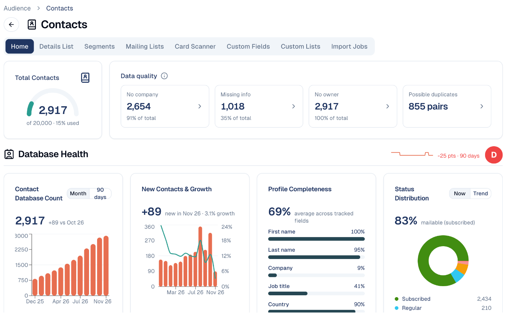

**Total Contacts**, top left, shows how many contacts you hold. The gauge fills
as you approach your plan's limit and turns orange, then red, near it. On a plan
without a limit, it shows the number alone.

The **Status distribution** card, under **Database Health**, shows how those
contacts split between statuses:

- **Subscribed** — contacts who have agreed to hear from you.
- **Regular** — contacts with no marketing consent yet: you can work with them,
  but not email them marketing.
- **Unsubscribed**, **Bounced** and **Do not contact** — people you must not
  email.

!!! warning "Subscribed is the number that matters"
    A large database is not much use if most of it has unsubscribed. Only
    **Subscribed** contacts can receive marketing email. See
    [Unsubscribed and unengaged contacts](#unsubscribed-and-unengaged-contacts)
    for how each status is set and what you can do about the quiet ones.

!!! info "Bounced and Do not contact are set for you"
    When a marketing email cannot be delivered, GoodBards reads the reply from
    the recipient's mail server. An address that does not exist, or whose server
    rejects the message outright, becomes **Bounced** at once. A temporary
    problem (full mailbox, message too large, content refused) only adds a note
    to the contact; after three sends that bounce this way, the contact becomes
    **Bounced** too. A recipient who reports your email as spam becomes
    **Do not contact**. Both statuses stop every further send, and the reason
    stays in the contact's engagement timeline and notes.

**Data quality**, next to it, is your clean-up list. Each tile counts the
contacts that need attention, with their share of your database. Hover a tile to
read exactly what it checks:

- **No company** — people you cannot count towards an account.
- **Missing info** — contacts missing an email, phone or country: records you
  cannot reach or segment. Email and phone are only checked when your role can
  see them.
- **No owner** — nobody is responsible for them.
- **Possible duplicates** — pairs of records with the same first and last name.
  Review them before merging anything.

Choose a tile to open the list filtered to exactly those rows; a chip above the
table shows the filter and the count, with a cross to clear it. A tile with
nothing to fix shows **All good**.

### The grades

**Database Health** grades how usable your database is, and **Engagement** how
much your contacts interact with you. Each is a score out of 100 shown as a
letter: **A** (90–100), **B** (75–89), **C** (60–74), **D** (40–59) or **F**
(below 40). Choose the grade to see its formula.

Beside each grade, a small line shows the score over the last 90 days, with how
many points it gained or lost. Hover the line to read the score on a given day.
It builds up day by day.

!!! tip "Why the Database Health line can jump"
    Part of the score compares this month's new contacts with last month's. On
    the first days of a month the comparison starts again, so the line can drop
    even though nothing got worse. The score also steps up as your database
    passes 100, 500, 1,000 and 10,000 contacts.

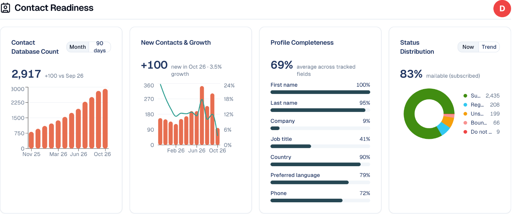

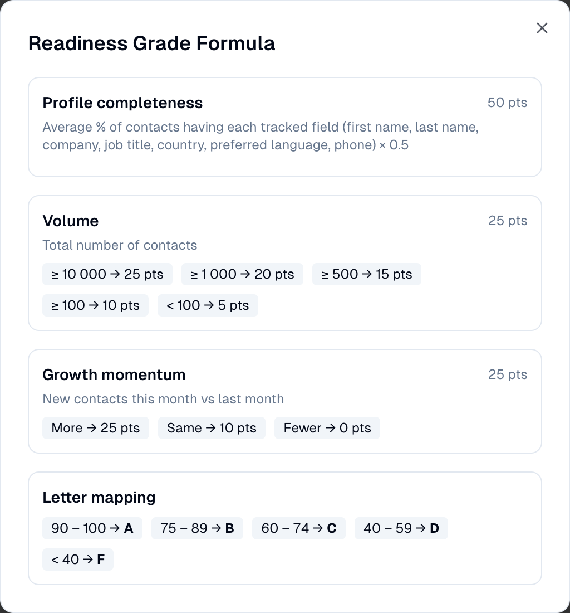

| Grade | Made of |
| --- | --- |
| **Database Health** | **Profile completeness** (50 points): how many contacts have a first and last name, company, job title, country, preferred language and phone. **Volume** (25 points): how many contacts you hold. **Growth momentum** (25 points): new contacts this month against last month. |
| **Engagement** | **Engaged share** (50 points): contacts with a score of 40 or more. **Reach** (25 points): contacts with any engagement at all. **Depth** (25 points): the average score per contact. |

To raise database health, fill in the missing details (an import with the
**Overwrite** conflict action can complete existing contacts). To raise
engagement, send your contacts something worth opening. See
[Lead scoring](lead-scoring.md).

Companies have the same two grades, built from company data. See
[Companies](companies.md).

## Finding individual contacts

The **Details List** tab lists every contact: their code, name, owner, email,
status and last update.

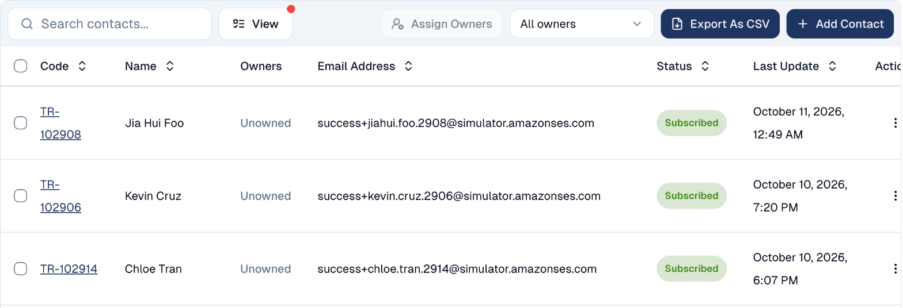

- Search by name or email, and choose the columns to show with **View**.
- The **Company** column shows the account a contact is linked to (a **+1**
  badge means more than one; hover to see them all). Sort on it to group
  contacts by company, or to bring the unlinked ones to the top.
- Each contact can have **owners**, the colleagues responsible for them. Filter by
  owner, or select contacts and choose **Assign Owners**. Depending on their role,
  a colleague may only see the contacts they own.
- **Export As CSV** downloads the list; **Add Contact** creates one.
- Click a contact's code to open their record: details, custom fields, mailing
  lists, and the history of every email, form and event.

### Asking the assistant

On the Contacts and Companies pages, the assistant in the top bar answers
questions about your audience, in plain words:

- *Which contacts have no company?*
- *Find Jon Tan from DBS, I am not sure of the spelling.*
- *Who opened the last newsletter but never clicked?*
- *Who went cold in the last six months?*
- *Top 10 companies by clicks in the last 30 days.*

It reads the same data as the screens, under the same rules: it only sees the
contacts you can see, it never shows an email or phone your role cannot see, and
it does not edit anything. When you open a contact's record, "this contact" in
your question means that person. Each answer states the rule it applied (for
example *contacts with no positive engagement in the last 180 days*), so you can
check it before acting.

## A contact's page

Choose a contact's code in the list to open their page: everything GoodBards
knows about them, in one place.

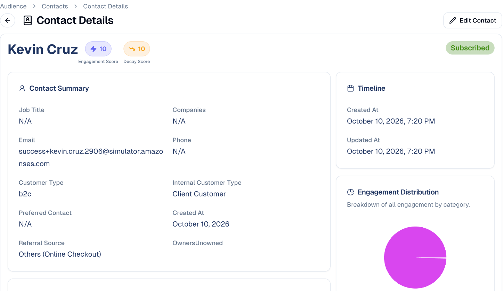

| Section | What it shows |
| --- | --- |
| **Scores** | The engagement score and the decay score next to the name. See [Lead scoring](lead-scoring.md). |
| **Contact Summary** | Job, companies, email, phone, customer type, preferred contact method, referral source and owners. |
| **Location** | Country, city, address and timezone. |
| **Custom Fields** | Your own fields, such as a loyalty tier or a home store. |
| **Messaging consent** | Whether the contact agreed to WhatsApp, Telegram and SMS messages, since when and how. For Telegram, also their personal link (**QR code**, **Email link**, **Copy link**) until they subscribe. See [Telegram](../settings/connectors/telegram.md). |
| **Policies** | The privacy statements the contact accepted, when, and how (for example through a form). This is your proof of consent. |
| **Mailing Lists** | The lists they belong to, how they joined (public sign-up, added manually) and whether they are still subscribed. |
| **Events** and **Form submissions** | The events they registered for and the forms they filled in. |
| **Social Links**, **Referral Info**, **Tags** | Their social profiles, where they came from, and your tags. |
| **Engagement Over Time** and **Engagement Timeline** | Every open, click, form, registration and subscription, day by day and in order. |

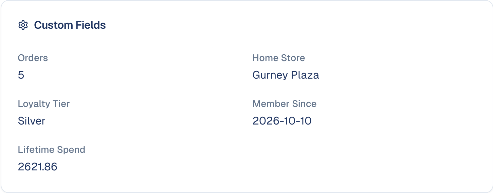

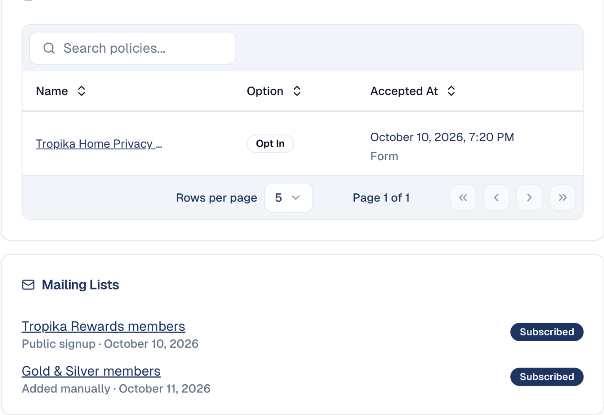

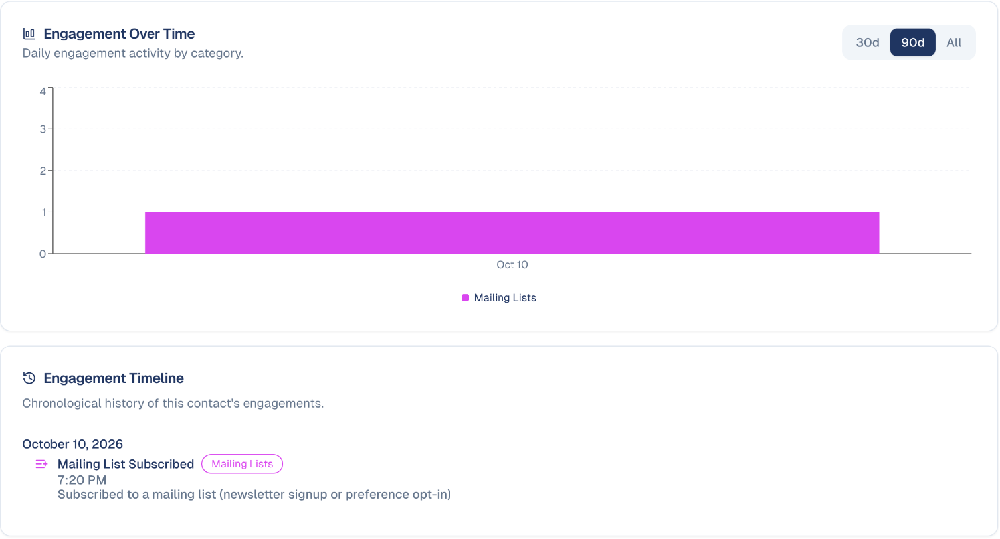

### Editing a contact

Choose **Edit Contact** at the top right. The form has the personal details,
address and timezone, job and companies, subscription status, social handles,
referral source, preferred contact method, customer type, privacy statement,
mailing lists, tags and **Contact Notes**. Choose **Save Contact** when done.

- **Notes** keep what your team knows that fits no field: *met at the Mid Valley
  styling clinic*. Choose **Add Note**.
- **Adding a mailing list here subscribes the contact straight away.** Only do it
  for people who agreed.
- **Owners** can be changed here by an administrator. See
  [Users, roles & permissions](../settings/users-roles.md#contact-ownership).

## Segments

A **segment** is a saved filter — a rule that decides who belongs, evaluated when
you use it, so it stays current as contacts change.

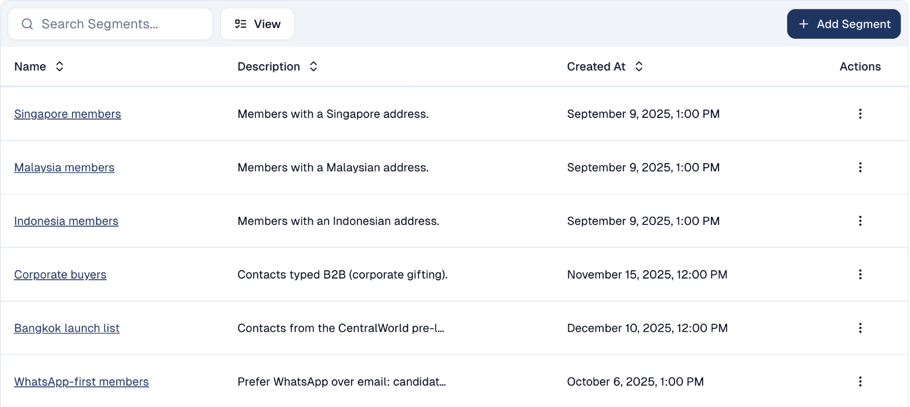

To create one, open the **Segments** tab and choose **Add Segment**, then set
the rule. Anyone with write access to the Audience module (the Marketer and
Sales roles, and administrators) can add, edit and delete segments. A rule is
made of up to three blocks. Each block is optional, and a contact must match
every block you fill in:

- **Contact Profile Block** — a detail of the contact: status, country, job
  title, tags, a custom field.
- **Behavior Block** — what the contact did: an engagement (email opened, email
  clicked, form filled, event attended…), how many times (**Min Count**,
  **Max Count**) and when (**Relative Days** with **Last n Days**, or a
  **Specific Range** of dates).
- **Alert & KPI Block** — the contact's **Engagement Score** or **Decay
  Score** compared with a number. See [Lead scoring](lead-scoring.md).

Inside a block, **Add Condition** adds a line.

!!! info "A segment is always up to date"
    You never refresh a segment. Its rule is evaluated each time you open it
    and each time an email is sent to it, so the people in it today may not be
    the same next week. For a worked example, see
    [How to find unengaged contacts](#how-to-find-unengaged-contacts).

Choose a segment's name to open it: its description, its filters, a summary of
which kinds of filter are applied, and the list of contacts it holds right now.
**Edit Segment** changes the rule.

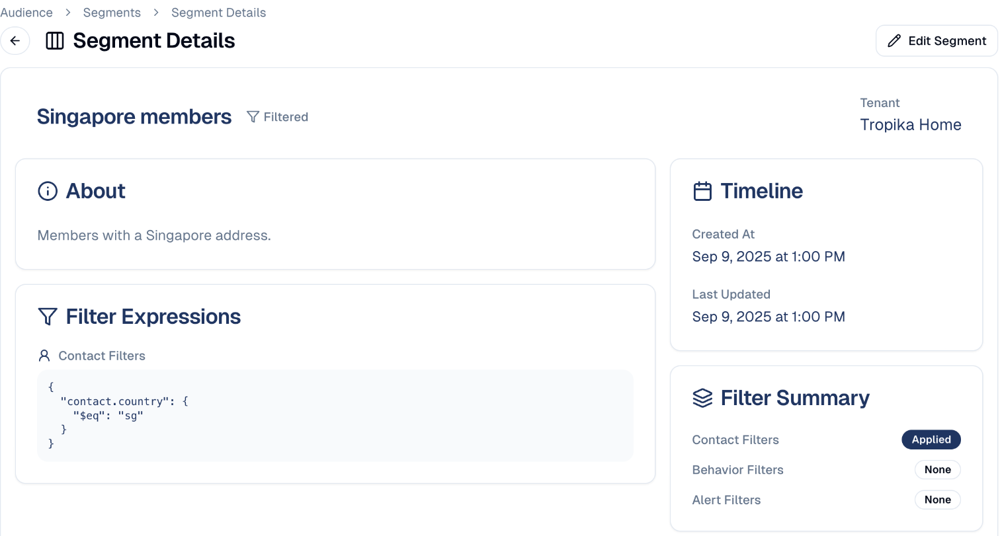

Useful segments look like:

- *Singapore members* — everyone in one market
- *Corporate buyers* — one type of customer
- *Bangkok launch list* — the people from one event

!!! tip "Segments beat one-off filters"
    If you find yourself applying the same filter repeatedly, save it as a
    segment. Give it a description too — in six months you will not remember
    what the rule was.

## Unsubscribed and unengaged contacts

Two groups to treat differently: people who told you to stop, and people who
simply went quiet. GoodBards handles the first group for you. For the second,
it gives every contact a score that fades with time, and you choose the rule.

!!! abstract "In short"
    | | Unsubscribed | Unengaged |
    | --- | --- | --- |
    | **How they are captured** | By the contact, from the unsubscribe link of an email; by a bounce or a spam complaint; or by your team. | By the score: every open, click, form or registration adds points, and points fade with time. |
    | **How you identify them** | The contact's **status**: Unsubscribed, Bounced or Do not contact. | The **Inactive** tier: a decay score of 0, which means nothing positive within your decay period (4, 8 or 12 weeks). |
    | **When it happens** | At once. | Scores are recalculated every night. The status never changes. |
    | **Can you configure it?** | No. An opt-out is always respected. | The decay period, yes. The tier thresholds, no. For any other rule (for example *no open in 90 days*), build a segment. |
    | **Can you segment them?** | Yes: *Status Equals unsubscribed*. | Yes, on the score or on behaviour. |
    | **Excluded from campaigns?** | Always, automatically. | When you send to a segment that leaves them out. |

### Unsubscribed contacts

#### How an unsubscribe is captured

A contact stops being **Subscribed** in one of three ways.

**1. They choose it.** The footer of every email design carries an unsubscribe
link. It opens the contact's **Email Preferences** page, which lists your
mailing lists with a switch for each:

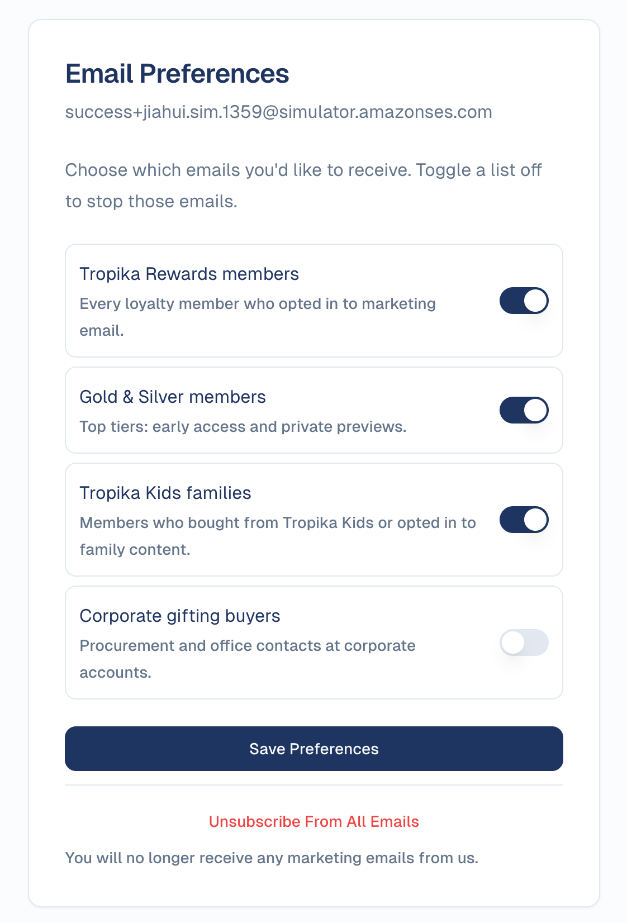{ width="420" }

| The contact does this | What changes |
| --- | --- |
| Switches one list off, then **Save Preferences** | They leave that list only. Their status stays **Subscribed**, and they still receive what your other lists and segments send. |
| Chooses **Unsubscribe From All Emails** | Their status becomes **Unsubscribed**, and an *Email Unsubscribe* line is added to their timeline. No marketing email reaches them any more. |

!!! info "Mail scanners cannot unsubscribe anyone"
    The link is signed for that one contact, and opening it changes nothing:
    the contact has to confirm on the page. Security tools that open every link
    of an incoming email therefore never unsubscribe your contacts by accident.

!!! note "An email without an unsubscribe link"
    Every design in the gallery has the link in its footer. If you write an
    email from scratch, or import one, and it has no unsubscribe link,
    GoodBards warns you on the email before you send it. Add the link with
    `{{unsubscribe_url}}`. See
    [Personalising an email](../marketing/emails.md#personalising-an-email).

**2. Their mail provider says so.** A recipient who reports your email as spam
becomes **Do not contact**. An address that cannot be delivered becomes
**Bounced**. See [Reading the Contacts home](#reading-the-contacts-home) for
the exact bounce rule.

**3. Your team sets it.** For an opt-out received by phone, by email or in a
store: open the contact, choose **Edit Contact**, and change **Status** under
**Subscription Detail**. For many contacts at once, use the `status` column of
an [import](#accepted-values) with the **Overwrite** conflict action.

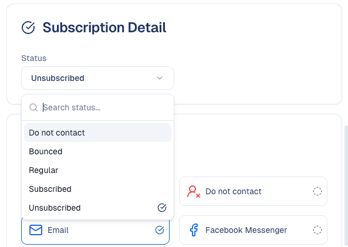{ width="420" }

#### How you identify them

- **In total.** On the Contacts home, the **Status Distribution** card counts
  each status. **Trend** shows how the split moved over time.

    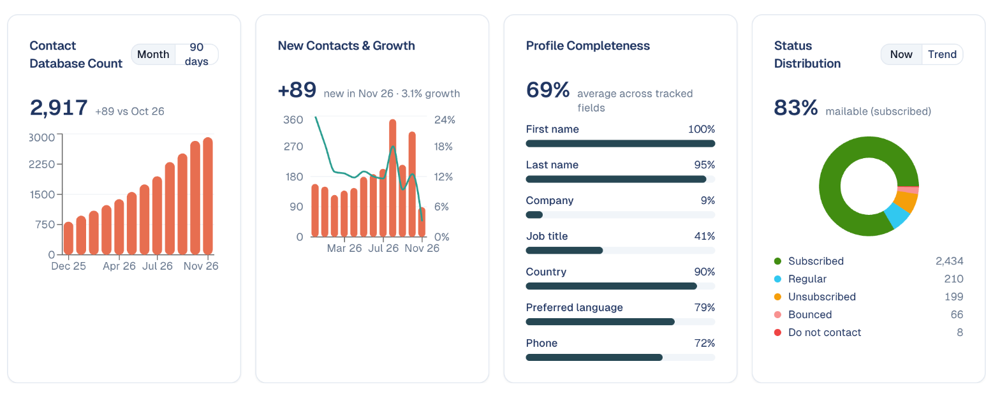

- **In the list.** In the **Details List**, choose the **Status** column
  header to sort by status and bring the unsubscribed contacts together.

    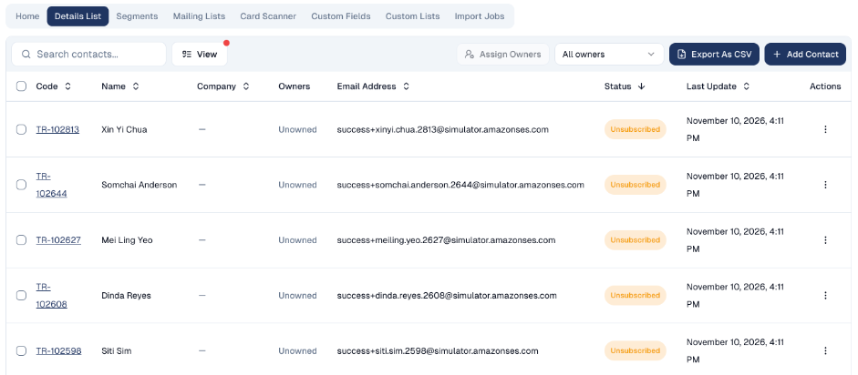

- **One contact.** Their page shows the status next to their name, and the
  **Engagement Timeline** shows when they unsubscribed.

    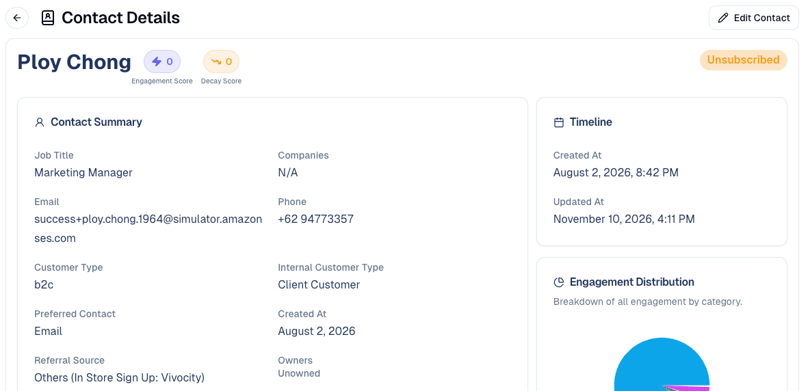

    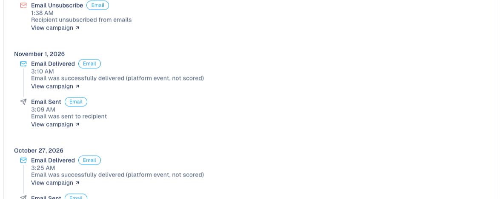

- **One mailing list.** A list shows its own **Unsubscribed** counter and each
  member's status on that list. See [Mailing lists](mailing-lists.md).
- **As a group.** Create a [segment](#segments) with one condition in the
  **Contact Profile Block**: *Contact*, *Status*, *Equals*, `unsubscribed`.

!!! tip "Type the status as its code"
    In a segment, the status value is typed, not picked from a list. Use the
    code, in lower case: `subscribed`, `regular`, `unsubscribed`,
    `do-not-contact`, or `invalid-email` for **Bounced**. The codes are the
    same as in an import: see [Accepted values](#accepted-values).

#### How they are managed

Only **Subscribed** contacts receive marketing email, whatever audience you
choose for the send: contacts, a segment, a mailing list or a company.
Unsubscribed, Bounced and Do not contact contacts are removed when the email is
sent, and there is no setting to switch this off. You do not need to exclude
them yourself.

- Someone who left a mailing list stays off it until they rejoin themselves.
  Nobody on your team can add them back.
- A contact enrolled in an [automation flow](../marketing/automations.md)
  leaves the flow as soon as they are no longer Subscribed.
- They stay in your database, with their history, for reporting.

!!! warning "Do not re-subscribe people yourself"
    The status can be edited, but under Singapore's PDPA and similar laws an
    opt-out stands until the person opts in again, through a form or their
    Email Preferences page. Re-importing them as Subscribed is not consent.

### Unengaged contacts

!!! info "There is no Unengaged status"
    GoodBards never changes a contact's status because they went quiet: a
    silent subscriber is still **Subscribed** and still receives your emails.
    Instead, every contact carries a score that fades with time. You read it
    in the **Inactive** tier, or you build a segment with a rule of your own.

#### What counts as unengaged

- **Engagement Score** adds points for every open, click, form, registration
  and attendance. See [Lead scoring](lead-scoring.md).
- **Decay Score** is the same points, fading evenly to zero over a period you
  choose (see below). With 8 weeks, a click is worth half its points after four
  weeks and nothing after eight.
- The contact's **tier** follows from the decay score:

    | Tier | Decay score | In plain words |
    | --- | --- | --- |
    | **High** | 100 and more | Very active: about a guest who registered for an event and came. |
    | **Medium** | 40 to 99 | Active: at least a click or a registration recently. |
    | **Low** | 1 to 39 | A few opens, or older activity that is fading. |
    | **Inactive** | 0 | **Unengaged**: nothing positive within the decay period, or never engaged at all. |

So an unengaged contact, for GoodBards, is a contact whose decay score has
reached zero: no open, click, form, registration or attendance within the decay
period. The rule counts **time**, not a number of campaigns: a contact who
clicked last week and then ignored five emails is not unengaged yet, and a
contact who has not reacted for the whole period is, however many emails you
sent.

On the Contacts home, the **Engagement Tiers** card counts each tier.
**Trend** shows how the tiers moved over time.

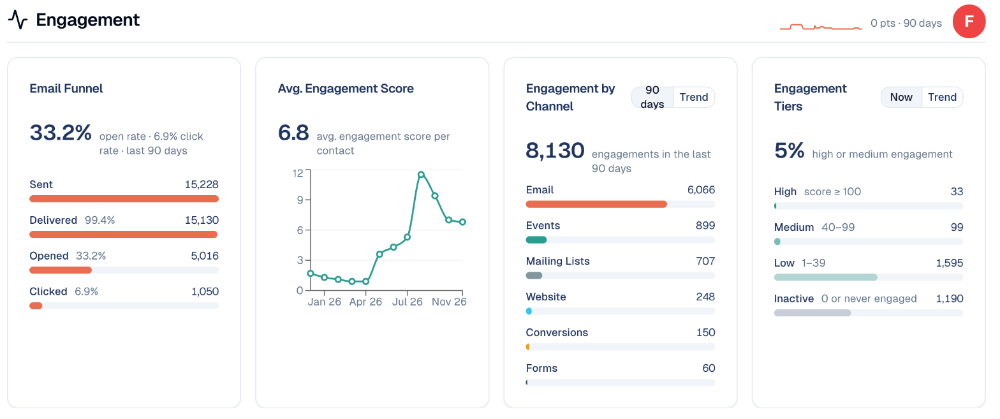

#### When a contact becomes unengaged

Scores are recalculated **every night**. A contact moves to **Inactive** on
the night their last points fade out, and moves back up the night after they
open, click or register again. Nothing else happens: no status change, no
email, no removal from a list.

#### What you can configure

An administrator sets the decay period under **Tenant Settings →
Preferences → Engagement Decay Velocity**: open the menu under your photo, top
right, to find **Tenant Settings**.

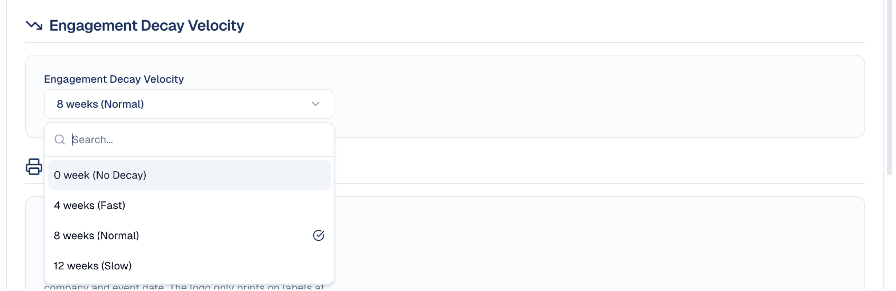

| Choice | A contact becomes Inactive after |
| --- | --- |
| **4 weeks (Fast)** | 4 weeks without engagement. For brands that email several times a week. |
| **8 weeks (Normal)** | 8 weeks without engagement. A good start for a weekly or monthly newsletter. |
| **12 weeks (Slow)** | 12 weeks without engagement. For long buying cycles and occasional sends. |
| **0 week (No Decay)** | Never: points do not fade, so only contacts who never engaged are Inactive. |

!!! note "Check that a period is chosen"
    If the field shows *Select decay velocity*, nobody has chosen a period for
    your workspace yet. Pick one, so that everyone on your team reads the tiers
    the same way.

| What | Can you change it? |
| --- | --- |
| How fast scores fade | Yes: **Engagement Decay Velocity**, above. |
| The tier thresholds (100, 40, 1) | No. They are the same for every workspace. |
| A rule of your own (*no open in 90 days*, *no click in 6 months*) | Yes, with a segment. See below. |
| The assistant's "cold" period | Yes, per question. 180 days by default. |
| An automatic status change after a period of silence | No. A status only changes through the contact's own choice, a bounce, a spam complaint or your team. |
| A rule counted in campaigns rather than days | No. |

#### How to find unengaged contacts

Three ways, from the quickest to the most precise.

**Ask the assistant.** On the Contacts page, ask *"Who went cold in the last
six months?"* It lists the contacts who engaged at least once and did nothing
in the last 180 days, or the number of days you name.

**Segment on the score.** This follows your decay period.

1. Open **Audience → Contacts**, the **Segments** tab, then **Add Segment**.
2. In the **Alert & KPI Block**, choose *KPI*, *Decay Score*, *Less than*, and
   type `1`.
3. Choose **Add Segment**.

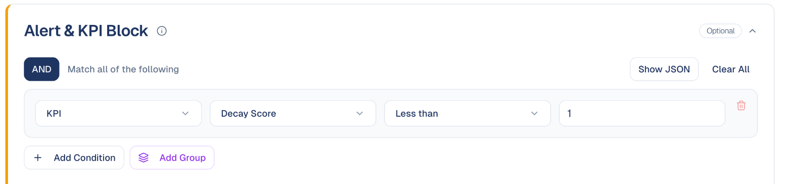

!!! note "Contacts with no history are not in this segment"
    A score exists once something has been recorded for a contact, such as an
    email sent to them. Contacts with no history at all (just imported, never
    emailed) have no score yet: the **Inactive** tier counts them, but this
    segment does not. To include them, use the rule on behaviour below.

**Segment on behaviour.** This is a rule of your own, independent of the decay
period. The example keeps the subscribers who neither opened nor clicked an
email in the last 90 days.

1. In **Add Segment**, in the **Contact Profile Block**, choose *Contact*,
   *Status*, *Equals*, and type `subscribed`. This keeps only the contacts you
   can still email.
2. In the **Behavior Block**, choose the engagement *Email Opened*, type `0`
   in both **Min Count** and **Max Count**, set **Frequency** to *Relative
   Days*, and type `90` in **Last n Days**.
3. Choose **Add Condition** and do the same for *Email Clicked*.
4. Choose **Add Segment**. Open the segment to see who is in it right now.

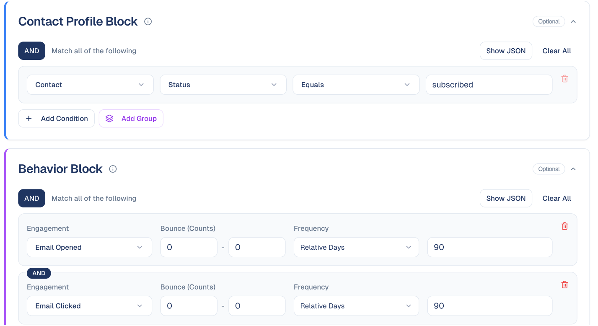

!!! warning "Type 0 in both counts"
    *0 to 0 times* is how you say "never" in a rule. If you leave **Min
    Count** empty it counts as 1, and the segment comes back empty. The period
    is required too: a behaviour condition always needs a number of days or a
    date range.

#### How to keep them out of a campaign

An email goes to the audience you choose. There is no separate exclusion or
suppression list, so you leave unengaged contacts out through the segment you
send to.

- **Send to the engaged.** Create a segment *Decay Score, Greater than or
  equals, 1* (or *Email Opened, 1 time or more, in the last 90 days*) and
  choose it under **Recipient Segments** when you send, instead of sending to
  everyone. A segment is evaluated again each time an email is sent, so a
  contact who re-engages is back in without any action from you.
- **Try to win them back first.** Send one re-engagement email to your
  unengaged segment. Those who open it come back on their own.
- **Then stop for good.** For contacts who stay silent, set the status to
  **Do not contact**. They stay in your database for reporting, and stop
  receiving every marketing email, whatever the audience.

!!! tip "Why it is worth doing"
    Mail providers watch how recipients react to your emails. Sending again
    and again to people who never open lowers your reputation as a sender, and
    more of your emails end up in spam, including for the contacts who do want
    them. A smaller, engaged audience is delivered better.

## Mailing Lists

Lists people subscribe to, for example from a sign-up form. See
[Mailing lists](mailing-lists.md).

## Card Scanner

Photograph a business card, or upload a picture of one: GoodBards reads it and
fills in a new contact for you to check and save. See
[Adding contacts](adding-contacts.md#scan-a-business-card).

## Custom Fields

The details GoodBards does not hold by default, but your business needs: a
loyalty tier, a preferred store, a renewal date.

1. Open the **Custom Fields** tab, then create a field.
2. Give it a **Field Name** and a **Field Type**:

    | Type | Holds |
    | --- | --- |
    | **Text** | Free text. |
    | **Number** | A number, for example a budget. |
    | **Date** | A date, for example a renewal date. |
    | **Boolean** | Yes or no. |
    | **Select** | A value from a list you define under **Custom Lists**. |

    Tick **Allow multiple values** when a contact can have several, for example
    several preferred stores.

3. Choose whether it applies to **Contact**, **Company** or both, under
   **Entity**, then **Create Field**.

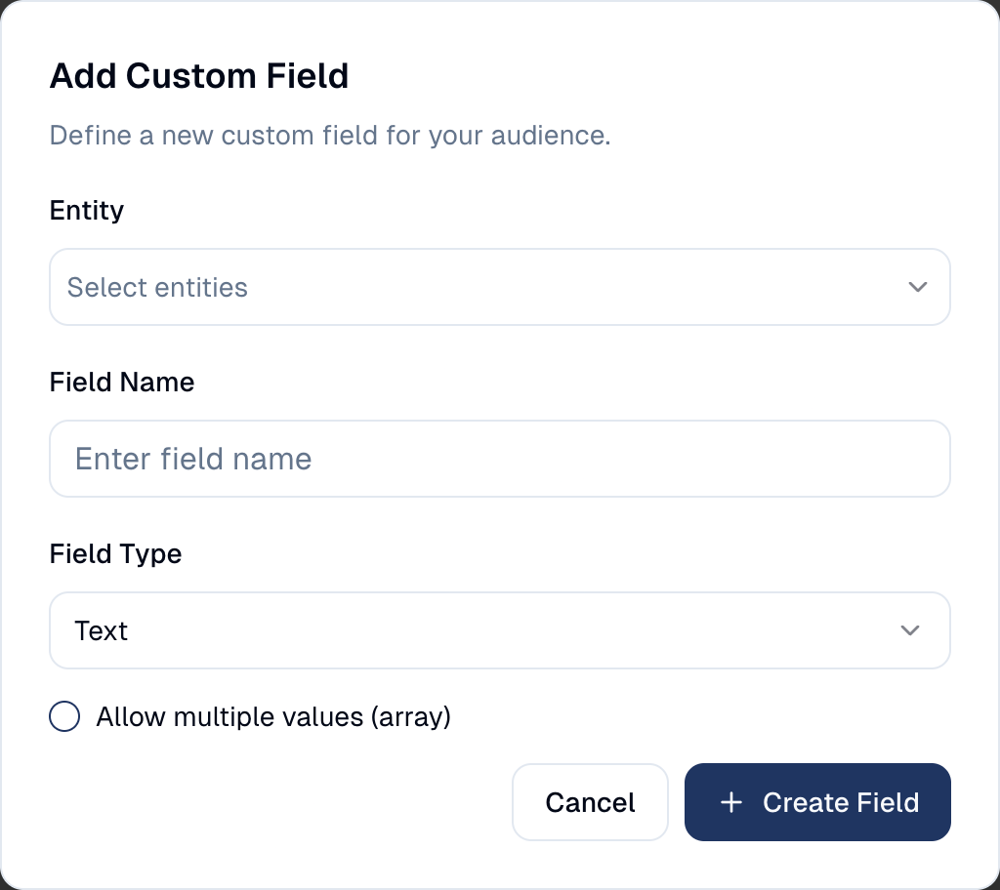

The field then appears on every contact's page and in the contact form, and can
be shown as a column in the **Details List** with **View**.

!!! warning "Deleting a field deletes its values"
    Removing a custom field removes the values stored in it for every contact.
    It cannot be undone.

## Custom Lists

The lists of values used by **Select** custom fields: statuses, categories,
types. Example: a *Store* list with *Jurong Point*, *Mid Valley* and
*CentralWorld*.

1. Open the **Custom Lists** tab, then **Add Reference List**.
2. Give it a **Technical List Identifier** (letters, digits, `-` and `_`, for
   example `store`) and a **List Name**.
3. Add the entries with **Add Entry**, each with a code and a label. Drag them to
   reorder, or sort them alphabetically.

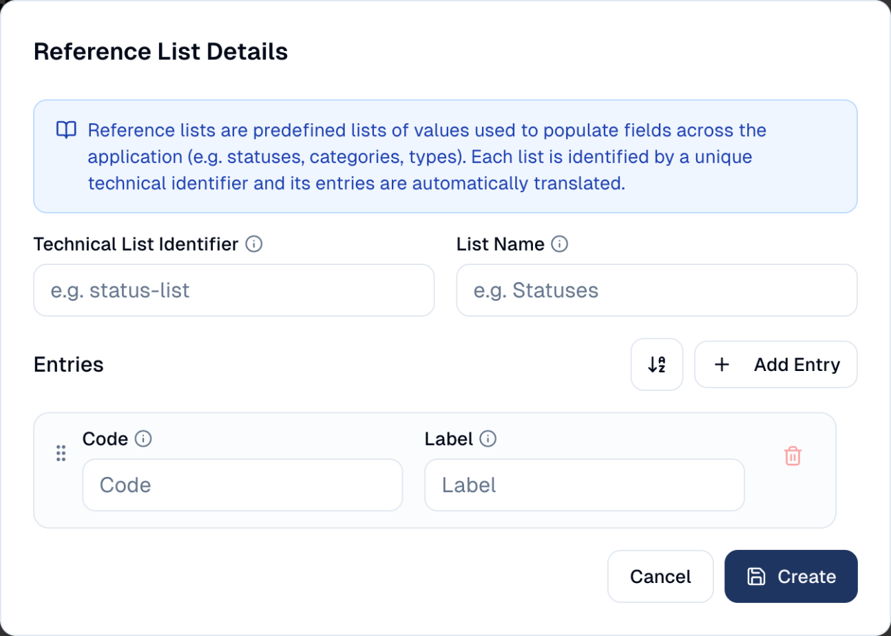

Write names and labels in English: GoodBards translates them automatically into
the other languages of the app.

## Import Jobs

Every spreadsheet import, with its status and how many rows were processed, so
you can check that an import went through. Start a new one with **Bulk Add
Contacts**, which requires the *Access sensitive data* permission and an
administrator role. See [Adding contacts](adding-contacts.md#import-a-spreadsheet).

### An import happens in two steps

Uploading a file does **not** import anything yet. You first create the job,
then you start it:

1. **Create the job.** Choose **Bulk Add Contacts → From a CSV file**, upload
   your file and fill in the form, then choose **Upload**. The job appears in
   the list as **READY TO START**. No contact has been created or changed.
2. **Start the job.** In the job's row, choose **Start**, then **Start import**
   to confirm. GoodBards reads the file row by row and creates or updates the
   contacts. Once started, an import cannot be stopped.

Until you start it, you can still **Delete** the job, for example if you picked
the wrong file or the wrong **Default Status**, and create a new one.

### Job statuses

| Status | What it means |
| --- | --- |
| **READY TO START** | The file is uploaded but not imported. Choose **Start**. |
| **COMPLETED** | Every row was imported. |
| **INCOMPLETE** | The import ran, but some rows were rejected. Open the job with **View** to see which. |
| **FAILED** | The file could not be read at all, for example because it has no header row. |

**View** opens the job's summary: rows processed, imported and failed, the
choices made when it was created, and **Download logs**, which explains line by
line why a row was rejected. **Download original file** gives back the file you
uploaded, so you can fix it and import again.

Deleting a job removes it from the list. The contacts it imported stay.

### Prepare your CSV file

The easiest start is **Download Template** in the **Bulk Add Contacts** form:
it holds every column, including one for each of your
[custom fields](#custom-fields), and an example row to replace.

Here is a short example you can copy, or
[download it](../../files/contacts-import-sample.csv):

```csv
email,customerCode,firstName,lastName,phone,status,customerType,customerTypeInternal,jobTitle,companyName,city,country,timezone,preferredContactMethod,tags,notes,engagementType,engagementDate
mei.tan@example.com,,Mei,Tan,+6591234567,subscribed,b2b,client-customer,Marketing Manager,Lion City Retail,Singapore,Singapore,Asia/Singapore,email,trade-show-2026;vip,Met at booth 12,event-attended,2026-09-24 14:30
arif.rahman@example.com,CUS00102,Arif,Rahman,+60123456789,regular,b2b,target-potential-customer,Head of Growth,Kopi Digital,Kuala Lumpur,Malaysia,Asia/Kuala_Lumpur,whatsapp,trade-show-2026,,,
linh.nguyen@example.com,,Linh,Nguyen,,,b2c,,,,Ho Chi Minh City,Vietnam,Asia/Ho_Chi_Minh,email,,,,
```

Linh's `status` is empty, so she gets the **Default Status** chosen for the job.

The rules of the file:

- **The first row holds the column names**, spelled exactly as below, capitals
  included (`firstName`, not `First Name`). A column whose name is not
  recognised is treated as a custom field, so a misspelt `Email` column is not
  read as the email address.
- **A custom field column is named after the field's key** (`interest_category`,
  not `Interest category`). For a field that allows multiple values, separate
  them with semicolons, as for tags: `Fitness;Nutrition`.
- **Keep only the columns you need**, in any order. Every row must have as many
  cells as the header row, even when they are empty.
- **Separate cells with commas**, and put a cell in double quotes if it contains
  a comma: `"Tan, Mei"`.
- **Save as UTF-8.** In Excel, choose **CSV UTF-8 (Comma delimited)**, so that
  accents and Chinese, Thai or Vietnamese characters come through.
- **Codes are written in lower case**, exactly as listed below: `subscribed`,
  not `Subscribed`.

### The columns

| Column | What to put in it |
| --- | --- |
| `email` | The contact's email address. This is how GoodBards recognises a contact who is already in your audience. |
| `customerCode` | Your own reference for the contact, for example from your CRM. Must be unique. Left empty, the email address is used. A row needs at least an `email` or a `customerCode`. |
| `firstName`, `lastName` | The contact's name. |
| `birthDate` | Date of birth, as `YYYY-MM-DD`: `1982-03-03`. |
| `secondaryEmail`, `phone`, `secondaryPhone` | Other ways to reach them. Write phone numbers with the country code: `+6591234567`. |
| `status` | Whether you may email them. See [Accepted values](#accepted-values). |
| `customerType` | `b2b` (a business contact) or `b2c` (a consumer). |
| `customerTypeInternal` | Your relationship with them. See [Accepted values](#accepted-values). |
| `timezone` | Their time zone, as a city name: `Asia/Singapore`, `Asia/Jakarta`, `Asia/Bangkok`. |
| `jobTitle` | Their job title. |
| `companyCode`, `companyName` | Their company. A company that does not exist yet is created and linked to the contact. |
| `street`, `city`, `state`, `country`, `zipCode` | Their address. Write `country` as a two-letter code (`SG`, `MY`, `ID`): GoodBards also uses it to read phone numbers written without a country code. |
| `linkedin`, `facebook`, `twitter`, `instagram` | Their social media profiles. |
| `preferredContactMethod` | How they prefer to be contacted. See [Accepted values](#accepted-values). |
| `tags` | Tags for this contact, separated by a semicolon: `trade-show-2026;vip`. |
| `notes` | Free text, added as a note on the contact. |
| `engagementType`, `engagementDate` | Something the contact did, to record in their history. Fill in both or neither. The date is `YYYY-MM-DD HH:MM`: `2026-09-24 14:30`. See [Accepted values](#accepted-values). |
| `whatsappConsent`, `telegramConsent`, `smsConsent` | Whether the contact agreed to receive messages on that channel: `yes` records their consent, `no` records that they withdrew it, and an empty cell changes nothing. Only import `yes` for people who really agreed: it is your proof of consent. Applied to new contacts and, with **Overwrite**, to existing ones. |
| *your custom fields* | One column per custom field, named as in **Download Template**. |

### Accepted values

The columns below only accept the codes listed. A row with any other value is
rejected, and the job ends as **INCOMPLETE**. An empty cell is always accepted.

**`status`**: whether you may send them marketing email.

| Code | Shown as | Meaning |
| --- | --- | --- |
| `subscribed` | Subscribed | They agreed to receive your marketing emails. **Only Subscribed contacts are emailed.** |
| `regular` | Regular | No marketing consent yet. You can work with them, but not email them marketing. |
| `unsubscribed` | Unsubscribed | They opted out. |
| `do-not-contact` | Do not contact | They must not be contacted at all. |
| `invalid-email` | Bounced | Their address does not work. GoodBards usually sets this itself when an email bounces. |

Left empty, a new contact gets the **Default Status** you chose for the job.

**`customerTypeInternal`**: your relationship with the contact.

| Code | Shown as |
| --- | --- |
| `target-potential-customer` | Target (Potential Customer) |
| `client-customer` | Client/Customer |
| `partner` | Partner |
| `strategic-alliance` | Strategic Alliance |
| `technology-partner` | Technology Partner |
| `reseller-channel-partner` | Reseller/Channel Partner |
| `distributor` | Distributor |
| `supplier-vendor` | Supplier/Vendor |
| `competitor` | Competitor |

**`customerType`**: `b2b` or `b2c`.

**`preferredContactMethod`**: `email`, `phone-call`, `sms-text-message`,
`whatsapp`, `facebook-messenger`, `push-notifications`, `direct-mail`,
`in-person-visit` or `do-not-contact`.

**`engagementType`**: the most useful for an import are `event-registered`,
`event-attended`, `form-filled` and `list-subscribe`. Email engagements
(`email-sent`, `email-delivered`, `email-opened`, `email-clicked`,
`email-unsubscribe`) are also accepted, for history brought over from another
tool.

### When a contact already exists

A row whose `email` is already in your audience is handled by the job's
**Choose Conflict Action**:

- **Ignore**: the contact's details are kept as they are. The row's `notes` are
  still added, and the contact still receives the job's tags, source and
  privacy statement.
- **Overwrite**: every cell you filled in replaces the contact's current value.
  Empty cells leave the current value unchanged, so an import never erases
  data.

## Good to know

- **Segments update themselves; mailing lists do not.** A segment re-evaluates its
  rule each time; a mailing list stays as you built it.
- **Watch your plan limit.** The Total Contacts gauge shows how close you are.
- **Respect unsubscribes.** Under Singapore's PDPA and equivalent rules elsewhere,
  contacts who opt out must not receive marketing email. GoodBards excludes them,
  but do not work around it by re-importing them.

---

*Still stuck? [Contact support](../contact.md).*
