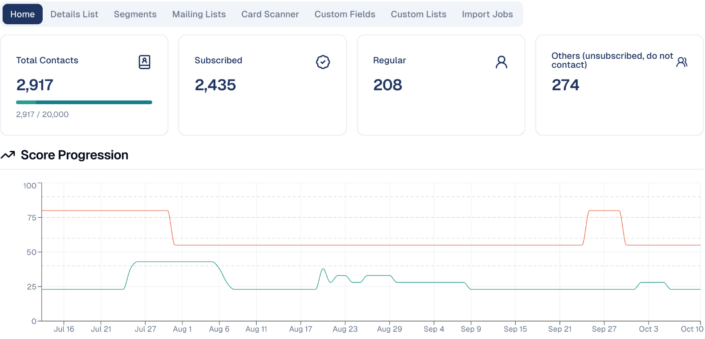
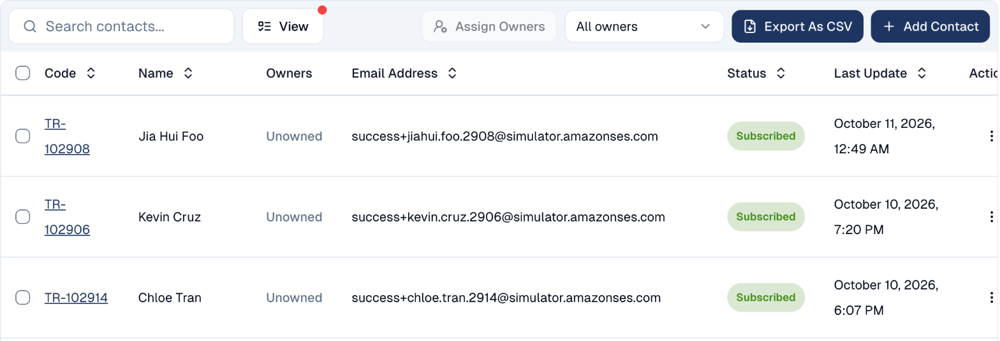
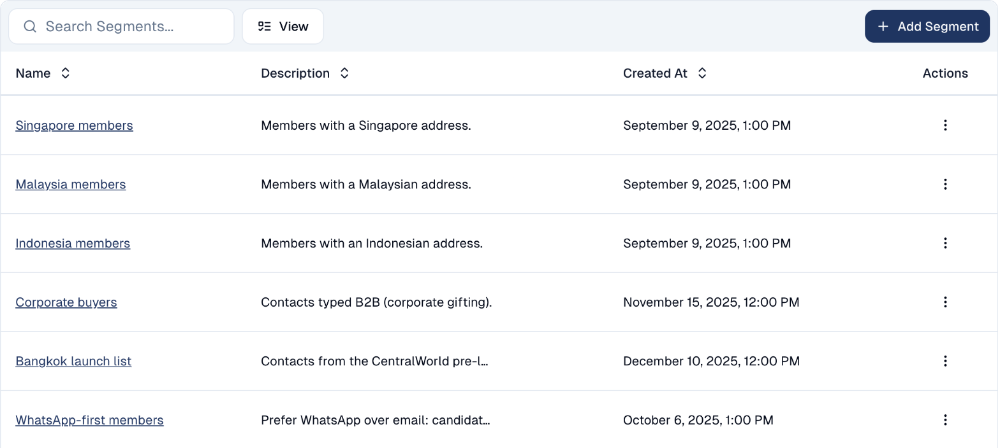

# Contacts

The people you market to — how to add them, keep their details current, and group
them into segments.

## What it's for

Every email you send and every form someone fills in comes back to a contact.
Contacts are the centre of the platform: get them right and the rest of your
marketing has something to work with.

## Adding contacts

There is more than one way, depending on how many you have:

| Method | Use it when |
| --- | --- |
| **Add one at a time** | You met someone and want them in straight away. |
| **Import** | You have a list to bring across. Progress shows under **Import Jobs**. |
| **Card Scanner** | You came back from an event with a stack of business cards. Scan them and the details are read for you. |
| **Forms** | Someone signs up themselves. See [Forms](../marketing/forms.md). |

## Reading the Contacts home

**Audience → Contacts** opens on the **Home** tab, which summarises your database
rather than listing individuals.

The tiles across the top tell you:

- **Total Contacts** — how many you hold, and how many your plan allows. The bar
  fills as you approach the limit.
- **Subscribed** — contacts who have agreed to hear from you.
- **Regular** — contacts with no marketing consent yet: you can work with them,
  but not email them marketing.
- **Others (unsubscribed, do not contact)** — people you must not email.

!!! warning "Subscribed is the number that matters"
    A large database is not much use if most of it has unsubscribed. Only
    **Subscribed** contacts can receive marketing email.

**Score Progression** below tracks engagement over time, and **Contact Readiness**
shows how complete and usable your data is.

## Finding individual contacts

The **Details List** tab lists every contact: their code, name, owner, email,
status and last update.

- Search by name or email, and choose the columns to show with **View**.
- Each contact can have **owners**, the colleagues responsible for them. Filter by
  owner, or select contacts and choose **Assign Owners**. Depending on their role,
  a colleague may only see the contacts they own.
- **Export As CSV** downloads the list; **Add Contact** creates one.
- Click a contact's code to open their record: details, custom fields, mailing
  lists, and the history of every email, form and event.

## Segments

A **segment** is a saved filter — a rule that decides who belongs, evaluated when
you use it, so it stays current as contacts change.

To create one, open the **Segments** tab and choose **Add Segment**, then set
the rule — location, job title, behaviour, or any custom field you have added.

Useful segments look like:

- *Singapore members* — everyone in one market
- *Corporate buyers* — one type of customer
- *Bangkok launch list* — the people from one event

!!! tip "Segments beat one-off filters"
    If you find yourself applying the same filter repeatedly, save it as a
    segment. Give it a description too — in six months you will not remember
    what the rule was.

## Other tabs

| Tab | What it holds |
| --- | --- |
| **Mailing Lists** | Lists people subscribe to. See [Mailing lists](mailing-lists.md). |
| **Custom Fields** | Extra fields you add to hold what matters to your business. |
| **Custom Lists** | Your own groupings. |
| **Import Jobs** | The status of imports, including any rows that failed. |

## Good to know

- **Segments update themselves; mailing lists do not.** A segment re-evaluates its
  rule each time; a mailing list stays as you built it.
- **Watch your plan limit.** The Total Contacts bar shows how close you are.
- **Respect unsubscribes.** Under Singapore's PDPA and equivalent rules elsewhere,
  contacts who opt out must not receive marketing email. GoodBards excludes them,
  but do not work around it by re-importing them.

---

*Still stuck? [Contact support](../contact.md).*
