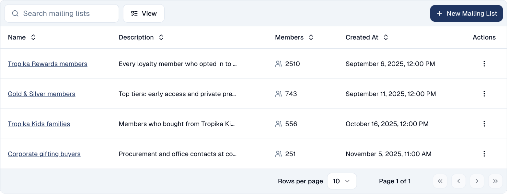
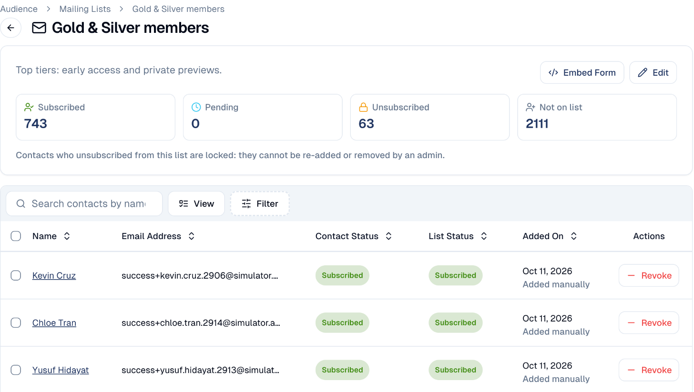

# Mailing lists

Lists people subscribe to, such as your newsletter or a members' club, with
their consent kept for each list.

## What it's for

A segment is a rule; a mailing list is a commitment. When someone joins a list,
from a sign-up form or because you added them, they agreed to receive what that
list sends. GoodBards keeps each person's status per list, so you always know who
may receive what, and an unsubscribe is respected everywhere.

## Before you start

- Contacts to add, or a [form](../marketing/forms.md) people can sign up with.

## How to manage a mailing list

1. In the sidebar, choose **Audience → Contacts**, then the **Mailing Lists**
   tab. Each list shows its description and number of members.

    

2. To create one, choose **New Mailing List**, then give it a name and a
   description.
3. Click a list to open it. The counters show who is **Subscribed**, **Pending**,
   **Unsubscribed**, and **Not on list**.

    

4. Below, each member shows their contact status, their status on this list, and
   how they joined. **Revoke** takes someone off the list.
5. **Embed Form** gives you a sign-up form for your own website that adds people
   to this list.

## Good to know

- **Unsubscribed means locked.** Someone who unsubscribed from a list cannot be
  added back, or removed, by anyone on your team. Only they can re-subscribe.
  This is how GoodBards keeps you compliant with PDPA and similar laws.
- **Lists do not update themselves.** A segment re-evaluates its rule every time;
  a mailing list only changes when people join or leave. See
  [Contacts](contacts.md#segments).
- **Email the list from a campaign.** When you send an email, choose the list as
  the audience. See [Emails](../marketing/emails.md).

---

*Still stuck? [Contact support](../contact.md).*
