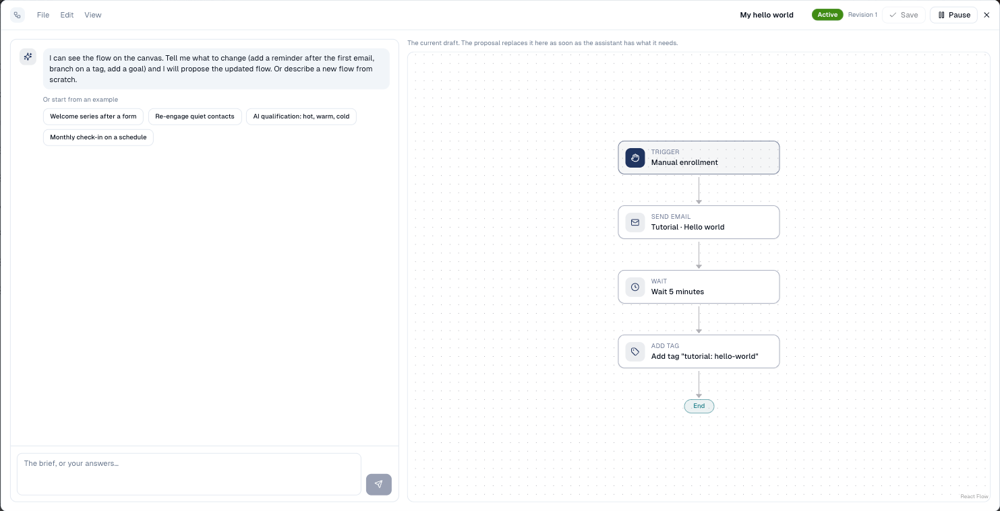
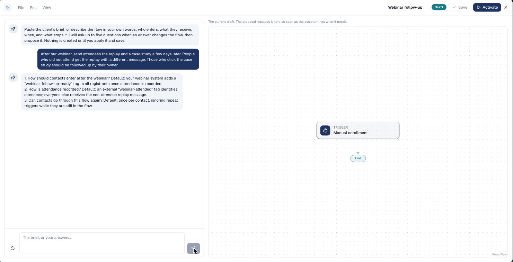
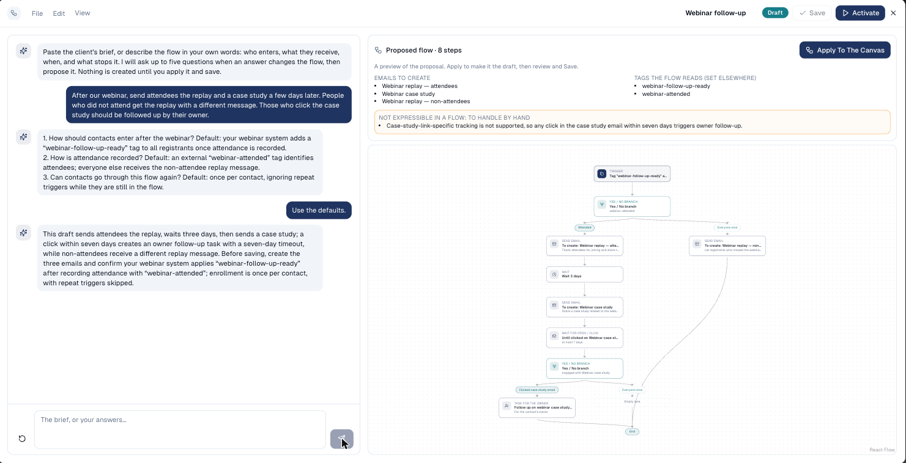
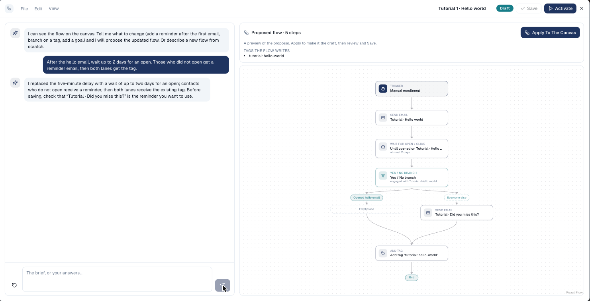

# The AI assistant

Describe a flow, or a change to the one on the canvas, in your own words. The
assistant asks what it needs, then proposes the flow for you to review.

## What it's for

Turning a brief ("after the webinar form, send the replay, then a case study
three days later to those who watched…") into cards takes a while. The
assistant drafts it in a minute: the trigger, the steps, the branches, the goal
and the stop rules, using your existing emails, forms, segments, tags and
fields. You stay in charge: nothing is saved or activated until you choose to.

## How to draft a flow with the assistant

1. Open a flow in the designer, then **View → AI assistant**.

    

2. Paste your brief or describe the flow. Not sure where to start? Choose one
   of the examples under **Or start from an example**: it fills in the box for
   you to adapt.
3. The assistant may ask up to five short questions, each with a proposed
   answer, for example *How do contacts arrive: a form or a tag?* Answer them,
   or reply *use the defaults*.

    

4. It then proposes the flow. The canvas on the right shows the proposal, with
   a checklist: the emails still to create, the tags and fields the flow reads
   and writes, and anything in your brief the flow cannot do.

    

5. Choose **Apply to the canvas**, review it in the **Visual** view, then
   **Save**.

## How to change a flow with the assistant

When the canvas already has steps, the assistant works on that flow. Ask for a
change, for example *add a reminder two days after the first email for those
who did not open it*. It keeps everything else as it is and proposes the
updated flow.

!!! tip "Write briefs like you would to a colleague"
    Say who enters, what they receive and when, what changes the path, and what
    counts as success: "Leads from the demo form get a welcome now and a case
    study in three days. If they click, their owner calls them. Stop when they
    book a demo."

## Good to know

- **Emails to create.** When no existing email fits, the proposal keeps an empty
  **Send email** card named and briefed for it. Create the email, then pick it
  on the card.
- **What it cannot do** is listed, never silently dropped: for example sending
  an SMS or a Slack message.
- **It knows every step**, including **Wait until…**, **Wait for a date**,
  **Note on contact**, the score conditions and the sending hours: "wait until
  they register, at most 14 days", "the day before the renewal date" or "stop
  once they are engaged" become the right cards.
- **Start over** clears the conversation and the proposal.
- **It uses AI credits** for each answer.

---

*Still stuck? [Contact support](../contact.md).*
