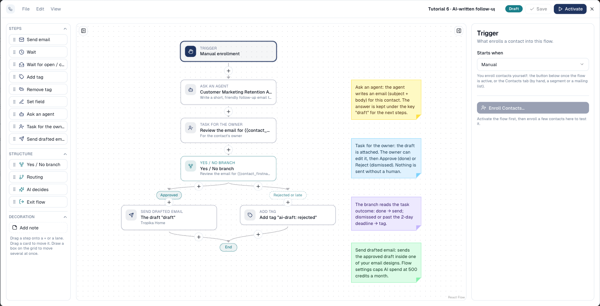
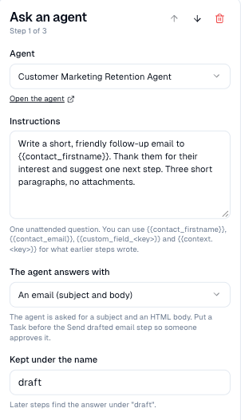
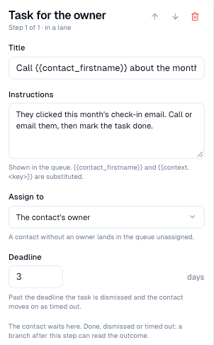
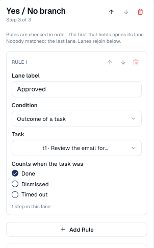
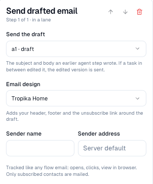
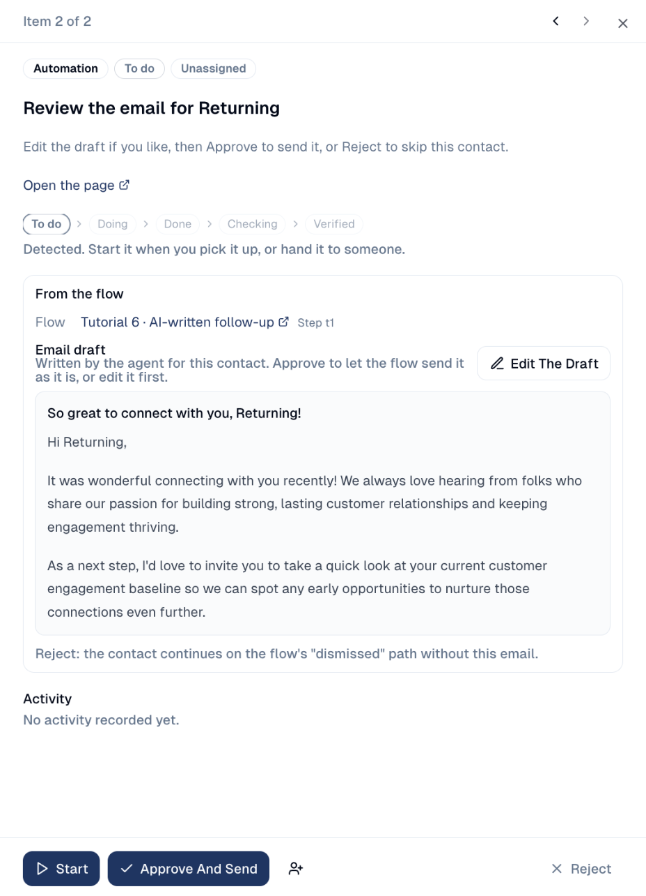
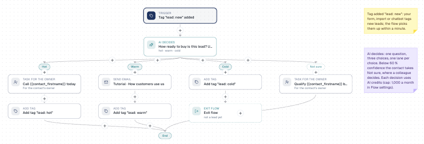
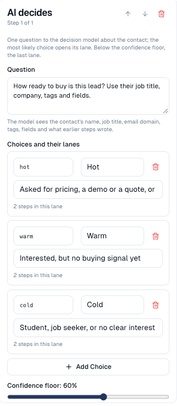

# AI and human steps

Let an AI agent write or judge, and let a colleague approve, call or decide,
without leaving the flow.

## What it's for

Some follow-ups need a personal touch: an email written for this one contact, a
call from their account manager, a judgement on how ready they are to buy.
Four steps bring that into a flow:

| Step | What it does |
| --- | --- |
| **Ask an agent** | One of your AI agents answers about the contact: free text, or a drafted email. |
| **Task for the owner** | Puts a task in **Actions** for the contact's owner or a colleague. The contact waits until it is done, dismissed or late. |
| **Send drafted email** | Sends the email an agent drafted (and maybe a colleague edited) inside one of your email designs. |
| **AI decides** | A branch whose lane is picked by the AI. |

!!! info "Nothing AI-written is sent without a human, unless you build it that way"
    The usual pattern is **Ask an agent → Task for the owner → Send drafted
    email**: the agent drafts, a colleague approves or edits in **Actions**,
    then the flow sends.

## Before you start

- **An agent.** Any of your agents under **Agentic AI → Agents**. See
  [Agentic AI](../agentic-ai/index.md).
- **An email design** for **Send drafted email**. See
  [Email designs](../marketing/email-designs.md).
- **Contact owners** for **Task for the owner**: a contact without an owner
  lands in **Actions** unassigned.

## How to build an AI-written follow-up

This is [Tutorial 6 · AI-written follow-up](samples.md#6-ai-written-follow-up).

1. Add **Ask an agent**. Pick the **Agent**, write the **Instructions**, set
   **The agent answers with** to **An email (subject and body)** and keep the
   answer under a short name, for example `draft`.

    { width="30%" }

2. Add **Task for the owner**. Give it a **Title** and **Instructions**, choose
   who gets it and a **Deadline**. The draft is attached to the task.

    { width="30%" }

3. Add a **Yes / No branch** on **Outcome of a task**, **Done**: approved
   drafts go one way, rejected or late ones the other.

    { width="30%" }

4. In the Approved lane, add **Send drafted email**: pick the draft and the
   **Email design**. Sender name and address are optional.

    { width="30%" }

## What the colleague sees

The task appears in **Actions** for the contact's owner, with the flow's name,
the draft and what the flow knows about the contact. They can edit the subject
and body, then **Approve and send** or **Reject**.

The flow picks the outcome up within a minute: **Done** when approved,
**Dismissed** when rejected, **Timed out** when the deadline passes first.

## AI decides

A branch whose lane is chosen by the AI: one question, a few choices, one lane
per choice, and a last lane for when the AI is not sure enough.

{ width="80%" }

1. Add **AI decides** from the **Structure** group.
2. Type the **Question**, for example *How ready to buy is this lead?*
3. Add one **choice** per lane: a short key (`hot`), the lane's label and a
   one-line description the AI reads.
4. Set the **Confidence floor**: below it, the contact takes the last lane,
   where a colleague can decide.

{ width="30%" }

*Sample: [Tutorial 7](samples.md#7-ai-lead-qualification).*

### What the AI sees

The panel lists it under **What the AI sees**. It is always the same set, read
from the contact at the moment they reach the step:

- first name, last name, job title, the email domain (not the address) and
  the subscription status;
- all the contact's tags;
- all your custom fields, each with its name and the contact's value;
- what earlier steps of this flow wrote: an agent's answer, a task outcome, a
  previous decision.

It does not see notes, opens and clicks, or company data.

!!! warning "Form answers must be mapped"
    The AI does not read a form submission. If your question depends on what
    the visitor answered (budget, timeline, the product they asked about), map
    those form fields to contact fields or tags in the form's **Contact
    mapping**. Give your custom fields clear names: the AI reads the name to
    understand the value.

## Good to know

- **AI budget.** **Ask an agent** and **AI decides** use AI credits. Cap them
  per flow and per month with **AI budget per month** in
  [Flow settings](settings.md); over the cap those steps fail until next month.
- **Tasks wait, AI does not.** An agent answers within the minute; a task holds
  the contact until someone acts or the deadline passes.
- **The path keeps it all.** Each contact's [path](results.md#a-contacts-path)
  shows what the agent wrote, what the AI chose and with what confidence, and
  the task outcome.

---

*Still stuck? [Contact support](../contact.md).*
