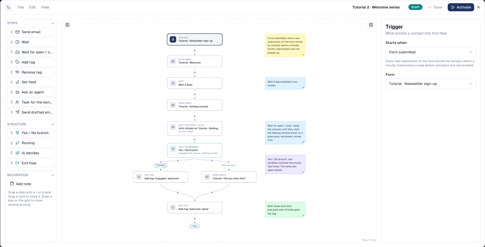
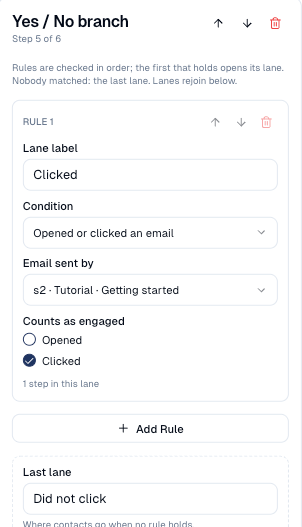
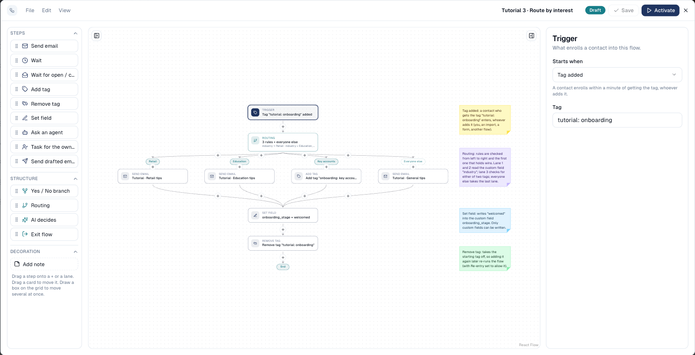
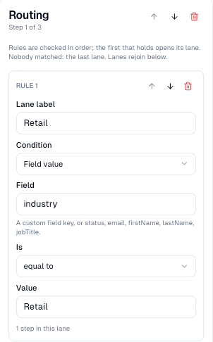
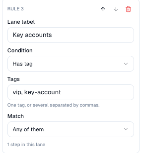
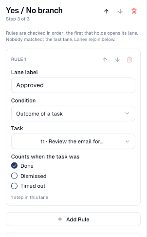
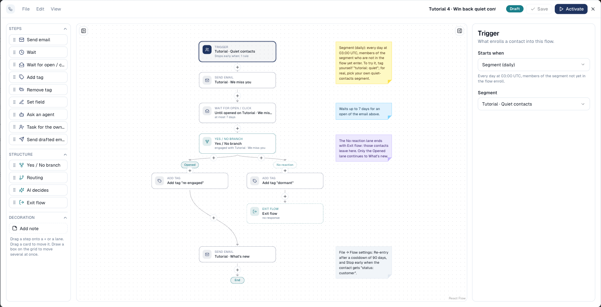

# Branches and conditions

Send different contacts down different lanes: those who clicked and those who
did not, retail and education, hot and cold leads.

## What it's for

A branch checks something about the contact and splits the flow into lanes,
one per answer. The lanes sit side by side on the canvas and **join again
below**, so the steps after the branch run for everyone, unless a lane ends with
**Exit flow**.

!!! abstract "In short"
    | You want | Use |
    | --- | --- |
    | Two lanes: yes or no | **Yes / No branch** |
    | Three or more lanes, checked in order | **Routing** |
    | The AI to judge, for example hot / warm / cold | **AI decides** |
    | Some contacts to stop here | A lane that ends with **Exit flow** |
    | Some contacts to skip a step | An empty lane |

## Yes / No branch

One condition, two lanes: contacts who match it, and everyone else.

1. Add **Yes / No branch** where the flow should split.
2. In the side panel, name the first lane under **Lane label** and pick its
   **Condition**.
3. Name the **Last lane** (everyone else).
4. Add steps inside each lane with its **+**.

{ width="30%" }

*Sample: [Tutorial 2 · Welcome series](samples.md#2-welcome-series).*

## Routing

Several rules, **checked from left to right: the first that holds opens its
lane**. Contacts who match none take the last lane.

Choose **Add Rule** in the panel for each lane, and reorder rules with the ↑ ↓
arrows: order matters when a contact could match two rules.

{ width="30%" }
{ width="30%" }

*Sample: [Tutorial 3 · Route by interest](samples.md#3-route-by-interest).*

## AI decides

The AI answers one question about the contact and picks a lane. See
[AI and human steps](ai-steps.md#ai-decides).

## The conditions

The same conditions work in branches, routing, [goals and stop
rules](settings.md):

| Condition | True when |
| --- | --- |
| **Has tag** | The contact has the tag. Several tags: **any** or **all** of them. |
| **Field value** | A contact field is equal to, not equal to, contains, is one of, is empty, is not empty, greater or less than a value. Works on custom fields and on status, email, first name, last name and job title. |
| **In segment** | The contact is a member of the segment right now. |
| **Opened or clicked an email** | The contact opened (or clicked) an email sent earlier in this flow. |
| **Outcome of a task** | A **Task for the owner** earlier in the flow was done, dismissed or timed out. |
| **What an earlier step wrote** | A value an agent, a task or an AI decision stored for this contact. |

{ width="30%" }

## Exit lanes and empty lanes

- A lane that ends with **Exit flow** takes its contacts out: the lanes that
  join again below are the others.

    

- An **empty lane** means "skip": its contacts go straight to the step after the
  branch. *Sample: [Tutorial 5](samples.md#5-monthly-check-in).*

## Good to know

- **Checked once, when the contact reaches the branch.** A branch does not
  wait: put a **Wait for open / click** before a branch on an email.
- **Lanes can hold branches**, but keep flows readable: past three levels,
  split into two flows connected by a tag.
- **Stop anywhere** is not a branch: for "stop as soon as they buy", use a
  stop rule in [Flow settings](settings.md).

---

*Still stuck? [Contact support](../contact.md).*
