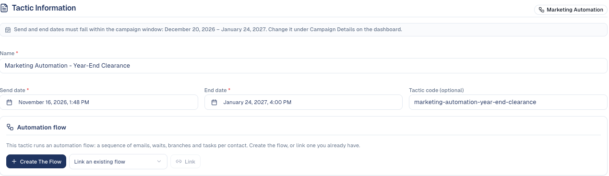
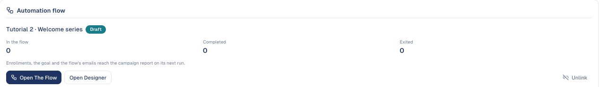

# Flows in a campaign

Make a flow one of a campaign's tactics, so its contacts and emails count in
the campaign's results.

## What it's for

A product launch might combine a social plan, an ad set and a nurture flow. As
a **Marketing Automation** tactic, the flow sits next to the others on the
campaign, starts and finishes with them, and its emails reach the campaign
report.

## Before you start

- **A campaign.** See [Campaigns](../marketing/campaigns.md).

## How to add a flow to a campaign

1. Open the campaign and add a **Marketing Automation** tactic (see
   [Launch a Tactic](../marketing/launch-tactic.md)).
2. Name the tactic, set its dates inside the campaign window, then choose
   **Create Tactic**.
3. Under **Automation flow**, choose **Create The Flow** for a new one, or pick
   a flow under **Link an existing flow** and choose **Link**.

    

4. **Open Designer** to build the flow as usual.
5. Activate the flow: the tactic moves to **Started**.

Once linked, the tactic shows how many contacts are **In the flow**,
**Completed** and **Exited**, and the flow's page shows **Part of a campaign**
with a link back.

## Good to know

- **The tactic follows the flow.** Activating the flow starts the tactic;
  archiving it completes the tactic.
- **One flow per tactic,** and a flow belongs to one tactic at most. **Unlink**
  frees both.
- **Campaign analytics** count the flow's enrolled, completed and exited
  contacts, its conversion rate and its emails' sends, opens and clicks.

---

*Still stuck? [Contact support](../contact.md).*
