# Your first flow: Hello world

Build a three-step flow, switch it on and run it on yourself. It takes about ten
minutes, and you will have used every screen you need for bigger flows.

## What it's for

Hello world is the smallest flow that does something you can check: it sends
you one email, waits five minutes, then puts a tag on your contact. Once it
works, you know your email server, your emails and your access are ready for
real flows.

!!! tip "Already built for you"
    The same flow exists as **Tutorial 1 · Hello world** in the
    [Sample flows](samples.md), with sticky notes explaining each card. Open it
    next to this page if you prefer to read rather than build.

## Before you start

- **You are a contact.** Add yourself under **Audience → Contacts** with your
  own email address and the status **Subscribed**. See
  [Adding contacts](../audience/adding-contacts.md).
- **An email to send.** Any of your [Emails](../marketing/emails.md) will do.
  The tutorial uses one called **Tutorial · Hello world**.
- **An email server** is connected. See
  [Email sending](../settings/connectors/email-sending.md).

## How to build it

1. In the sidebar, choose **Marketing → Automations**, then **New Flow**.
2. Name it **My hello world**, add a description if you like, and choose
   **Create**.

    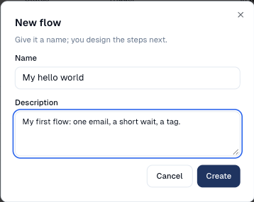{ width="40%" }

3. The designer opens with a single **Trigger** card, set to **Manual**: nobody
   enters until you enrol them. That is what you want for a test.

    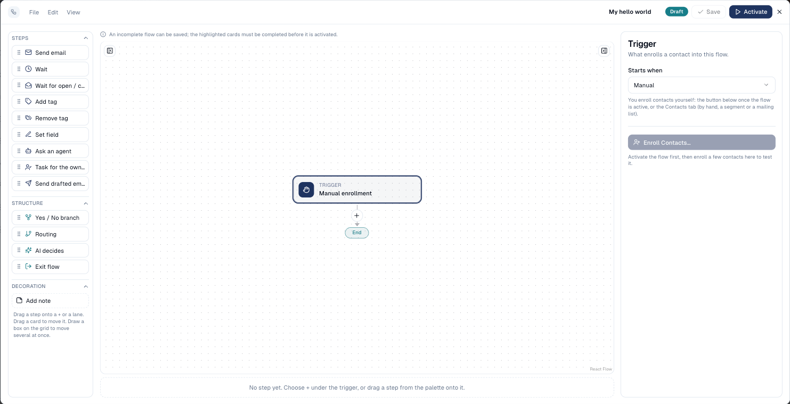

4. Choose the **+** under the trigger. **Add a step** lists every step; choose
   **Send email**.

    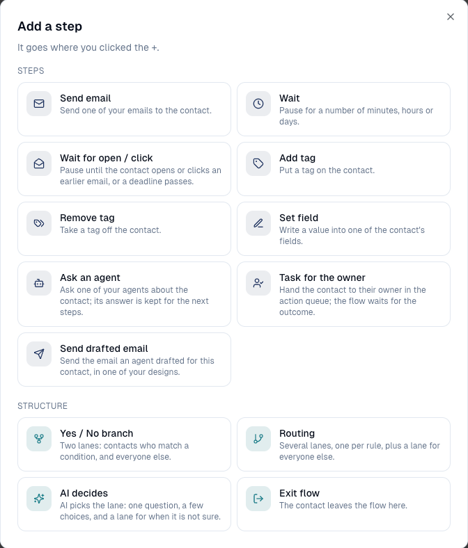{ width="65%" }

5. The new card is selected. In the side panel, pick your email under
   **Email**.

    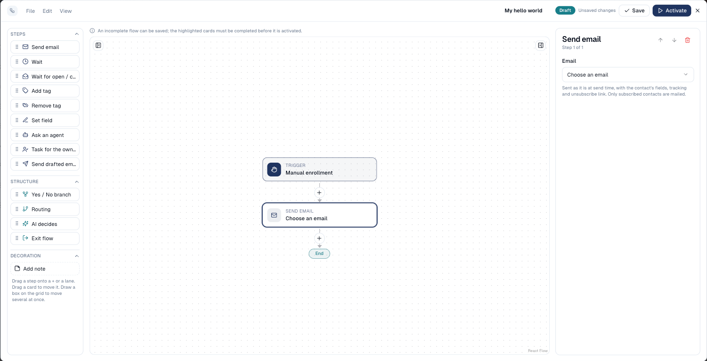

6. Choose the **+** under the email card, then **Wait**. Set **Wait for** to
   **5** and the unit to **minutes**.

    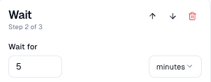{ width="30%" }

7. Choose the **+** under the wait, then **Add tag**. Type
   `tutorial: hello-world`.

    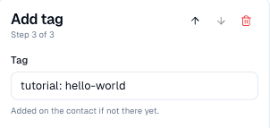{ width="30%" }

8. Your flow now reads from top to bottom: trigger, email, wait, tag, end.
   Choose **Save**.

    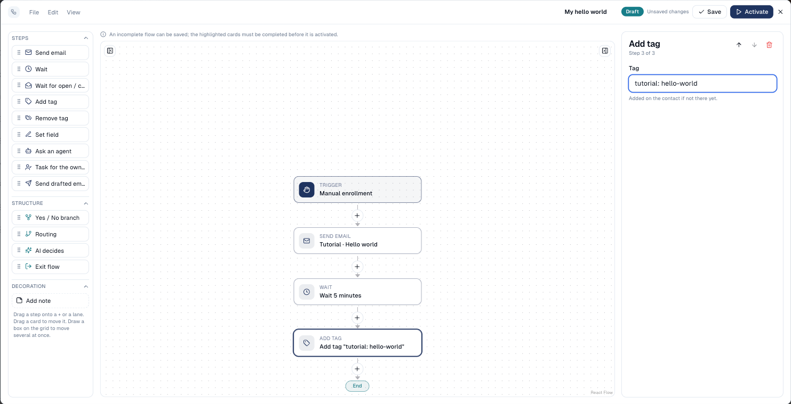

9. Choose **Activate**. The status turns **Active** and the flow gets its first
   revision.

    { width="40%" }

!!! note "Highlighted cards"
    A card with a red mark is missing something (an email, a duration, a tag).
    You can save an unfinished flow, but **Activate** waits until every card is
    complete.

## How to run it on yourself

1. Select the **Trigger** card and choose **Enroll Contacts…**.

    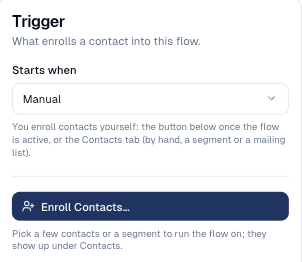{ width="30%" }

2. On **Contacts**, pick yourself, then choose **Enroll**. (The **Segment** and
   **Mailing list** tabs enrol a whole group at once, up to 2,000 contacts.)

    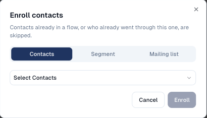{ width="40%" }

3. Within a minute the email arrives in your inbox, with your first name filled
   in.
4. Close the designer, open the flow's menu in the list and choose
   **Contacts & report**. You are listed as **Waiting**, on the wait step, with
   the time you move on under **Next**.

    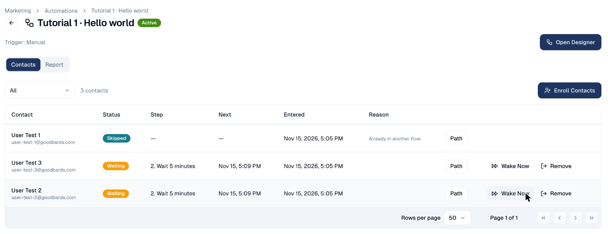

5. Five minutes later you are **Completed**. Testing and don't want to wait?
   Choose **Wake now** on your row: you move on within a minute. Then choose
   **Path** to see each card you went through, with its time.

    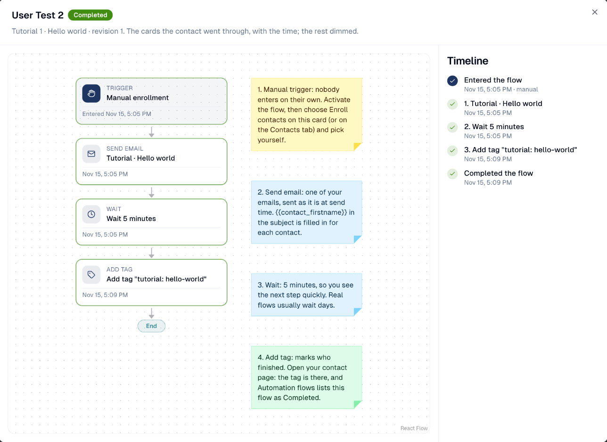

6. Open your contact page: the tag `tutorial: hello-world` is there, and
   **Automation flows** lists My hello world as **Completed**.

    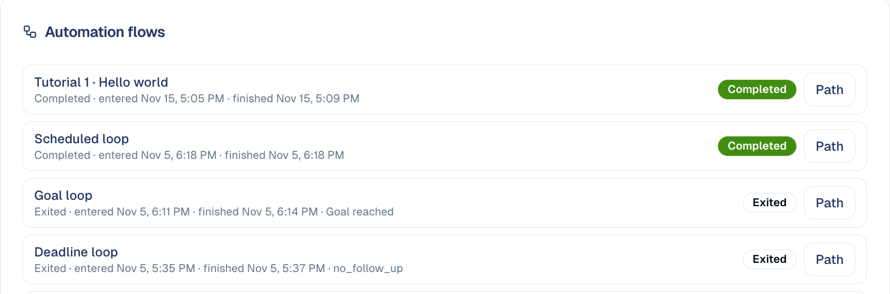{ width="65%" }

Congratulations: you built, activated and tested a flow. Next, try
[Tutorial 2 · Welcome series](samples.md#2-welcome-series), which adds a form
trigger, a wait for a click and a Yes / No branch.

## Good to know

- **Only once.** A contact goes through a flow once by default. To run the test
  again on yourself, set **Re-entry** in [Flow settings](settings.md), or
  duplicate the flow.
- **Pause, don't delete.** **File → Pause** holds everyone where they are;
  **Resume** continues. A flow that has had contacts can only be archived.
- **Edit while it runs.** Changes to an active flow go into a draft until you
  choose **Activate changes**; contacts already inside finish the old version.

---

*Still stuck? [Contact support](../contact.md).*
