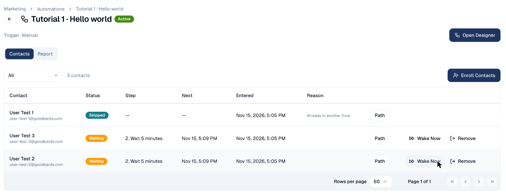
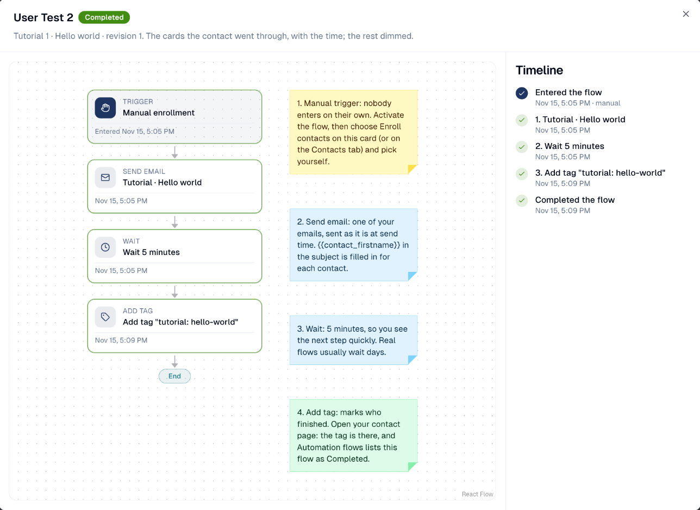
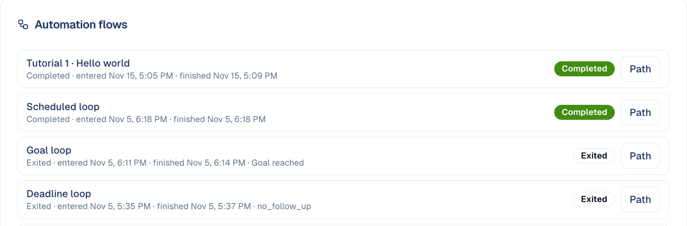
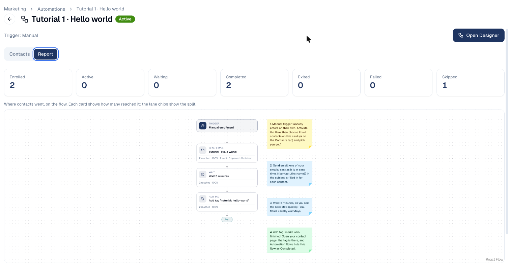
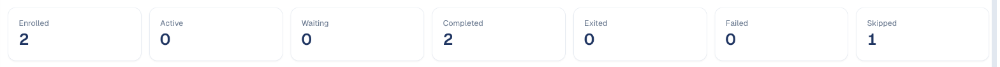

# Results and analytics

See who is in a flow, where each contact is, the path they took, and how many
reached each card, opened, clicked and converted.

## What it's for

A flow runs for weeks. These screens answer the questions that come up along
the way: did my test contact get the email? Why did this lead not get the
offer? Which lane do most contacts take? How many booked a demo?

## How to open a flow's results

In **Marketing → Automations**, open the flow's menu and choose **Contacts &
report** (or select its name). The page has two tabs: **Contacts** and
**Report**.

## The Contacts tab

Everyone who entered the flow, one row each: their status, the step they are on,
when they entered and, for those who left, why.

- **Filter** by **In flow**, **Completed**, **Exited**, **Skipped** or
  **Failed**.
- **Path** shows the contact's journey (see below).
- **Wake now** ends the contact's current wait early, to test the next steps
  without waiting days.
- **Send now** appears when an email is held. **Reason** says why: **Held by
  the sending hours**, **Held by the email limit**, or **No longer held** once
  you raised the limit. The limit and the hours are checked again: if one still
  applies, the email stays held.
- **Remove** takes the contact out of the flow.

| Status | Meaning |
| --- | --- |
| **In flow** | On a step or waiting. **Next** shows when they move on, for example an email held until the [sending hours](settings.md#sending-hours) open or the [email limit](settings.md#email-limit-per-contact) has room. |
| **Completed** | Reached the end. |
| **Exited** | Left early: an **Exit flow** step, a stop rule, the goal, an unsubscribe, or a **Wait until…** that ran out with **Leave the flow** (reason `wait_timeout`). The reason is shown. |
| **Skipped** | The trigger fired but they could not enter (already in this flow, or already went through it). A contact can be in several flows at once. |
| **Failed** | A step failed three times, for example no email server. |

## A contact's path

**Path** draws the flow with the cards this contact went through and the time
of each, and what each step did: the email sent, the lane taken, what the agent
wrote, what the AI chose and how sure it was, the task outcome, and how a wait
ended (**condition**, **timeout**, **date passed**, **no date**).

A contact's own page lists every flow they have been in under **Automation
flows**, with a **Path** button for each.

{ width="65%" }

## The Report tab

The report draws the flow with its figures on the canvas: how many contacts
reached each card, the sent, opened and clicked counts of each email, and how
the lanes of each branch split.

Above the canvas, tiles sum up the flow: **Enrolled**, **Active**, **Waiting**,
**Completed**, **Exited**, **Failed** and **Skipped**. A flow with a goal adds
**Goal reached** and the **Conversion** rate; a flow with AI steps adds the AI
credits spent this month against the budget.

## Good to know

- **Opens are approximate.** Some mail apps open every email to scan it, and
  others block images. Clicks are the stronger signal; use **clicked** in
  branches when it matters.
- **Figures follow the version.** The report counts every contact on the card
  of the same name across versions of the flow.
- **In a campaign**, the flow's figures also reach the campaign's analytics. See
  [Flows in a campaign](campaigns.md).

---

*Still stuck? [Contact support](../contact.md).*
