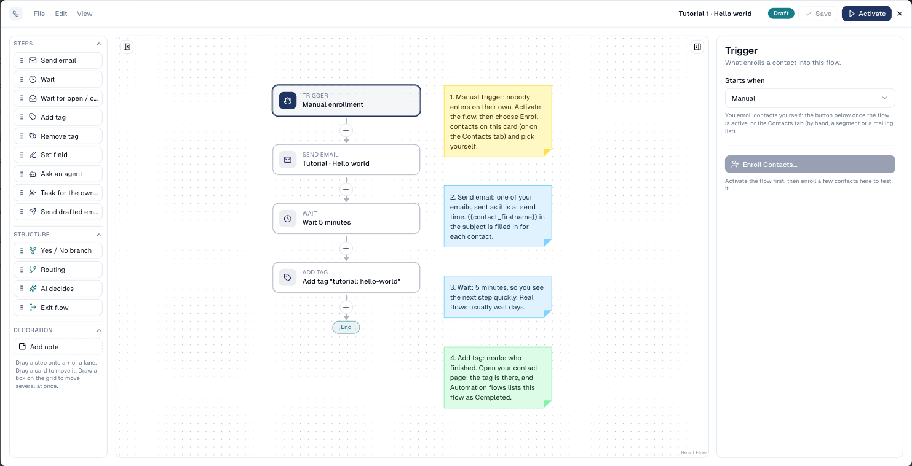
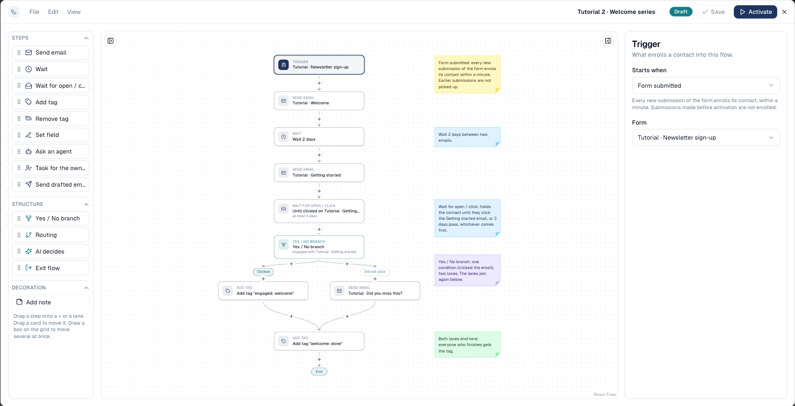
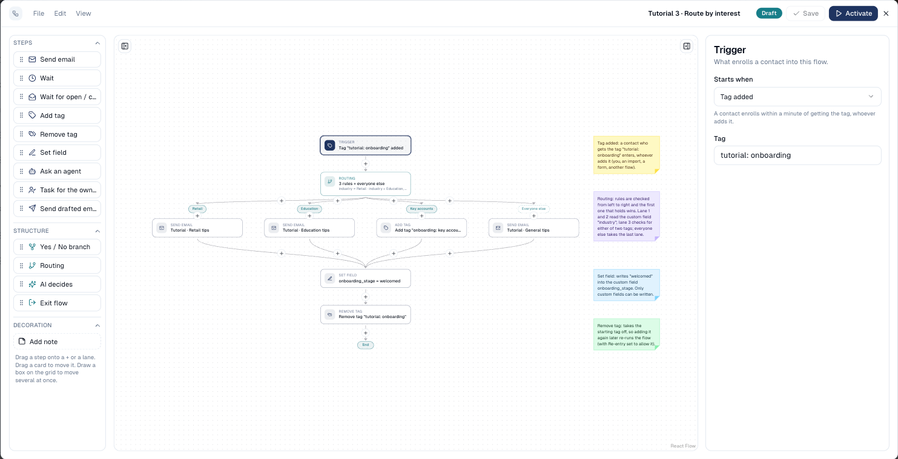
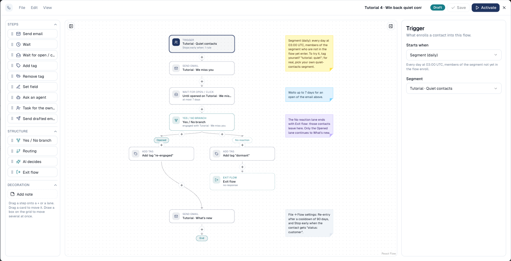
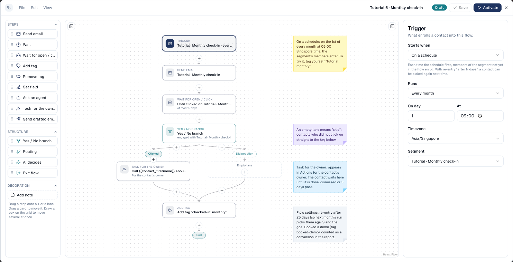
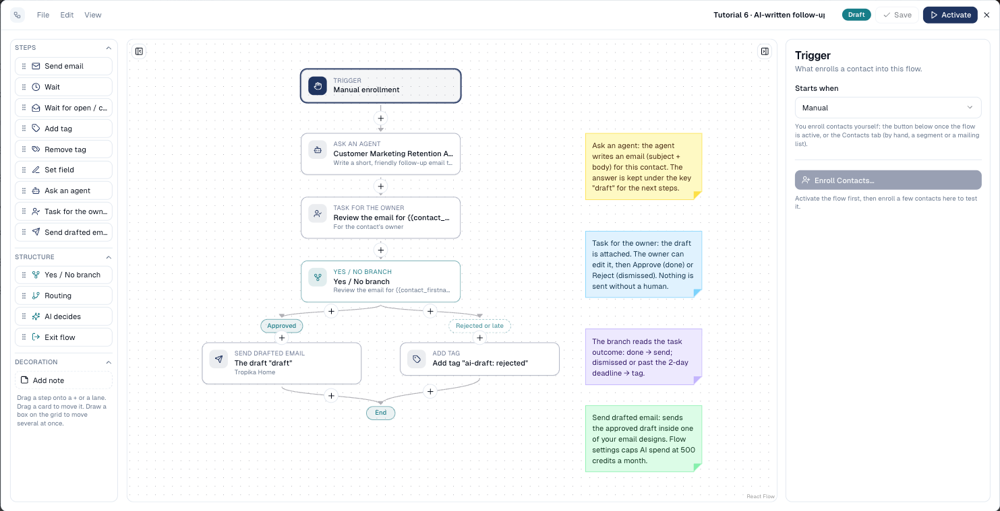
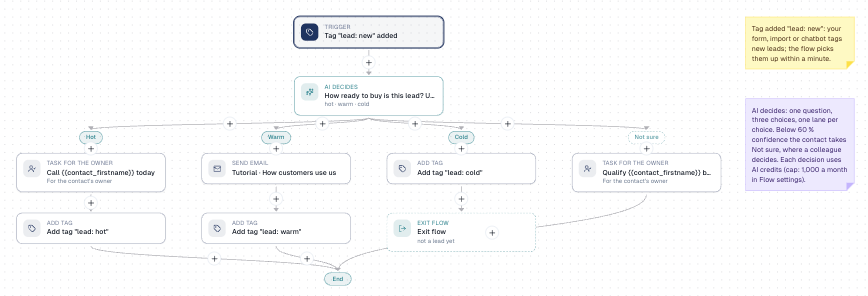
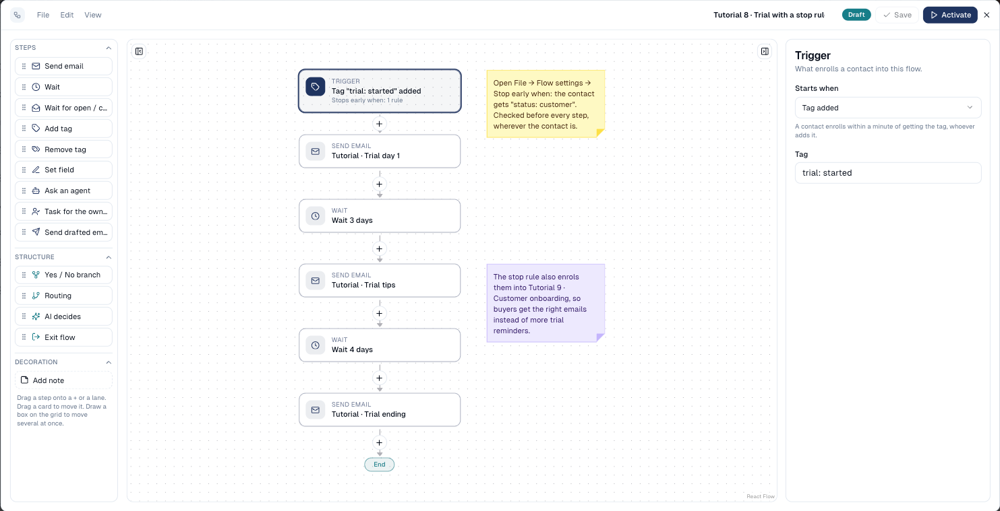

# Sample flows

Nine ready-made flows, from the simplest to AI and hand-overs. Each teaches a
few building blocks and explains its cards with sticky notes on the canvas.

## What it's for

The fastest way to learn flows is to open a working one. The samples come with
their own emails (marked *Tutorial ·*), a sign-up form and two segments, all as
drafts: nothing runs until you activate a flow.

!!! info "Getting the samples"
    Ask your GoodBards contact to add the tutorial flows to your workspace. They
    appear in **Marketing → Automations** as **Tutorial 1** to **Tutorial 9**,
    with the emails under **Emails**, the form **Tutorial · Newsletter sign-up**
    and the segments **Tutorial · Quiet contacts** and **Tutorial · Monthly
    check-in**.

| Sample | You learn |
| --- | --- |
| [1 · Hello world](#1-hello-world) | Manual trigger, Send email, Wait, Add tag |
| [2 · Welcome series](#2-welcome-series) | Form trigger, Wait for open / click, Yes / No branch, lanes joining |
| [3 · Route by interest](#3-route-by-interest) | Tag trigger, Routing on fields and tags, Set field, Remove tag |
| [4 · Win back quiet contacts](#4-win-back-quiet-contacts) | Segment trigger, an exit lane, re-entry cooldown, a stop rule |
| [5 · Monthly check-in](#5-monthly-check-in) | Schedule trigger, empty lane, Task for the owner, a goal |
| [6 · AI-written follow-up](#6-ai-written-follow-up) | Ask an agent, review task, branch on the task outcome, Send drafted email, AI budget |
| [7 · AI lead qualification](#7-ai-lead-qualification) | AI decides, the Not sure lane, a goal |
| [8 · Trial with a stop rule](#8-trial-with-a-stop-rule) | Stop early when… and moving a contact to another flow |
| [9 · Customer onboarding](#9-customer-onboarding) | The flow Tutorial 8 hands buyers to |

## How to try a sample

1. Open it in the designer and read the notes beside the cards.
2. Check what it needs: the email server for every flow, an agent for 6 and 7,
   your own segment if you replace the tutorial one.
3. **Activate** it, then trigger it on yourself: enrol yourself (manual flows),
   fill in the form (2), or add the starting tag to your contact (3, 7, 8),
   `tutorial: quiet` (4) or `tutorial: monthly` (5).
4. Follow yourself on the **Contacts** tab and with **Path**. See
   [Results and analytics](results.md).
5. **Duplicate** a sample to start your own flow from it.

## 1 · Hello world

Enrol yourself by hand, get one email, wait five minutes, get a tag. The
[tutorial](hello-world.md) builds it step by step.

## 2 · Welcome series

A sign-up form starts it; a welcome, two days, tips; then the flow waits for a
click. Clickers are tagged, the others get a reminder; both lanes end with the
same tag.

## 3 · Route by interest

The tag `tutorial: onboarding` starts it. Routing sends retail and education
contacts (custom field `industry`) their own tips, key accounts (tag `vip` or
`key-account`) a tag, and everyone else general tips. Then a field is written
and the starting tag removed.

## 4 · Win back quiet contacts

Every day, members of a quiet-contacts segment get *We miss you*. Those who
open within a week are tagged `re-engaged` and get *What's new*; the others are
tagged `dormant` and leave. Customers stop at once; anyone may come back after
90 days.

## 5 · Monthly check-in

On the 1st of every month at 09:00 Singapore time, the segment gets a check-in
email. Contacts who click get a call task for their owner; the others skip it
(empty lane). Goal: *Booked a demo*.

## 6 · AI-written follow-up

An agent drafts a personal email; the owner reviews it in **Actions**;
approved drafts are sent in your design, rejected or late ones are tagged. AI
spend is capped at 500 credits a month.

## 7 · AI lead qualification

The tag `lead: new` starts it. The AI rates the lead hot, warm or cold: hot
leads get a call task, warm ones a nurture email, cold ones leave. When the AI
is less than 60 % sure, a colleague qualifies the lead. Goal: *Opportunity*.

{ width="80%" }

## 8 · Trial with a stop rule

Three trial emails over a week, started by the tag `trial: started`. A contact
who gets `status: customer` stops at once and enters Tutorial 9.

## 9 · Customer onboarding

A customer welcome, a week's wait, a tag. Contacts arrive from Tutorial 8's stop
rule (or by hand).

## Good to know

- **Safe by design.** The two segments only take contacts you tag yourself, and
  tag-triggered samples start only when the tag is added after activation.
- **Edit freely.** Your changes to a sample are yours; adding the samples again
  never overwrites them.
- **Mock copy.** The sample emails say they are samples: replace the copy before
  using a flow with real contacts.

---

*Still stuck? [Contact support](../contact.md).*
