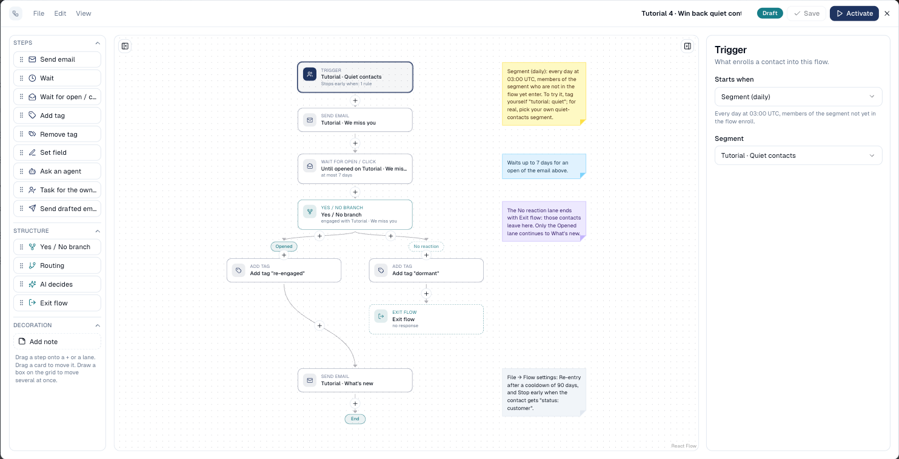
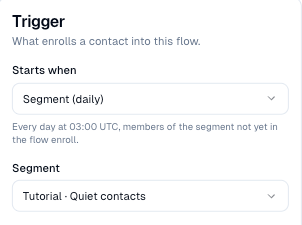
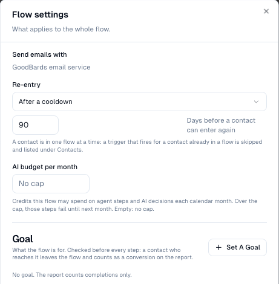
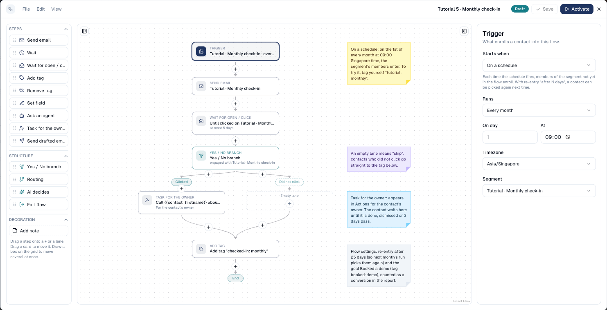
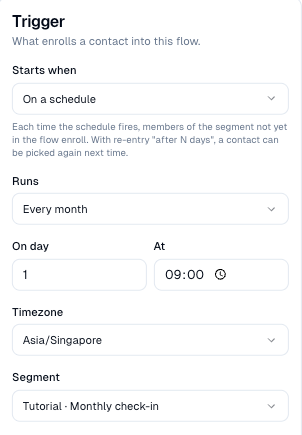
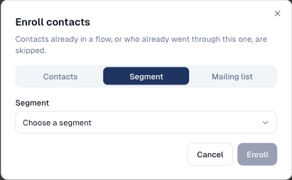

# Segments and schedules

Run a flow on a segment: every day for newcomers to the segment, or on a
schedule for a recurring touchpoint.

## What it's for

A [segment](../audience/contacts.md) describes a group by rules ("subscribed,
no open in 90 days", "customers in Singapore") and keeps itself up to date. A
flow can use a segment in four ways:

| Where | What it does |
| --- | --- |
| **Segment (daily)** trigger | Every day at 03:00 UTC, members not yet in the flow enter. |
| **On a schedule** trigger | Each time the schedule runs, members not yet in the flow enter. |
| **In segment** condition | A branch, goal or stop rule checks membership at that moment. |
| **Enroll contacts → Segment** | You enrol the whole segment by hand, once. |

## Before you start

- **The segment.** Build it under **Audience**. The
  [Sample flows](samples.md) bring two: **Tutorial · Quiet contacts** and
  **Tutorial · Monthly check-in**. Both only take contacts tagged
  `tutorial: quiet` or `tutorial: monthly`, so you can try them on yourself
  safely.

## How to win back quiet contacts, every day

[Tutorial 4](samples.md#4-win-back-quiet-contacts) runs on a segment of contacts
who opened and clicked nothing in 90 days.

1. Select the trigger, choose **Segment (daily)** and the segment.

    { width="30%" }

2. Build the steps.
3. In **File → Flow settings**, set **Re-entry** to **After a cooldown** of 90
   days: someone who goes quiet again next season gets the flow again.

    { width="40%" }

## How to send a monthly check-in

[Tutorial 5](samples.md#5-monthly-check-in) runs on the 1st of every month at
09:00 Singapore time.

1. Select the trigger and choose **On a schedule**.
2. Under **Runs**, choose **Every day**, **Every week** (and the weekday) or
   **Every month** (and the day), then the time and the **Timezone**.
3. Pick the **Segment**.

    { width="30%" }

4. In **File → Flow settings**, set **Re-entry** to **After a cooldown** shorter
   than the schedule (25 days for a monthly flow). Without it, each contact
   only gets the first month.

## How to enrol a segment once

On an active flow, choose **Enroll Contacts…** (trigger card or **Contacts**
tab), then **Segment**, and pick it. Up to 2,000 contacts at a time.

{ width="40%" }

## Good to know

- **Membership is read when the trigger runs.** A contact who leaves the
  segment after entering stays in the flow; add a stop rule **In segment** (or
  its opposite with a branch) if they should leave.
- **The first run is the next scheduled one.** Activating a monthly flow on the
  2nd means nothing happens until the 1st of next month. Enrol the segment by
  hand to start now.
- **Large segments.** Every member who is subscribed and not already in this
  flow enters. Try the flow on a small test segment first.

---

*Still stuck? [Contact support](../contact.md).*
