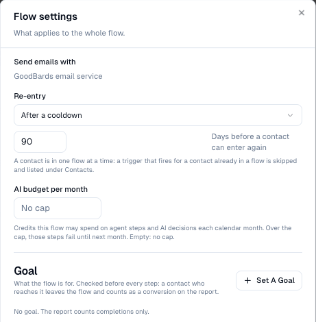
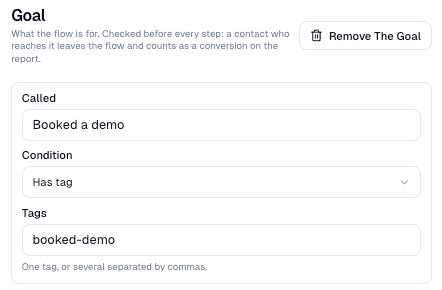
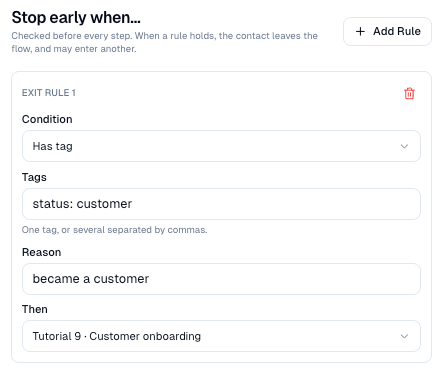
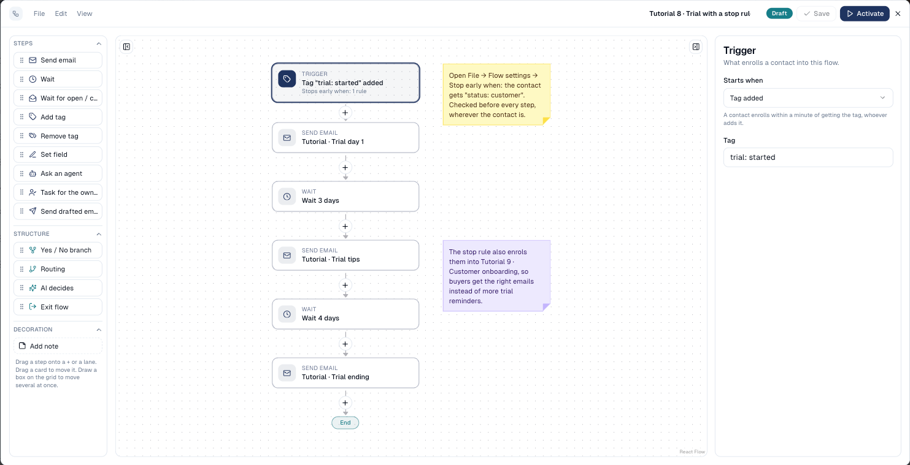

# Flow settings

What applies to the whole flow: who may come back, what success looks like,
and when a contact should stop early.

## What it's for

Steps describe the path; settings describe its rules. Set a goal to measure
conversions, a stop rule so buyers don't get "buy now" reminders, a cooldown so
a monthly flow picks the same people again next month.

## How to open them

In the designer, choose **File → Flow settings**.

{ width="40%" }

| Setting | What it decides |
| --- | --- |
| **Send emails with** | Which email server sends, when you have more than one connected. |
| **Re-entry** | **Once per contact** (the default); **Every time the trigger fires again (after finishing)**; or **After a cooldown**, with the number of days before the same contact can enter again. |
| **AI budget per month** | The most credits this flow may spend on **Ask an agent** and **AI decides** steps each calendar month. Empty means no cap. |
| **Goal** | What the flow is for. A contact who meets it leaves and counts as a conversion. |
| **Stop early when…** | Rules that take a contact out as soon as something becomes true, and may move them into another flow. |

## How to set a goal

1. Under **Goal**, choose **Set A Goal**.
2. Name it (**Called**), for example *Booked a demo*.
3. Pick the condition that means success, for example **Has tag**
   `booked-demo`.

{ width="40%" }

The report then shows **Goal reached** and the **Conversion** rate (see
[Results](results.md)). *Sample: [Tutorial 5](samples.md#5-monthly-check-in).*

## How to stop early, and hand over to another flow

1. Under **Stop early when…**, choose **Add Rule**.
2. Pick the condition, for example **Has tag** `status: customer`, and type a
   **Reason** (shown on the Contacts tab).
3. Under **Then**, keep **Just leave the flow**, or pick another flow the
   contact should enter.

{ width="40%" }

[Tutorial 8](samples.md#8-trial-with-a-stop-rule) uses this: a trial contact who
becomes a customer leaves the trial emails and enters **Tutorial 9 · Customer
onboarding** straight away.

## Goal or stop rule?

| | Goal | Stop rule |
| --- | --- | --- |
| Means | Success | Not relevant any more |
| Report | Counted as a conversion | Counted as an exit, with its reason |
| Can move the contact to another flow | No | Yes |

## Good to know

- **Checked before every step, not during a wait.** A contact on a three-day
  wait who books a demo on day one leaves when the wait ends, before the next
  email goes out.
- **Unsubscribe always stops.** Whatever the rules, a contact who is no longer
  subscribed leaves within a minute.
- **The trigger card shows it.** A flow with stop rules says **Stops early
  when: N rules** on its trigger card.

---

*Still stuck? [Contact support](../contact.md).*
