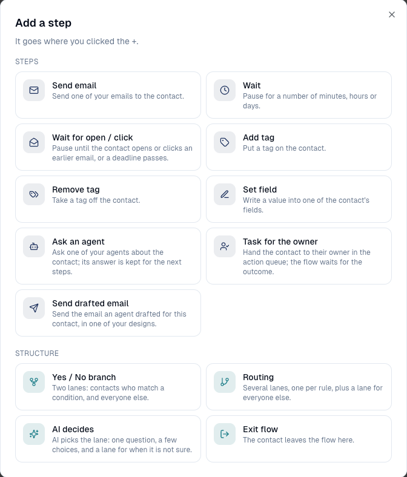
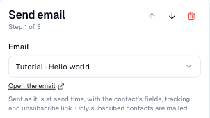
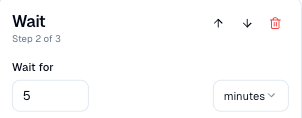
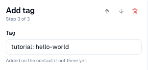
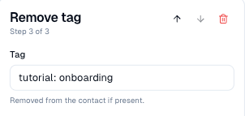

# Steps

Every card under the trigger is a step. This page shows each one and its
settings.

## What it's for

Steps are what the flow does to each contact: send an email, wait (a time, an
open or click, a condition, a date), tag them, write a field or a note, ask an
AI agent, hand them to a colleague. The structure steps
(branches) are covered in [Branches and conditions](branches.md), the AI and
human steps in [AI and human steps](ai-steps.md).

## How to add, move and remove a step

- **Add**: choose the **+** on a connector where the step should go, then pick
  it in **Add a step**. Or drag a step from the palette onto a **+** or a lane.
- **Edit**: select the card; its settings open in the side panel.
- **Move**: drag the card to another **+**, or use the ↑ ↓ arrows at the top of
  its panel.
- **Remove**: the bin at the top of its panel.

{ width="65%" }

## Send email

Sends one of your [Emails](../marketing/emails.md), as it is at send time,
with the contact's details filled in, tracking and the unsubscribe link.

{ width="30%" }

**Open the email** opens it in a new tab so you can check the copy.

- **Custom fields:** `{{custom_field_<key>}}` in the email shows the contact's
  value, for example `Your result: {{custom_field_archetype}}`. A contact
  without a value gets an empty text.
- **Email limit:** a contact who already had the workspace's maximum of
  marketing emails waits on this step until there is room again. See
  [Email limit per contact](settings.md#email-limit-per-contact).
- **Who gets it:** only **Subscribed** contacts. A contact with another status
  leaves the flow here, unless the email is transactional (below).

### Transactional email

For an email the person asked for: a quiz result, a confirmation, a download
link. Switch on **Transactional email** in the Send email panel. The card then
shows a **Transactional** tag.

A transactional email:

- goes out **at once**, whatever the flow's [sending hours](settings.md#sending-hours);
- is **never held** by the [email limit](settings.md#email-limit-per-contact),
  but still counts toward it;
- also reaches **Regular** contacts (no marketing consent);
- never reaches **Unsubscribed**, **Bounced** or **Do not contact** contacts;
- keeps tracking and the unsubscribe link.

A Regular contact stays in the flow for its transactional emails. Tags, notes
and field updates keep running. The contact leaves the flow at the first
marketing email: "the result, and nothing after it".

- **Admins only.** Only a workspace admin can switch it on, or change the email
  of a transactional step. Other users see the switch greyed out; they can
  still edit the rest of the flow, or switch it off.
- **Use it only for what the person requested.** Mailing contacts without
  consent is allowed for an email they asked for, not for promotion (PDPA). A
  newsletter or an offer is never transactional.
- **Reports keep them apart.** The flow's [Report tab](results.md#the-report-tab)
  counts transactional and marketing emails separately. The contact's history
  tags each transactional email.

## Wait

Pauses for a number of minutes, hours or days (from one minute to 365 days).

{ width="30%" }

## Wait for open / click

Holds the contact until they open (or click) an email sent earlier in this
flow, or until **At most** passes, whichever comes first.

For a click, **Link** can name one link of the email: the wait then ends only
when that link is clicked, for example the *kit* button and not the footer.
See [Naming a link](../marketing/emails.md#naming-a-link-and-tagging-on-click).

{ width="30%" }

Follow it with a [Yes / No branch](branches.md#yes-no-branch) on **Opened or
clicked an email** to treat the two groups differently.

## Wait until…

Holds the contact until something is true: they have a tag, a field has a
value, they are in a segment, their score is high enough, or a form answer.
It uses the same conditions as a [branch](branches.md#the-conditions).

- **At most** caps the wait, for example 14 days.
- **If it never happens:** continue to the next step, or leave the flow.
- If the condition is already true, the contact goes straight on.
- The condition is checked again every 15 minutes, so a contact can move on
  up to 15 minutes after it becomes true.

*Example:* after the webinar invitation, **Wait until** the contact has the
tag `registered`, at most 14 days; then send the thank-you email.

## Wait for a date

Waits for a date: a fixed one (`24 Dec 2026`), the contact's **birthday**, or
a **date field** of the contact (renewal date, event date, interview day).

- **Days before (−) or after (+)**, for example `-1` for the day before.
- **At** sets the time, in the contact's timezone (else your workspace's).
- The birthday means the next one.
- A date already passed, or missing on the contact, moves the contact on at once.

*Example:* **Wait for a date** on the field `renewal_date`, `-30` days, at
`09:00`; then send the renewal reminder.

## Wait until a time of day

Holds the contact until the next time it is, say, **17:00** in the contact's
timezone (else your workspace's).

- Reached at 10:00: moves on at 17:00 the same day. Reached at 19:00: at
  17:00 the next day. Reached exactly at 17:00: moves on at once.
- **Only on**: pick days (for example Monday to Friday) to skip the others. No
  day picked = every day.

*Example:* a wake-up email that should land after work: **Wait until a time of
day** `17:00`, then **Send email**.

## Add tag and Remove tag

Puts a tag on the contact, or takes one off. Tags are how flows talk to each
other and to your segments.

{ width="30%" }
{ width="30%" }

## Set field

Writes a value into one of the contact's custom fields, for example
`onboarding_stage = welcomed`.

{ width="30%" }

Built-in fields (status, email, name) cannot be set by a flow.

**Copy a form answer onto the contact.** In a flow started by a form, type
`{{context.form.<field>}}` as the value, for example
`{{context.form.archetype}}`. The contact's custom field gets the answer of
the submission that started this run, and it is overwritten on each new
submission (a form alone only fills an empty field). Branches and emails later
in the flow then read the latest answer.

## Note on contact

Writes a note on the contact's record, signed with the flow's name. Your team
sees it in the contact's **Notes**, next to the notes people write.

The note can use the contact's details and the answers of the form that
started the flow; the panel lists the form's fields for you. For example:
`Unhappy on the survey: rated {{context.form.csat_score}}/5. Comment: {{context.form.csat_comment}}`.

- An answer left blank on the form becomes an empty text, never a `{{…}}` left in the note.
- Not to be confused with **Add note** under **Decoration** (a sticky note on
  the canvas, see below): **Note on contact** writes on the contact's record.

## Exit flow

The contact leaves the flow here, with the reason you type. The reason shows
on the **Contacts** tab.

{ width="30%" }

Exit is always the last step of its lane: nothing can follow it.

## Ask an agent, Task for the owner, Send drafted email

The three steps that bring AI and your team into a flow. See
[AI and human steps](ai-steps.md).

## Sticky notes on the canvas

Under **Decoration** in the palette, **Add note** puts a sticky note on the
canvas for your colleagues: what a card is for, what to check before
activating. Contacts never see it. Drag a note's corner to resize it and pick
its colour in the side panel. The [Sample flows](samples.md) use them to explain
every card.

## Good to know

- **Merge fields.** Email subjects and bodies can use `{{contact_firstname}}`
  and `{{custom_field_<key>}}`; task titles, notes and agent instructions also
  accept `{{context.<key>}}` (what earlier steps wrote, and `form.<field>` for
  the form that started the flow).
- **Emails can wait.** An email step waits outside the flow's
  [sending hours](settings.md#sending-hours) or when the contact reached the
  [email limit](settings.md#email-limit-per-contact). Tags, notes, tasks and
  waits never do.
- **Steps run in order, without delay** unless a wait holds them: an email,
  a tag and a field in a row all happen within the same minute.

---

*Still stuck? [Contact support](../contact.md).*
