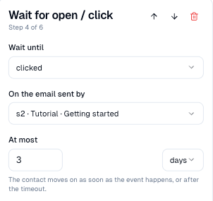
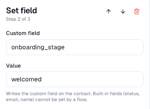
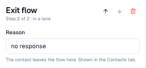

# Steps

Every card under the trigger is a step. This page shows each one and its
settings.

## What it's for

Steps are what the flow does to each contact: send an email, wait, tag them,
write a field, ask an AI agent, hand them to a colleague. The structure steps
(branches) are covered in [Branches and conditions](branches.md), the AI and
human steps in [AI and human steps](ai-steps.md).

## How to add, move and remove a step

- **Add**: choose the **+** on a connector where the step should go, then pick
  it in **Add a step**. Or drag a step from the palette onto a **+** or a lane.
- **Edit**: select the card; its settings open in the side panel.
- **Move**: drag the card to another **+**, or use the ↑ ↓ arrows at the top of
  its panel.
- **Remove**: the bin at the top of its panel.

{ width="65%" }

## Send email

Sends one of your [Emails](../marketing/emails.md), as it is at send time,
with the contact's details filled in, tracking and the unsubscribe link.

{ width="30%" }

**Open the email** opens it in a new tab so you can check the copy.

## Wait

Pauses for a number of minutes, hours or days (from one minute to 365 days).

{ width="30%" }

## Wait for open / click

Holds the contact until they open (or click) an email sent earlier in this
flow, or until **At most** passes, whichever comes first.

{ width="30%" }

Follow it with a [Yes / No branch](branches.md#yes-no-branch) on **Opened or
clicked an email** to treat the two groups differently.

## Add tag and Remove tag

Puts a tag on the contact, or takes one off. Tags are how flows talk to each
other and to your segments.

{ width="30%" }
{ width="30%" }

## Set field

Writes a value into one of the contact's custom fields, for example
`onboarding_stage = welcomed`.

{ width="30%" }

Built-in fields (status, email, name) cannot be set by a flow.

## Exit flow

The contact leaves the flow here, with the reason you type. The reason shows
on the **Contacts** tab.

{ width="30%" }

Exit is always the last step of its lane: nothing can follow it.

## Ask an agent, Task for the owner, Send drafted email

The three steps that bring AI and your team into a flow. See
[AI and human steps](ai-steps.md).

## Add note

Under **Decoration** in the palette, **Add note** puts a sticky note on the
canvas for your colleagues: what a card is for, what to check before
activating. Contacts never see it. Drag a note's corner to resize it and pick
its colour in the side panel. The [Sample flows](samples.md) use them to explain
every card.

## Good to know

- **Merge fields.** Email subjects and task titles can use
  `{{contact_firstname}}`; agent and task instructions also accept
  `{{custom_field_<key>}}` and `{{context.<key>}}` (what earlier steps wrote).
- **Steps run in order, without delay** unless a wait holds them: an email,
  a tag and a field in a row all happen within the same minute.

---

*Still stuck? [Contact support](../contact.md).*
