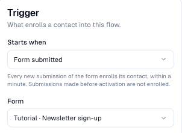
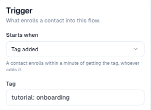
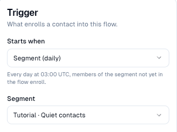

# Triggers

The trigger is the first card of every flow. It decides who enters, and when.

## What it's for

Pick the trigger that matches how your contacts reach you: a sign-up form, a
tag another tool or a colleague adds, a segment you keep up to date, or simply
your own hand-picked list.

## How to choose a trigger

1. In the designer, select the **Trigger** card at the top.
2. Under **Starts when**, choose one of the six triggers below.
3. Fill in what it asks for: the form, the tag, the segment, the schedule.

The trigger card then names what starts the flow, with an icon per trigger.

!!! note "Nothing is backfilled"
    Only events after you activate the flow count: earlier form submissions,
    tags or contacts are never picked up. To include them, enrol them yourself
    (see [Manual](#manual)).

## Manual

Nobody enters on their own. Once the flow is active, choose **Enroll
Contacts…** on the trigger card (or on the flow's **Contacts** tab) and pick
contacts, a segment or a mailing list, up to 2,000 at a time.

{ width="30%" }

Use it to test any flow on yourself, and for one-off sends to a hand-picked
group. *Sample: [Tutorial 1 · Hello world](samples.md#1-hello-world).*

### Start a flow from the assistant

An agent with the **Marketing Automation** tool can do the same from a
conversation: *"Launch Hello world for anna@acme.com and ben@acme.com."* It
works with any active flow, whatever its trigger, for up to 50 emails at a
time.

- Only existing, subscribed contacts enter. The assistant lists every address
  it left out; it never creates a contact.
- A contact already in a flow, or who already went through this one, is
  skipped, as in **Enroll Contacts…**.
- If two flows match the name you gave, the assistant asks which one.

!!! note "Signed-in users only"
    The tool answers the members of your workspace. The public chatbot on your
    website cannot start a flow, even if the tool is ticked on its agent. To
    start a flow for chatbot visitors, use **Tag added** with the tag
    `chatbot`, which the chatbot puts on every lead it captures.

## Form submitted

Every new submission of the chosen form enrols its contact, within a minute.

{ width="30%" }

The form must create or update contacts (see [Forms](../marketing/forms.md)).
*Sample: [Tutorial 2 · Welcome series](samples.md#2-welcome-series).*

## Contact created

Every contact added after activation enrols, within a minute, however it was
added: by hand, an import, a form, the card scanner, an integration.

!!! warning "Every new contact"
    This trigger takes everyone. If only some new contacts should enter, use
    **Tag added** with a tag your import or form sets, or a branch right after
    the trigger with an **Exit flow** lane.

## Tag added

A contact who gets the chosen tag enrols within a minute, whoever adds it: you,
an import, a form, another flow's **Add tag** step, an integration.

Only the moment the tag arrives counts. Editing a contact who already carries
the tag, or giving them another tag, does not bring them in again. To send
someone through again, remove the tag and add it back (with **Re-entry** set
to let them return, see [Flow settings](settings.md)). Tags that were on your
contacts before you activated the flow never start it.

{ width="30%" }

Tags are the easiest way to connect a flow to the rest of your tools.
*Samples: [Tutorial 3](samples.md#3-route-by-interest),
[Tutorial 7](samples.md#7-ai-lead-qualification),
[Tutorial 8](samples.md#8-trial-with-a-stop-rule).*

## Segment (daily)

Every day at 03:00 UTC, members of the segment who are not in the flow yet
enrol.

{ width="30%" }

A contact who joins the segment on Tuesday enters on Wednesday morning. See
[Segments and schedules](segments.md). *Sample:
[Tutorial 4 · Win back quiet contacts](samples.md#4-win-back-quiet-contacts).*

## On a schedule

The segment's members enrol each time the schedule runs: every day, every week
on a given day, or every month on a given date, at a time and timezone you
choose.

{ width="30%" }

Combine it with **Re-entry: after a cooldown** in
[Flow settings](settings.md), or each contact only runs once. *Sample:
[Tutorial 5 · Monthly check-in](samples.md#5-monthly-check-in).*

## Several ways in

A flow that starts on a **form**, a **tag** or a **new contact** can have up
to five more ways in. In the trigger panel, under **Also starts when**, choose
**Add another way in** and pick a form, a tag or new contacts. A contact
enters when any of them happens.

For example, an enquiry flow can start when the enquiry form is submitted *and*
when the website chatbot captures a lead (it tags every lead `chatbot`).

- The trigger card shows **+ 1 more way in**; the **Contacts** tab says which
  one brought each contact.
- A contact who does two of them in the same minute enters once.
- **Manual**, **Segment (daily)** and **On a schedule** flows have a single
  trigger. You can still enrol contacts by hand in any active flow.

## Good to know

- **Several flows at once.** A contact in another flow still enters this one.
  A contact already in *this* flow is skipped and listed under **Skipped** on
  its **Contacts** tab.
- **Form answers.** With **Form submitted**, the answers of the submission
  that started the flow can be read by a branch or a **Wait until…** (as
  `form.<field name>`, for example `form.csat_score`) and written into a
  **Note on contact**. See [Branches and conditions](branches.md#the-conditions).
- **Re-entry.** By default a contact goes through a flow once. See
  [Flow settings](settings.md) to let them come back.

---

*Still stuck? [Contact support](../contact.md).*
