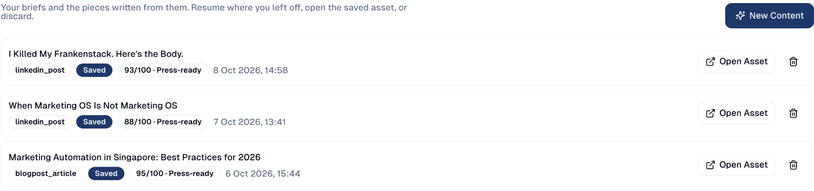

# Content Workspace

Write articles and posts with an AI writer and an AI reviewer: you give a short
brief, the writer drafts in your brand voice, the reviewer scores it, and you
revise until it is ready.

## What it's for

A blank page is slow, and a first AI draft is rarely publishable. The workspace
splits the job: one AI writes, a second one reviews the draft against your brief
and your brand, gives it a score out of 100 and says what to improve. You stay
in charge of what gets saved.

## Before you start

- Your brand voice set up, so the writer sounds like you. See
  [How the AI knows your brand](../settings/brand-voice-memory.md).

## How to write a piece

1. In the sidebar, choose **Content Hub → Content Workspace**, then **New
   Content**. You can also start from a topic in
   [Research & Plan](research-plan.md), or from an action in **Actions**.
2. Fill in the brief: the topic, who it is for, the format (for example a
   LinkedIn post or a blog article) and the tone.
3. The writer drafts the piece, then the reviewer scores it. Read the score and
   the reviewer's notes.
4. Not there yet? Ask for a revision in your own words, for example *shorter,
   with a Singapore example*. Each revision is scored again.
5. When you are happy, save it. It goes to your
   [Content Repository](../workspace/drive.md), ready to edit, schedule or post.

## Your briefs and pieces

The Content Workspace lists every brief with the piece written from it, its
format, its status and its score. Resume one where you left off, open the saved
piece with **Open Asset**, or delete it.

## Good to know

- **The score is a guide, not a gate.** *Press-ready* means the reviewer found
  nothing important to fix; you can still save a lower score.
- **The writer uses your data.** Started from Research & Plan, the brief already
  holds the searches and questions behind the topic.
- **Saving does not publish.** A saved piece is a draft in the Content Repository
  until you post or send it.

---

*Still stuck? [Contact support](../contact.md).*
