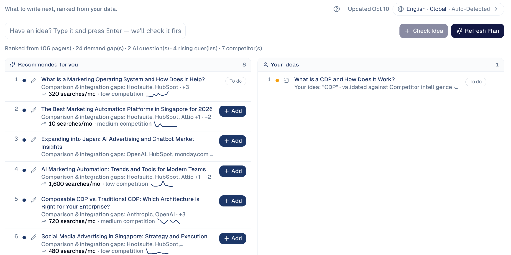
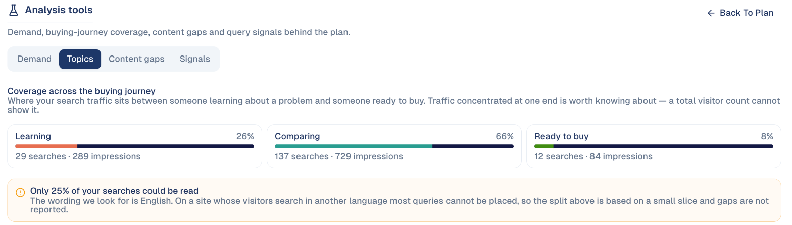
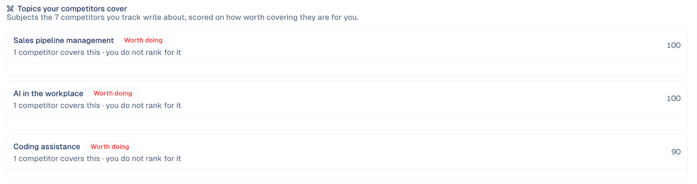
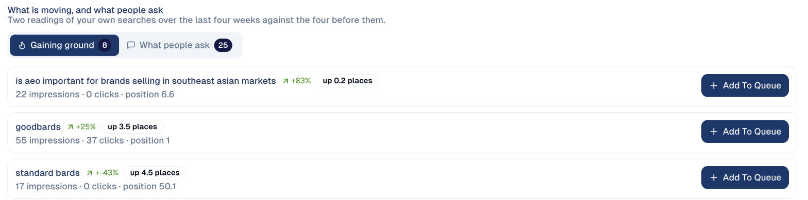

# Research & Plan

What to write next, ranked from your own data: what your market searches for,
the questions people ask AI assistants, and the gaps against your competitors.

## What it's for

Content that nobody searches for brings nobody. Research & Plan looks at your
site, your Search Console data and your competitors, and ranks the topics most
likely to bring visitors, each with its monthly searches and competition.

## Before you start

- **Google Search Console** connected under **Connections**, for your own
  searches.
- Your competitors listed under **Brand & Context → Competitors**.

## How to use it

1. In the sidebar, choose **Content Hub → Research & Plan**.
2. Read **Recommended for you**: each topic with why it is there (for example a
   gap against competitors), its monthly searches, its competition and its trend.

    

3. Choose **Add** on a topic to put it on your list as **To do**, then write it
   in the [Content Workspace](content-workspace.md).
4. Have your own idea? Type it in the box at the top and choose **Check Idea**:
   it is checked against the same data and lands under **Your ideas**.

**Refresh Plan** ranks the topics again from the latest data. The language and
market used, for example *English · Global*, are shown at the top right; choose
them to change.

## The analysis behind the plan

From an idea, choose **Explore demand trend** to open the **Analysis tools**:
four views of the data the plan is ranked from. **Back To Plan** returns.

| Tab | What it shows |
| --- | --- |
| **Demand** | Searches rising around your strongest term, including topics you have nothing for yet. **Add To Queue** turns one into an action. |
| **Topics** | Where your search traffic sits in the buying journey: **Learning**, **Comparing** or **Ready to buy**. Traffic piled at one end is worth knowing about. |
| **Content gaps** | Subjects your competitors write about and you do not rank for, scored on how worth covering they are for you. |
| **Signals** | Your own searches over the last four weeks against the four before: **Gaining ground** (moving up) and **What people ask** (questions in your searches). |

!!! note "Topics reads English wording"
    The buying-journey split looks for English words. On a site whose visitors
    search in another language, only part of the searches can be placed; the
    screen tells you how much.

## Good to know

- **Searches are a monthly average** from Google; a small number in a niche
  market can still be worth it.
- **Low competition is the opportunity.** A topic with steady searches and low
  competition is usually the quickest win.
- **Check your own idea before writing it.** If nobody searches for it, the
  check says so before you spend the time.

---

*Still stuck? [Contact support](../contact.md).*
