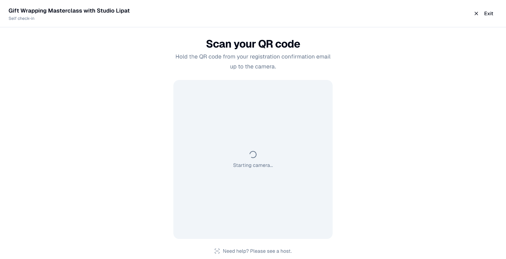

# Check-in and badges

On the day: check guests in with their QR code, at the door or at a self-service
kiosk, and print name badges.

## What it's for

A paper list at the door is slow and tells you nothing afterwards. Every
confirmed guest of a GoodBards event has a personal QR code; scanning it checks
them in in a second, and their attendance is recorded on their contact for the
follow-up.

## Before you start

- A phone, tablet or laptop with a camera.
- Guests confirmed: only confirmed guests receive a QR code, in their
  confirmation email and in the event reminders.

## How to check guests in

Open the event and its **Actions** menu.

- **Scan attendee**: for a host at the door. Point the camera at the guest's QR
  code and the guest is checked in.
- **Kiosk mode**: for self-service. Put a tablet at the entrance; guests hold up
  their QR code and check themselves in. Choose **Exit** to leave kiosk mode.

A guest who lost their email can be found on the **Attendance** tab: search for
their name and set their status to **Attended**.

## How to print badges

1. On the **Attendance** tab, under **Badge**, choose the **Badge label format**
   for your label printer, or keep your company's default.
2. Line 1 is the guest's name. For line 2, pick the form field to print under
   it, for example their company.
3. Choose **Print Test Badge** to check the layout, then print badges from the
   guests' rows.

## After the event

Choose **Actions → End event**. Guests who were not checked in are marked
**Absent**, so the **Follow-up** tab can thank those who came and reach those who
missed it. **Export attendees** downloads the list.

## Good to know

- **The QR code is personal.** It checks in that one registration; a screenshot
  forwarded to a friend still checks in the original guest.
- **Pending and waitlisted guests have no QR code.** They get one in the email
  that confirms their seat.
- **Check the camera before doors open.** The browser asks for permission to use
  it the first time.

---

*Still stuck? [Contact support](../contact.md).*
