# Event emails

The invitation, the reminders, the confirmation and the follow-up: which emails
an event sends, how to make them look like your brand, and how to write your
own.

## What it's for

An event sends a dozen different emails, each to the right people at the right
moment. All of them are ready when you create the event. You can leave them as
they are, change their look in one place, reword any of them, or replace one
with an email you built yourself.

!!! abstract "In short"
    | You want | Do this |
    | --- | --- |
    | Your colours and logo on every event email | Choose a design under **Definition › Email design**. |
    | A different wording for one email | Choose **Edit** on its card, change the text, **Save**. |
    | A completely different email | Choose **Use one of my emails instead** under its card. |
    | To see it before your guests do | Choose **Send Test Email** under its card. |

## The emails of an event

| Email | Who receives it | When | Where to find it |
| --- | --- | --- | --- |
| **Invitation** | Everyone in the event's audience | When you choose **Send Invitations** | **Communications** |
| **Registration reminders** | People in the audience who have not registered yet | On the days you schedule, or with **Send Reminder Now** | **Communications** |
| **Event reminders** | Registered guests only | A number of days or hours before the event | **Communications** |
| **Registration emails** (Confirmed, On the waitlist, Spot opened…) | The guest concerned | Automatically, when the guest reaches that situation | **Registration › Registration emails** |
| **Follow-up** (Attended, Registered but absent, Never registered) | Each group | After the event, scheduled or with **Send Now** | **Follow-up** |

!!! info "Who is in the audience"
    The audience is chosen on the **Definition** tab, under **Audience**: one
    or more contact segments, company segments and mailing lists. They are
    combined, and a person who appears twice is emailed once.

Every email is shown as a card: a preview of what guests receive, with **Edit**
on it, and its buttons underneath.

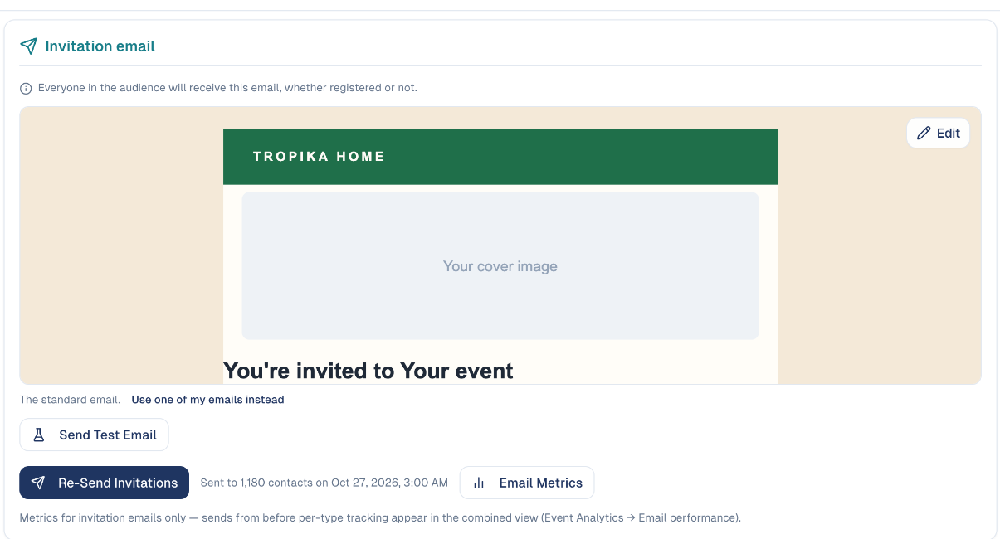

## Before you start

- An **email design** with your logo and colours, if you want the event emails
  to look like your other emails. See
  [Email designs](../marketing/email-designs.md).
- The event's **Definition** tab filled in: the event name, date, place and
  description in every email come from there.

## How to put your brand on every email

One choice changes the look of all the emails of the event.

1. Open the **Definition** tab and scroll to **Email design**.

    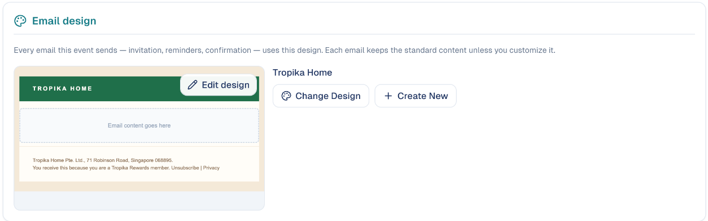

2. Choose **Choose A Design** and pick one of your designs.

    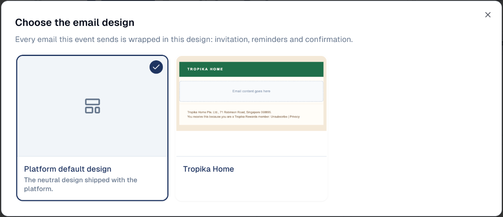

3. The block now shows your design. **Edit design** opens it, **Change
   Design** picks another one, and **Create New** starts a new design.

Go back to **Communications**: every preview now sits inside your design.

!!! note "A design is the frame, not the message"
    The design holds what is common to all your emails: the header with your
    logo, the colours, the footer with your address and the unsubscribe link.
    The message in the middle stays the standard one until you edit that
    email. The neutral platform design cannot be edited: create your own.

To also change **who the emails come from**, fill in **Sender** on the same
tab: **From Name**, **From Email** and **Reply-To Email**. Left empty, the
emails use your workspace's usual sender.

## How to reword an email

1. On the email's card, click the preview or **Edit**. The editor opens.

    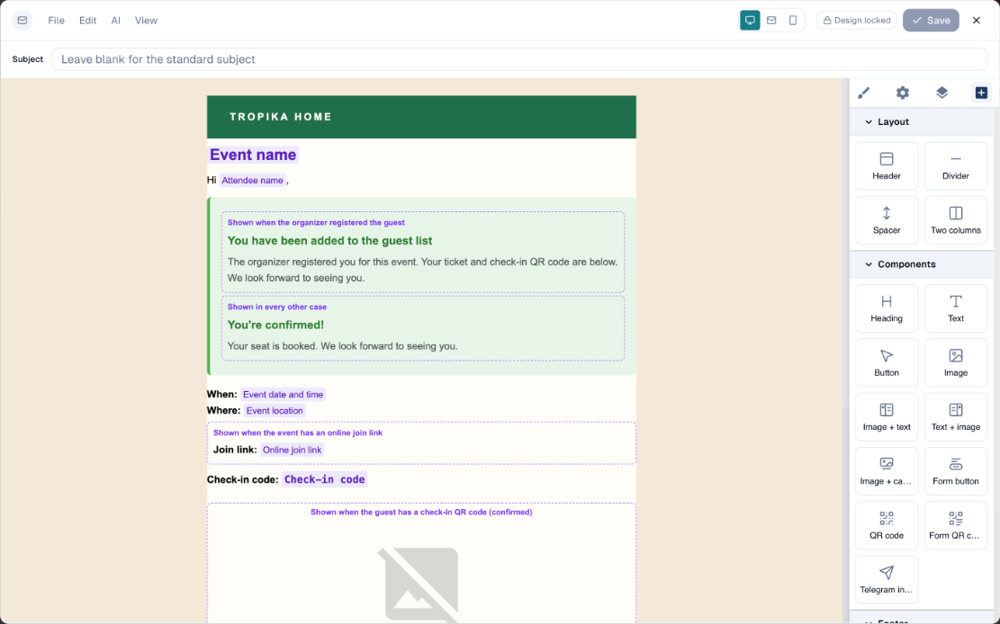

2. Type a **Subject**, or leave it empty to keep the standard one.
3. Double-click a text and change it.
4. Choose **Save**, then close the editor. The card now says *Your own version
   of this email*. **Reset to standard** brings the original back.

Two things in the editor are special to event emails.

**Purple chips** are filled in for each guest when the email is sent: **Event
name**, **Attendee name**, **Event date and time**. To add one, click into a
text and pick it from **Insert field…** in the small toolbar.

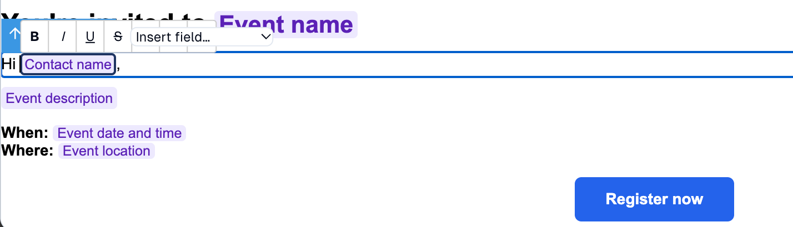

| Field | Becomes |
| --- | --- |
| **Event name**, **Event description** | The name and short description from the Definition tab. |
| **Event date and time**, **Event location** | The date in the event's timezone, and the address or *Online*. |
| **Contact name**, **Attendee name**, **First name**, **Last name** | The person the email is sent to. |
| **Registration link** | The link to the event page, for the invitation. |
| **Check-in code**, **Check-in QR code** | What the guest shows at the door. |
| **Online join link** | The link to join an online event. Confirmed guests only. |
| **Add to calendar link**, **Google Calendar link**, **Outlook link** | Links that add the event to the guest's calendar. |
| **Cancel link** | The link a guest uses to cancel their registration. |
| **Ticket type**, **Slot start**, **Slot end** | The ticket or time slot the guest chose. |
| **Survey link** | The link to your post-event survey, in the follow-up emails. |

**Purple dashed boxes** are parts only some guests see. The title says who:
*Shown when the organizer registered the guest*, *Shown when the event has an
online join link*, *Shown when the guest has a check-in QR code*. Change the
text inside; the box itself cannot be moved or deleted, so the email keeps
working for every guest.

!!! warning "Do not type a field by hand"
    A chip is more than its text. Typing *Event name* in a sentence sends the
    words "Event name" to your guests. Always use **Insert field…**.

!!! tip "The frame is locked on purpose"
    In the editor, **Design locked** means the header and footer come from the
    event's email design. Change them once, under **Definition › Email
    design**, and every email follows.

The **View** menu switches between **Visual editor**, **HTML code** and **AI
assistant**, and **Preview** shows the email without the editing marks. See
[Editing an email](../marketing/emails.md#editing-an-email).

## How to send an email of your own instead

When rewording is not enough, replace an event email with one you built under
**Marketing → Emails**: your layout, your images, your text.

1. Build and save the email first. See
   [Emails](../marketing/emails.md#how-to-create-an-email).
2. On the event, under the card of the email to replace, choose **Use one of
   my emails instead**. The card changes to a single button.

    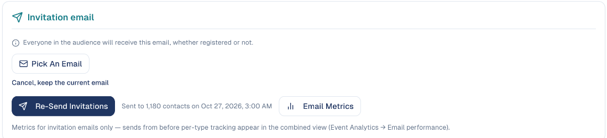

3. Choose **Pick An Email**, select your email, then **Use This Email**.

    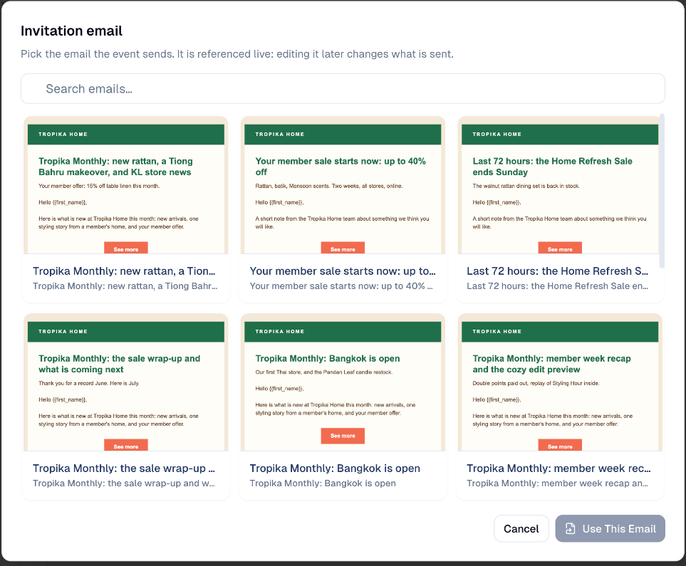

Changed your mind before picking? Choose **Cancel, keep the current email**.

!!! info "Your email is used live"
    The event does not keep a copy: it sends your email as it is at the moment
    of the send. If you edit that email later under **Emails**, the event
    sends the new version.

!!! note "An email of your own contains only what you put in it"
    The standard confirmation and reminders already carry the check-in QR
    code, the calendar links and the cancel link of each guest. For these,
    rewording the standard email is usually the safer choice. Replacing is
    best for the **invitation** and the **follow-up**, where the design
    matters most.

## Reminders

On **Communications**, there are two kinds, each with its own emails.

- **Registration reminders** go to the people you invited who have **not
  registered yet**: *seats are filling up*.
- **Event reminders** go to **registered guests**: *your event starts in 1
  day*, with their check-in code.

Choose **Add Reminder**, then set how long **before the event** it goes out, in
days or hours. Each reminder has its own card, so the email of the day before
can say something different from the email of the last hour. The bin removes a
reminder. **Send Reminder Now** sends one at once.

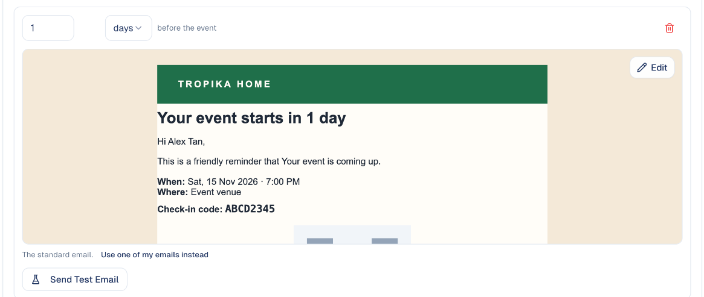

## Registration emails

These are sent one guest at a time, automatically. Open **Registration ›
Registration emails**: the list shows the emails your event can send, and grows
when you turn on **Require Approval** or the **Waitlist**.

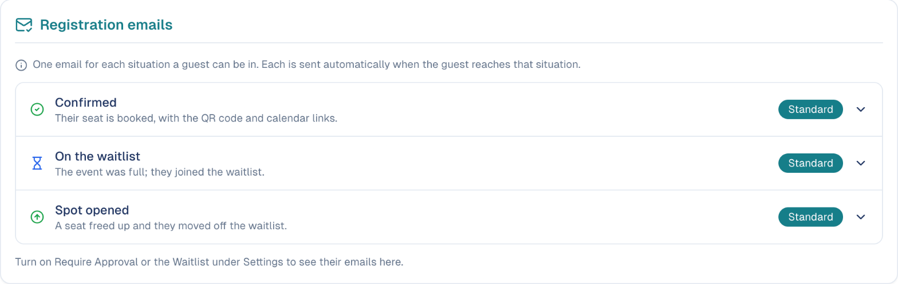

Open a line to see its preview, **Edit** it or replace it, exactly like the
invitation. The label on the right says **Standard** until you change the
email. For when each one is sent, see
[Registration emails](../marketing/event-management.md#registration-emails).

## Follow-up emails

The **Follow-up** tab has one email for each group, once the event is over:

- **Attended**: a thank-you to the guests who checked in.
- **Registered but absent**: *sorry we missed you*, to those who did not come.
- **Never registered**: to the people you invited who did not register.

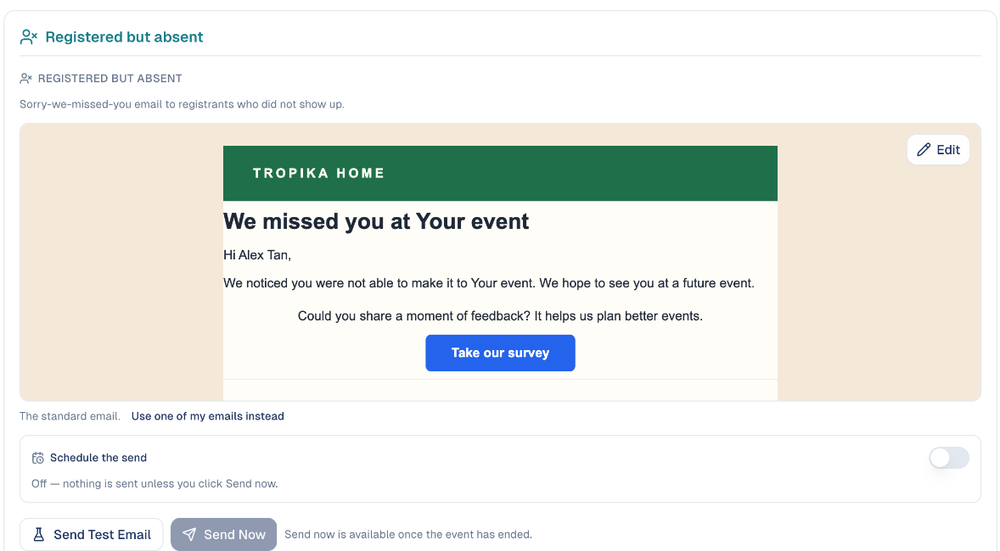

Nothing is sent on its own. For each group, either switch on **Schedule the
send**, or choose **Send Now**, which becomes available once the event has
ended.

!!! tip "Ask for feedback while it is fresh"
    Under **Post-event survey**, at the top of the tab, attach a form (or
    choose **New survey form**). The follow-up emails then link to it through
    the **Survey link** field.

## How to test an email

Every card has a **Send Test Email** button. It works at any time, even while
the event is a draft.

1. Choose **Send Test Email**. The address is filled in with yours; change it
   to send the test to a colleague.
2. Choose **Send Test**, and read the email in that inbox, on a phone too.

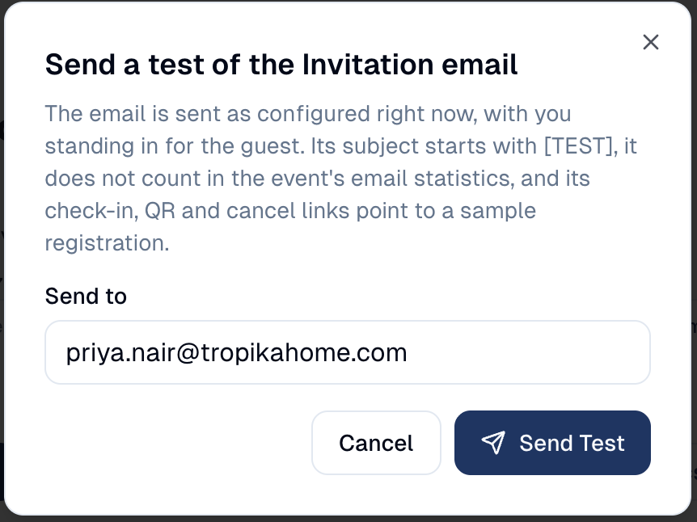{ width="420" }

The test is the email as it is saved right now, with your name in place of the
guest's. Its subject starts with **[TEST]**, and it does not count in the
email metrics. Its check-in, QR and cancel links belong to a sample
registration. The registration link of a test invitation is the real one: if
you fill in the form, you are registered.

## Seeing what was sent

At the bottom of **Communications**, **Sent emails** lists every email the
event has sent, with the time, the number of recipients and who sent it.
**Recipients** shows who received a send, **Metrics** its opens and clicks.

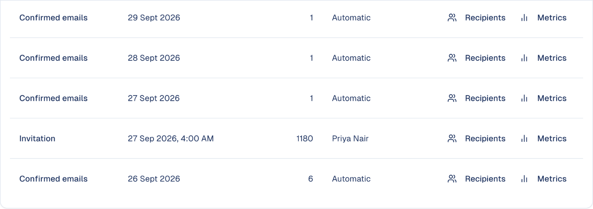

## Good to know

- **Brand first, wording second.** Choose the email design before you edit any
  email: you will then see each email as your guests do.
- **Change event details on the Definition tab.** The name, date and place in
  your emails are fields. Never type them into an email: they would be wrong
  the day the event moves.
- **Test every email you changed.** One test per email, to yourself, before
  the first real send.
- **An edited email stops following the standard.** If GoodBards improves a
  standard email later, your own version stays as you wrote it. **Reset to
  standard** takes the new one.
- **Declined guests can stay unaware.** With **Require Approval** on, you can
  turn the **Declined** email off.

---

*Still stuck? [Contact support](../contact.md).*
