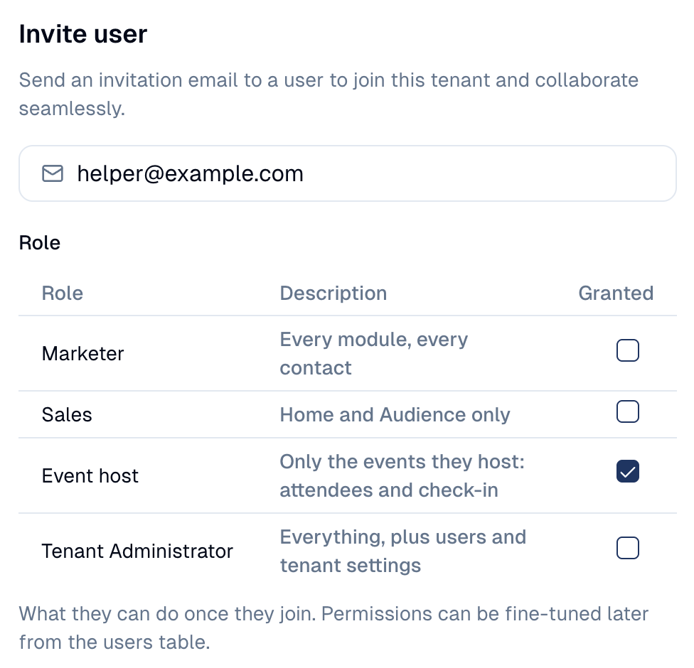
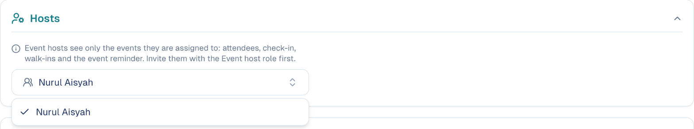
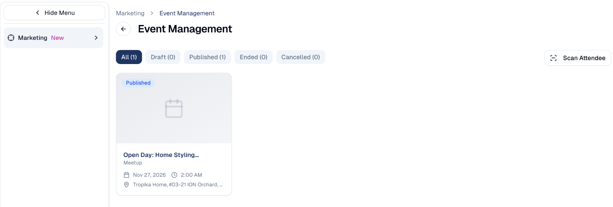
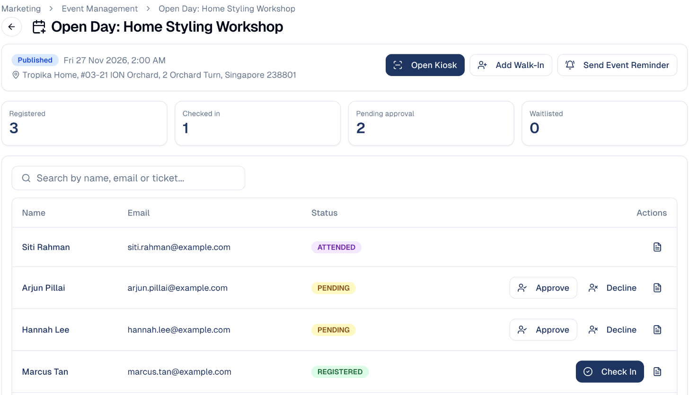
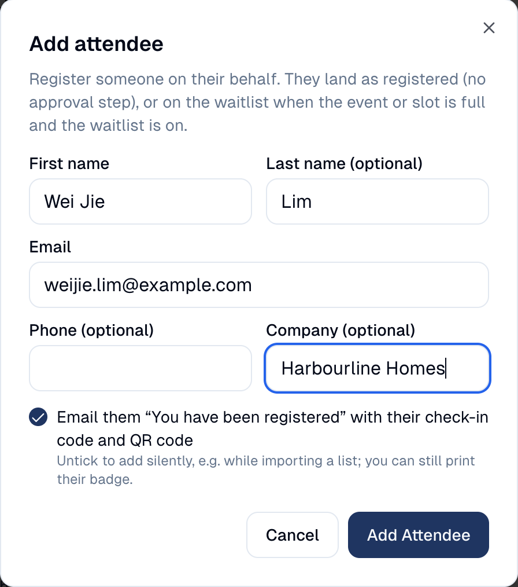
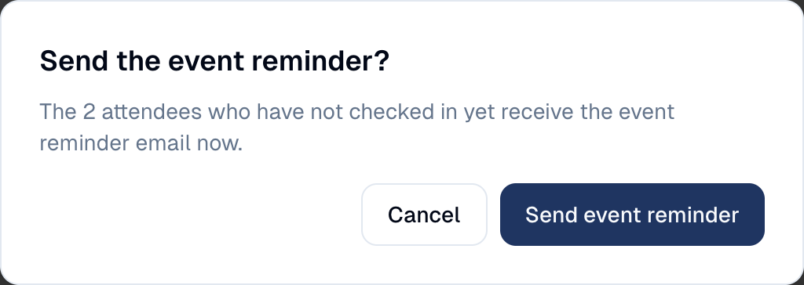

# Event hosts

Give a helper at the door access to one event, and nothing else in your
GoodBards account.

## What it's for

On the day, you often need extra hands at the entrance: a colleague from
another team, a volunteer, a student helper. They need the guest list and the
check-in, but they should not see your campaigns, your contacts or your other
events. An **Event host** sees only the events you assign to them, on a simple
screen made for the door.

## Before you start

- You can edit the event (the **Events** module in read and write, or an
  administrator).
- An administrator invites the helper with the **Event host** role (see
  [Users and roles](../settings/users-roles.md)).

!!! info "A host is a member of your account"
    An Event host signs in with their own email and password, like any other
    member, and counts as a user of your plan.

## How to invite a host

1. Open your account menu (your picture, top right), choose **Tenant
   Settings**, then open the **Security** tab.
2. Under **Users**, choose **Invite user** and enter the helper's email.
3. Tick the role **Event host**, then choose **Send Invitation**.

{ width="40%" }

The helper receives an email and creates their password. Until you assign them
to an event, they see an empty event list.

## How to assign a host to an event

1. Open the event from **Marketing → Event Management**.
2. Open the **Registration** tab, then the **Hosts** block.
3. Tick the people who will work this event. Only members with the **Event host**
   role are listed.

The change is saved at once. To remove a host, untick them.

!!! tip "One host, several events"
    Tick the same person on each event they help with. They see all of them in
    their list.

## What the host sees

When the host signs in, GoodBards opens on **Event Management** with only their
events. The sidebar shows nothing else.

They choose an event to open its host screen:

From there, the host can:

- **See the guest list**, search it by name, email or ticket, and open a guest's
  registration answers and check-in code.
- **Approve or decline** a pending registration.
- **Check a guest in** from their row, or choose **Open kiosk** to scan QR codes
  (see [Check-in and badges](check-in.md)).
- **Add a walk-in**: someone who turns up without registering. Enter their name
  and email; they join the guest list, ready to be checked in.

    { width="40%" }

- **Send the event reminder** to guests who have not checked in yet.

    { width="40%" }

## Good to know

!!! warning "Hosts see guests' names and emails"
    That is what they need at the door. They cannot export the guest list or
    open a guest's contact record, but brief them on handling personal data
    (PDPA) like anyone on your team.

- **A host cannot change the event.** No editing, publishing, cancelling,
  emails, tickets or waitlist moves: those stay with your team.
- **The walk-in form does not search your contacts.** If the email already
  belongs to a contact, GoodBards links the registration to it without showing
  the host anything about that contact.
- **Hosts keep access after the event**, so they can check who attended. Untick
  them in **Hosts**, or remove them from your account, when they no longer need it.
- **Another event is out of reach.** A link to an event they do not host shows
  *Event not available*.

---

*Still stuck? [Contact support](../contact.md).*
