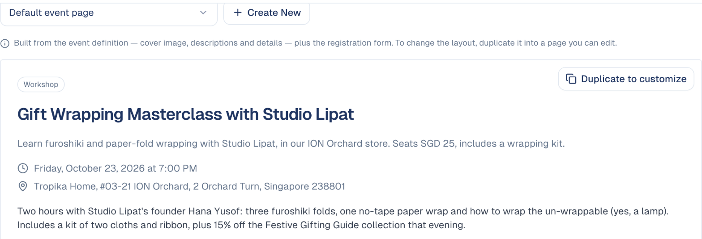
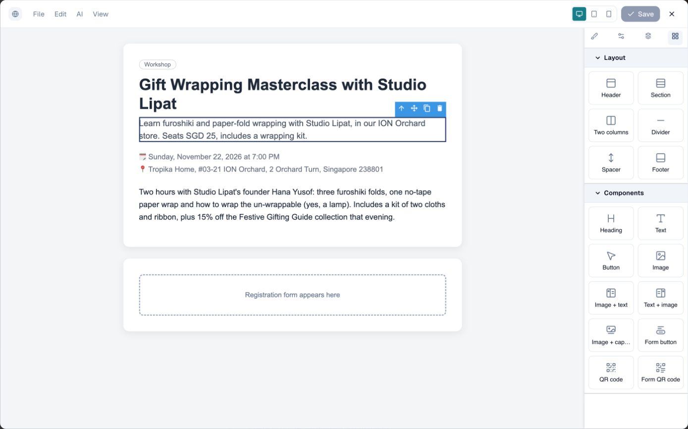
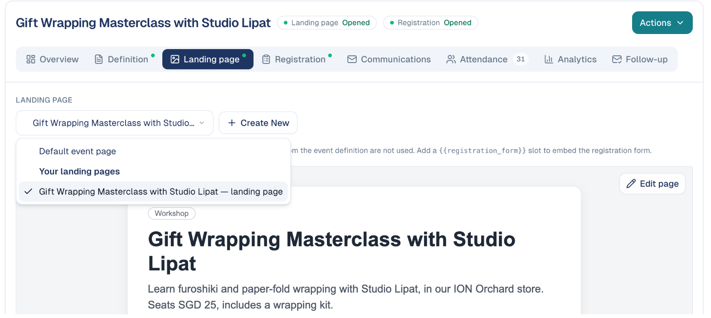
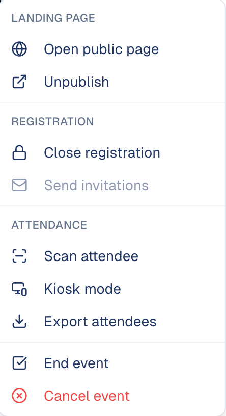

# The event page

The page your guests land on when they follow your invitation: what the event
is, when and where, and the form to register.

## What it's for

Every event gets a page without any work from you. Use it as it is, or make a
copy and lay it out your own way: your photos, your sections, your wording.

!!! abstract "In short"
    | You want | Do this |
    | --- | --- |
    | A page that is always right | Keep the **Default event page**. It is built from the **Definition** tab. |
    | Your own layout | Choose **Duplicate to customize**, then edit the copy. |
    | To change a custom page later | Choose **Edit page** on the preview. |
    | To go back to the default | Pick **Default event page** in the list. Your custom page is kept. |

## Before you start

- An event with its **Definition** tab filled in: description, date, address
  and, ideally, a cover image. See
  [Event Management](../marketing/event-management.md).

## The default page

In the sidebar, choose **Marketing → Event Management**, open your event, and
choose the **Landing page** tab. With **Default event
page** selected, the preview shows the page exactly as guests see it.

The default page is put together from the **Definition** tab, top to bottom:

| On the page | Comes from |
| --- | --- |
| The cover image | **Cover Image** |
| The label above the title (*Workshop*) | **Event Type** |
| The title | The event's name |
| The line under the title | **Short Description** |
| The date and time | **Event Date**, **Start Time** and **Timezone** |
| The place | **Address**, or *Online event* |
| The long text | **Full Description** |
| The form at the bottom | The form chosen under **Registration › Registration form** |

!!! info "The default page updates itself"
    Change the date, the address or the description on the **Definition** tab
    and the page shows it at once. There is nothing to republish.

## How to customise the page

1. On the **Landing page** tab, choose **Duplicate to customize** (or **Create
   New**, next to the list: it does the same).
2. GoodBards creates a page named after your event, selects it for the event,
   and opens it in the editor.

    

3. Change the page:

    - **Edit a text**: double-click it and type.
    - **Add something**: drag a block from the right onto the page. **Layout**
      blocks (Header, Section, Two columns, Divider, Spacer, Footer) organise
      the page; **Components** (Heading, Text, Button, Image, Image + text,
      Text + image, Image + caption) fill it.
    - **Move, copy or remove a block**: select it, then use the small blue bar
      that appears above it.
    - **Check it on a phone**: use the three screen icons at the top, next to
      **Save**.

4. Choose **Save**, then close the editor with the cross.

Back on the tab, the list now shows your page under **Your landing pages**, and
the preview has an **Edit page** button to open the editor again.

!!! warning "Keep the registration form block"
    The dashed box *Registration form appears here* is where your form is
    shown. If you delete it, guests can read the page but cannot register.
    Move it where you like, but keep it.

!!! note "A customized page is a copy"
    Your page starts with the event's details as they were when you copied
    them. From then on it is yours: a later change on the **Definition** tab
    (a new date, a new address) is **not** copied into it. Update the page
    yourself, in the editor. Your event emails still follow the Definition tab.

## How to switch between pages

The list at the top of the tab decides which page guests see:

- **Default event page** goes back to the automatic page. Your custom page is
  not deleted: it stays under **Your landing pages**.
- **Your landing pages** lists the pages made for events. Picking one links it
  to this event at once.

The change is saved as soon as you pick: there is no Save button on the tab.

## How to put the page online

The page is online when the event is published. In the **Actions** menu, top
right of the event:

- **Publish** puts it online; **Unpublish** takes it down.
- **Open public page** shows it as a guest sees it.

{ width="25%" }

The two chips next to the event's name, **Landing page** and **Registration**,
tell you at a glance whether the page is online and whether people can still
register.

## Good to know

!!! tip "Start with the default"
    It is always correct. Customise only when the event deserves its own look,
    not for every event.

- **Fill in the Definition tab first.** The copy takes what is there at that
  moment; a page copied from an empty definition is an empty page.
- **Write the Full Description before copying.** It is the body of the page.
- **The form is separate.** To change the questions, edit the form under
  **Registration › Registration form**, not the page. See
  [Forms](../marketing/forms.md#use-a-form-to-register-for-an-event).
- **Your custom pages are kept with your content.** You also find them in the
  [Content Repository](../workspace/drive.md).

---

*Still stuck? [Contact support](../contact.md).*
