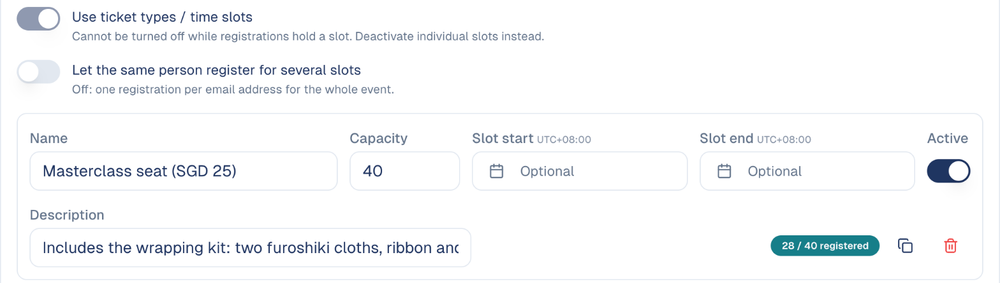

# Ticket types and waitlist

Offer several ticket types or time slots, each with its own number of seats, and
decide what happens when the event is full.

## What it's for

Many events are not one block of seats: a workshop has paid seats and free
observer places, a store opening runs in three time slots. Ticket types let each
guest pick one, and each fills up on its own. When seats run out, the waitlist
keeps the next people in line instead of turning them away.

## Before you start

- An event. See [Run an event from start to finish](../guides/run-an-event.md).

## How to set up ticket types

1. Open the event, then the **Registration** tab.
2. Under **Settings**, set the **Max Capacity** for the whole event.
3. Under **Ticket types**, turn on **Use ticket types / time slots**, then choose
   **Add Ticket Type** for each one: its name, its number of seats, and, for a
   time slot, its own start and end time.

On the registration form, each guest picks one ticket type. The guest's emails
and badge show their own slot and time.

## How the waitlist works

1. Under **Settings**, turn on **Waitlist**.
2. Choose how a freed seat is given:
    - **Automatic**: the next person in line gets it and is emailed straight away.
    - **Manual**: you choose. On **Attendance**, use **↑ Promote** on a waiting
      guest. It only works when a seat is free.

With ticket types, each type has its own waitlist: a seat freed in one slot goes
to someone waiting for that slot.

Guests on the waitlist receive the **On the waitlist** email; when they get a
seat, the **Spot opened** email. See
[Registration emails](../marketing/event-management.md#registration-emails).

## Good to know

- **The overall capacity still applies.** If the ticket types add up to more seats
  than the event's capacity, the event fills before every type does. The screen
  warns you when that happens.
- **Raising the capacity seats people.** In Automatic mode, raising the capacity
  or a ticket type's seats moves the first people in line onto the list, and
  emails them.
- **Cancel with ⊘ to free a seat.** Cancelling a registration with ⊘ offers the
  seat to the waitlist; changing a status from the status menu does not.

---

*Still stuck? [Contact support](../contact.md).*
