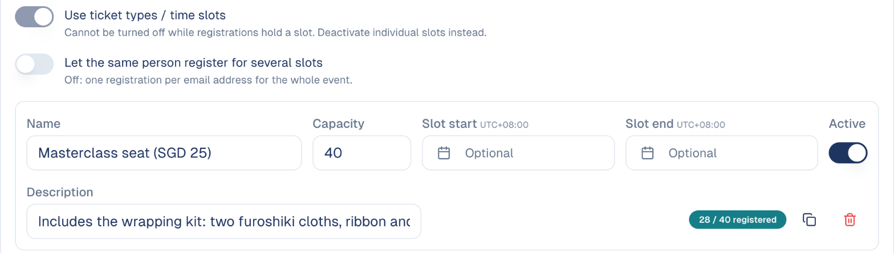
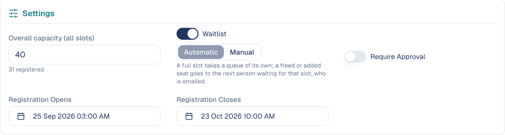

# Ticket types and waitlist

Offer several ticket types or time slots, each with its own number of seats, and
decide what happens when the event is full.

## What it's for

Many events are not one block of seats: a workshop has paid seats and free
observer places, a store opening runs in three time slots. Ticket types let each
guest pick one, and each fills up on its own. When seats run out, the waitlist
keeps the next people in line instead of turning them away.

## Before you start

- An event. See [Run an event from start to finish](../guides/run-an-event.md).

## How to set up ticket types

1. In the sidebar, choose **Marketing → Event Management**, open the event, then
   the **Registration** tab.
2. Under **Settings**, set the **Max Capacity** for the whole event.
3. Under **Ticket types**, turn on **Use ticket types / time slots**, then choose
   **Add Ticket Type** for each one: its name, its number of seats, and, for a
   time slot, its own start and end time.

On the registration form, each guest picks one ticket type. The guest's emails
and badge show their own slot and time.

### Many time slots at once

For interviews, visits or sessions that repeat through the day, do not add the
slots one by one.

1. Under **Ticket types**, choose **Generate time slots**.
2. Give the **Days**, the **Hours** (add a second range to skip lunch), the
   **Slot length** in minutes and the **Seats per slot**.
3. Read the summary at the bottom: the number of slots, the first and the last.
4. Choose **Create slots**.

<!-- SCREENSHOT TO ADD: the Generate time slots dialog filled with 2 days, 09:00-12:00 and 14:00-17:00, 30 minutes, 4 seats, showing "24 slots over 2 days (12 per day)" -->

!!! tip "Example"
    Two days, 09:00 to 12:00 and 14:00 to 17:00, slots of 30 minutes with 4
    seats: 24 slots, 12 per day, named by their day and time.

!!! note "Good to know about generated slots"
    - Times are in the event's time zone, shown at the top of the window.
    - Hours that do not fill a whole slot are left out, and the summary says so.
    - Generating the same slots twice is refused. To add a second series on the
      same hours, give it a **Name prefix**, such as *Interview*.
    - Each slot is an ordinary ticket type afterwards: rename it, change its
      seats or switch it off in the list.

You can also ask the assistant, in one sentence. See
[Asking the assistant](../marketing/event-management.md#asking-the-assistant).

## How the waitlist works

1. Under **Settings**, turn on **Waitlist**.
2. Choose how a freed seat is given:
    - **Automatic**: the next person in line gets it and is emailed straight away.
    - **Manual**: you choose. On **Attendance**, use **↑ Promote** on a waiting
      guest. It only works when a seat is free.

!!! info "One waitlist per ticket type"
    With ticket types, each type has its own waitlist: a seat freed in one slot
    goes to someone waiting for that slot.

Guests on the waitlist receive the **On the waitlist** email; when they get a
seat, the **Spot opened** email. See
[Registration emails](../marketing/event-management.md#registration-emails).

## Good to know

!!! note "The overall capacity still applies"
    If the ticket types add up to more seats than the event's capacity, the
    event fills before every type does. The screen warns you when that happens.

- **Raising the capacity seats people.** In Automatic mode, raising the capacity
  or a ticket type's seats moves the first people in line onto the list, and
  emails them.
- **Cancel with ⊘ to free a seat.** Cancelling a registration with ⊘ offers the
  seat to the waitlist; changing a status from the status menu does not.

---

*Still stuck? [Contact support](../contact.md).*
