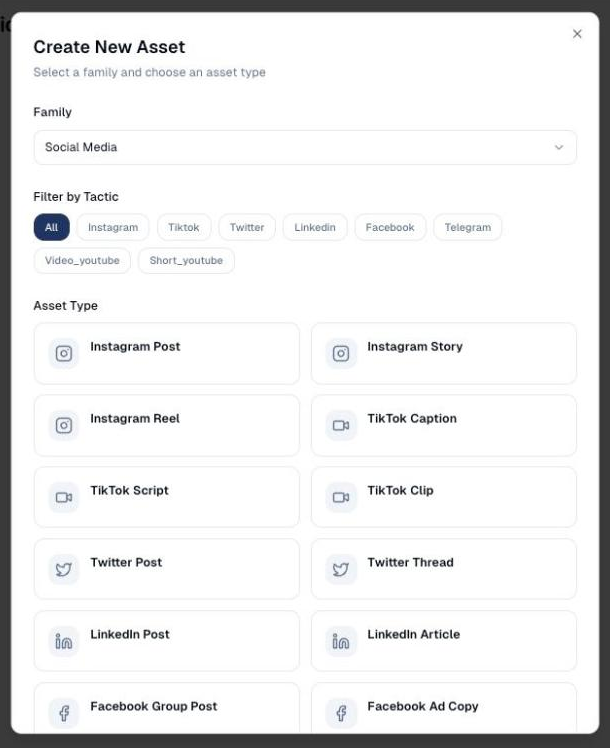
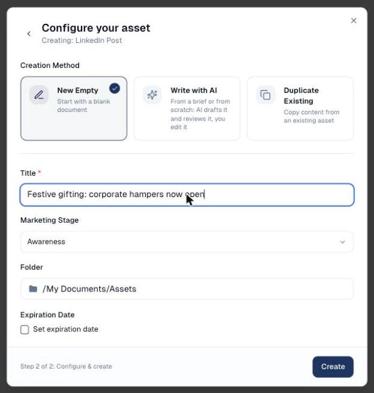
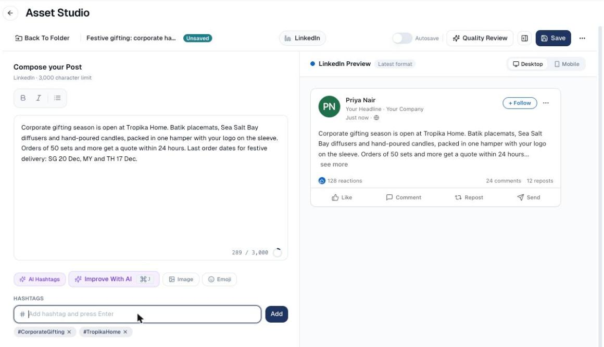
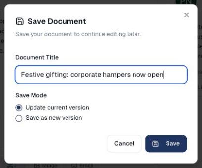
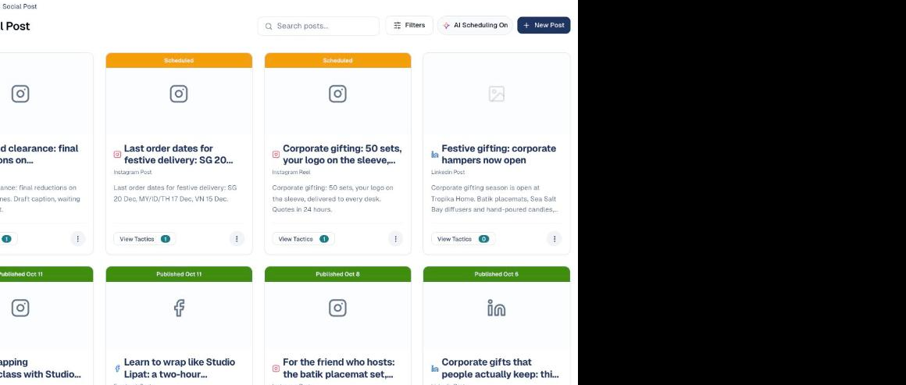
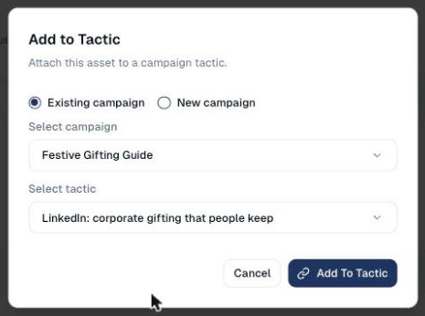
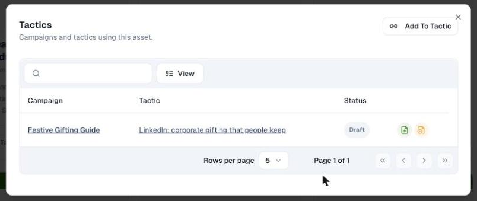
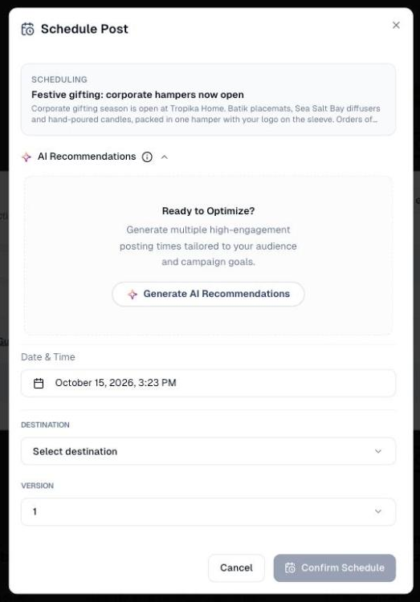

# Create a social post from scratch

Write one post yourself, by hand, save it as an asset, add it to a campaign and
publish or schedule it. This is the quickest way to get a single post out when
you already know what you want to say.

## What it's for

Not every post needs a brief or an article behind it. A quick announcement, a
reminder of a deadline, a reply to something in the news: you type it, check it
in the network's preview, and send it. The post is still saved as an asset in
your Content Repository and still goes out through a campaign, so its results
count with the rest.

## Before you start

- **A connected account** for the network you post to: LinkedIn, Facebook,
  Instagram, X or TikTok. See [Connections](../settings/connections.md).
  Without it, **Publish** and **Schedule** stay greyed out.
- **A campaign with a tactic for that network**, to publish from. If you have
  none yet, you can create one as you go (step 3).

## 1. Create the asset

1. In the sidebar, choose **Social Media → Social Post**, then **New Post**.
2. In **Create New Asset**, leave **Family** on **Social Media** and pick the
   **Asset Type**: for example **LinkedIn Post**, **Instagram Post (images)**,
   **Instagram Reel (video)** or **Facebook Post**. Use **Filter by Tactic** to
   show one network only.

    

3. Choose **Next**.
4. Under **Creation Method**, keep **New Empty**. *(**Write with AI** drafts the
   post for you; **Duplicate Existing** copies one of your posts. Both are
   covered in [Social Post](../social-media/social-post.md).)*
5. Type a **Title**. It names the asset in your lists; it is not part of the
   post. Leave **Marketing Stage** and **Folder** as they are unless you sort
   your assets.

    

6. Choose **Create**. The post editor opens.

## 2. Write the post

1. Type your text under **Compose your Post**. The counter shows how much of
   the network's limit you have used, and the preview on the right shows the
   post as it will appear, on **Desktop** or **Mobile**.
2. Add hashtags under **Hashtags**: type one and press ++enter++. **AI
   Hashtags** suggests some once the post has ten words.
3. Choose **Image** to attach a picture from your Content Repository, or
   **Emoji** to insert one. **Improve With AI** rewrites the post from an
   instruction (*shorter, add a question at the end*).

    

    On LinkedIn, **Insert → Video…** or **Insert → Document (PDF, PowerPoint,
    Word)…** attaches a video or a document instead of a picture. For an
    Instagram Reel, pick the video first. See
    [Videos, documents, Reels and stories](../social-media/social-post.md#videos-documents-reels-and-stories).

4. Choose **Save** at the top right. In **Save Document**, check the title and
   choose **Save** again.

    

The message **Asset created** confirms it. Back on **Social Post**, your post
is a card with **View Tactics 0**: it exists, but it is not attached to any
campaign yet.

## 3. Add it to a campaign

1. On the post's card, choose **View Tactics**, then **Add To Tactic**.
2. Keep **Existing campaign**, choose the campaign under **Select campaign**,
   then the tactic under **Select tactic**. Only tactics for the post's network
   are offered.

    

    *No campaign for it yet?* Choose **New campaign** instead, give it a name
    and a marketing objective, and choose **Create & Launch**.

3. Choose **Add To Tactic**. The **Tactics** window now lists the campaign and
   tactic, with the post as **Draft** and two buttons on the row: **Publish**
   and **Schedule**.

    

## 4. Publish or schedule it

- **Publish** sends it now: choose the **Destination** (the page or account to
  post to) and confirm.
- **Schedule** sends it later: pick a **Date & Time**, or choose **Generate AI
  Recommendations** for the best slots for your audience, then the
  **Destination**, then **Confirm Schedule**.

    

For Instagram, **Publish as** sets whether it goes out as a **Post** or a
24-hour **Story**.

The band on the post's card then reads **Scheduled** or **Published** with the
date. A post with a video or a document shows **Sending** for a few minutes
first, while the network processes the file. You can also do both from the campaign: open the tactic, and under
**Asset Management** use the post's **⋮** menu.

## Good to know

- **Save before you leave the editor.** The editor does not save on its own
  unless you switch **Autosave** on at the top. Leaving with **Unsaved** on the
  title loses the post.
- **One asset, one network.** A LinkedIn post can only go to a LinkedIn tactic.
  For the same message on several networks, create one asset per network, or
  write them in one go with **Write with AI** or from an article: see
  [Social Post](../social-media/social-post.md).
- **Character limits are per network**: 3,000 on LinkedIn, 280 on X, 2,200 on
  Instagram and TikTok. The counter turns red past the limit.
- **Instagram needs a picture or a video.** A text-only Instagram post cannot
  be published.
- **Published posts are locked.** You cannot edit or delete them from
  GoodBards once they are out.

---

*Still stuck? [Contact support](../contact.md).*
