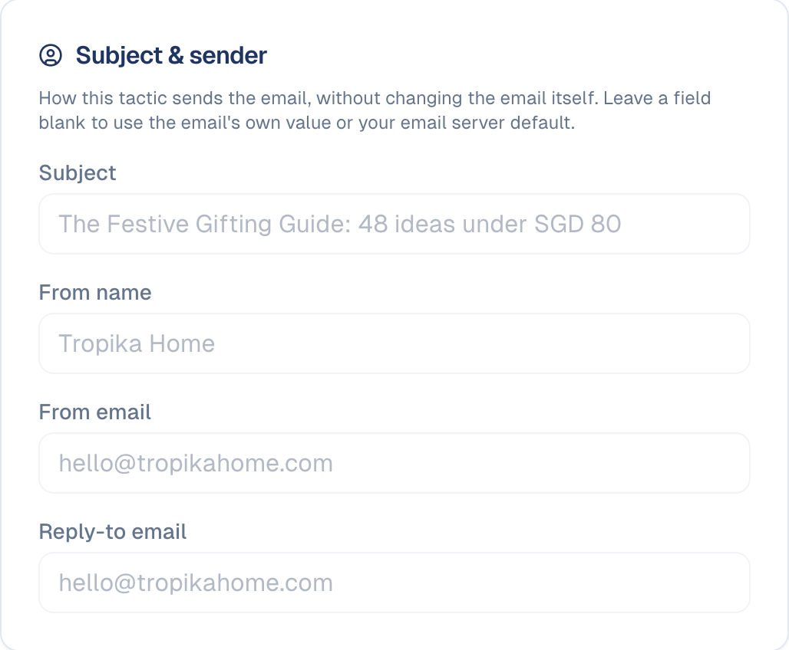
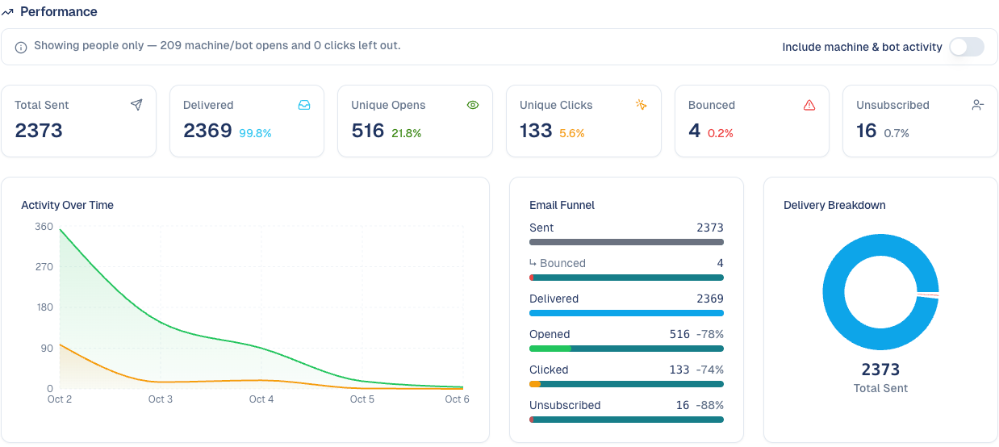
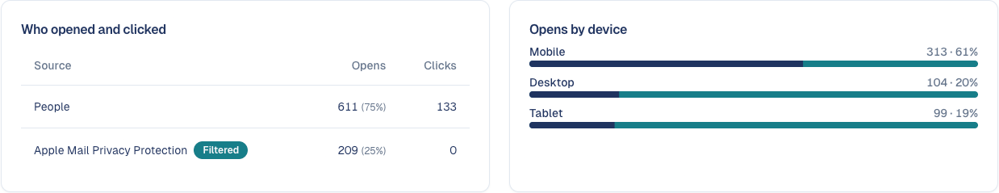
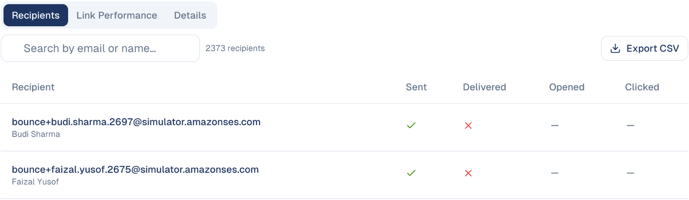
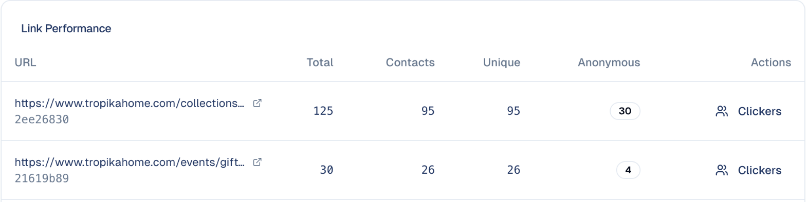

# Run an email marketing campaign

Choose who to reach, write the email, send it from a campaign, and read what
happened.

## What it's for

A newsletter or a promotion is more than one email: it has an audience, a goal,
a send date and results you will want to compare with the next one. Running it
as a tactic inside a campaign keeps all of that together, and the results feed
the campaign report.

## Before you start

- A **mailing list** or a **segment** to send to. See
  [Mailing lists](../audience/mailing-lists.md) and
  [Contacts](../audience/contacts.md#segments).
- An **email design** with your brand, so you only write the content. See
  [Emails](../marketing/emails.md).
- Your email sending set up under **Connections**. Until it is, the tactic shows
  *You need to setup your email provider*.

## 1. Set up the campaign

1. Choose **Marketing → Campaigns**, then **Create New Campaign** (or open an
   existing one).
2. Fill in the objective, dates, audience and description. The description is
   what the AI reads when it writes for this campaign, so say who you target and
   what you offer.

See [Campaigns](../marketing/campaigns.md).

## 2. Add the email tactic

1. In the campaign, under **Tactics**, choose **Add Tactic** and pick **Email
   Campaign**.
2. Give it a name and a **Send date**.

## 3. Write the email

1. Open the tactic. Under **Email Management**, choose **Add Email**: create a
   new one, or pick one from your Email Gallery.
2. Write it in the editor, or let the AI draft it from the campaign's
   description. To greet each recipient by name, type `{{contact_firstname}}`
   where the name should go; see
   [Personalising an email](../marketing/emails.md#personalising-an-email).
3. Under **Subject & sender**, set the subject and who it comes from for this
   send. Leave a field blank to use the email's own value or your default.

    

4. Under **Recipients**, choose the mailing list or segment.

## 4. Test, then send or schedule

1. Send yourself a test and check it on your phone and in Gmail or Outlook.
2. Send now, or let it go at the send date. The email shows **Published** with
   the date once it is out.
3. To reach more people later, for example contacts who joined the list since,
   use **Send To More People**.

## 5. Read the results

The tactic's **Performance** panel shows how the email did:

- **Sent**, **Delivered**, **Unique Opens**, **Unique Clicks**, **Bounced** and
  **Unsubscribed**, each with its rate.
- **Activity Over Time**: opens and clicks day by day after the send.
- **Email Funnel**: from sent to clicked, where people dropped off.

Opens by mail-provider robots and security scanners are left out, so the open
rate reflects people. Turn on **Include machine & bot activity** to see
everything.

Below the funnel:

- **Who opened and clicked** separates real people from **Apple Mail Privacy
  Protection**, which opens every email automatically and is filtered out of
  your open rate. **Opens by device** shows mobile, desktop and tablet.

    

- **Recipients**: each recipient with whether the email was sent, delivered,
  opened and clicked. Search by email or name, and **Export CSV** for your own
  analysis.

    

- **Link Performance**: each link with its total clicks, clicks by known
  contacts, unique clickers and anonymous clicks. **Clickers** lists who
  clicked a link: a ready-made list of interested people.

    

- **Details**: every count in one table: sent, delivered, opens, clicks,
  bounces, errors and unsubscribes.

The same figures appear in the campaign's **Analytics** tab, next to the other
tactics. See [The campaign report](../marketing/campaigns.md#the-campaign-report).

## Good to know

- **Only subscribed contacts are emailed.** Contacts who unsubscribed, or never
  gave consent, are left out of the send automatically.
- **A tactic sends one email.** For a reminder or a follow-up, add another email
  tactic to the same campaign; each keeps its own results.
- **Compare like with like.** Open rates vary with the list and the day; compare
  this email with earlier sends to the same list.
