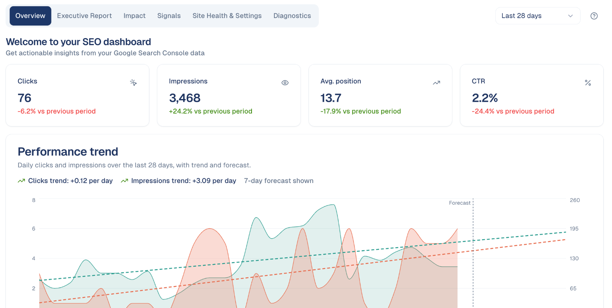

# Improve your presence with SEO

Get found by people searching for what you do, in Google and in AI assistants,
and see the effect of your work in clicks.

This guide follows one loop: see where you stand, fix the pages that matter,
write what your market searches for, and measure. Count about an hour to set up,
then a regular hour a week.

## 1. Connect your site

Under **Settings → Connections**, connect **Google Search Console** for your
website, and **Google Analytics**. Search Console gives clicks, impressions and
positions; Analytics says what visitors did once they arrived.

See [Connections](../settings/connections.md).

!!! tip "Check the connection"
    If a screen stays empty, open **Organic Visibility → Performance & Report →
    Diagnostics**: it shows which site and property every screen reads, and
    whether each Google connection answers.

## 2. See where you stand

Open **Organic Visibility → Performance & Report**. Note four numbers for the
last 28 days: clicks, impressions, average position and click rate, and whether
the trend goes up or down.

This is your starting point. The **Executive Report** tab puts it on one page
for your manager.

See [Performance & Report](../website/performance-report.md).

## 3. Fix the pages that matter most

Open **Organic Visibility → Page Fixes**. The pages are ranked by the clicks a
fix could bring. Start with **Low CTR**: pages people see but do not click. A
better title and description take minutes.

Choose **Add To Queue** on the fixes you will do. They land in **Actions**, with
the steps, so the work is tracked until it is verified.

See [Page Fixes](../website/page-fixes.md) and [Actions](../workspace/actions.md).

## 4. Write what your market searches for

Open **Content Hub → Research & Plan**. The topics are ranked from your own data:
searches you could win, questions people ask, gaps against your competitors.
Pick one with steady searches and low competition.

Write it in the **Content Workspace**: the AI writer drafts it in your brand
voice from the topic's data, the reviewer scores it, and you revise until it is
ready. Publish it on your site.

See [Research & Plan](../content-hub/research-plan.md) and
[Content Workspace](../content-hub/content-workspace.md).

## 5. Make sure AI assistants can quote you

Open **Organic Visibility → AI Readiness & Authority**. The score shows whether
assistants such as ChatGPT or Gemini can read and trust your pages. The lowest
pillar is usually **Answers & FAQ**: add the questions your customers really ask,
with short answers.

See [AI Readiness & Authority](../website/ai-readiness.md).

## 6. Measure, a few weeks later

Search results take two to six weeks to react. Come back to **Performance &
Report**:

- **Impact** shows what your shipped work actually changed.
- **Content Hub → Momentum** shows the pages rising right now: give them a push
  while the trend is with you, for example in your next newsletter.

See [Momentum](../website/momentum.md).

## Your weekly hour

1. **Performance & Report:** the four numbers, and any pattern detected.
2. **Page Fixes:** add the top one or two to the queue.
3. **Actions:** finish what is in progress.
4. **Momentum:** push one rising page.
5. **Research & Plan:** write one new piece a week or two.

## Good to know

- **Position going down is good.** Position 1 is the top of the results.
- **Do not judge a change after a few days.** Search Console data is two to three
  days behind, and rankings move slowly.
- **One good page beats five thin ones.** Write fewer pieces, each answering a
  real search fully.
