# Run an event from start to finish

From the first invitation to the thank-you email: everything an in-person,
online or hybrid event needs, in the order you will do it. Allow about an hour
to set up your first event; later ones go faster because you can duplicate them.

## What it's for

An event touches every part of your marketing: your audience, a landing page, a
registration form, several emails, check-in at the door and the follow-up.
GoodBards keeps all of it on one event page, and every guest who registers
becomes a contact you can market to afterwards.

## Before you start

- Your **Brand Kit**, so the landing page and emails look like you. See
  [Brand Kit](../settings/brand-kit.md).
- The people you will invite, as a segment or a mailing list. See
  [Contacts](../audience/contacts.md).

## 1. Create the event

1. In the sidebar, choose **Marketing → Event Management**. Your events are
   listed as cards, with their status, date, place and registrations.

    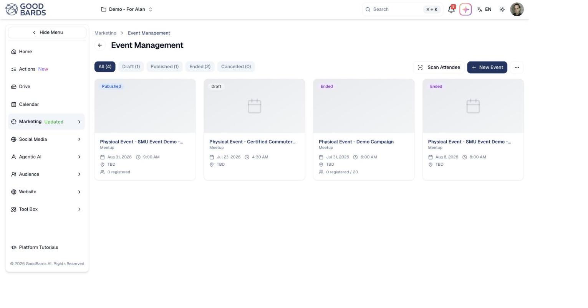

2. Choose **New Event**, then give it a name, a date and time, and a place.
3. Open the event. It starts on the **Overview**: registrations against capacity,
   invitations sent, days to go, and quick actions such as **Copy Registration
   Link**. The tabs follow the life of the event, from left to right.

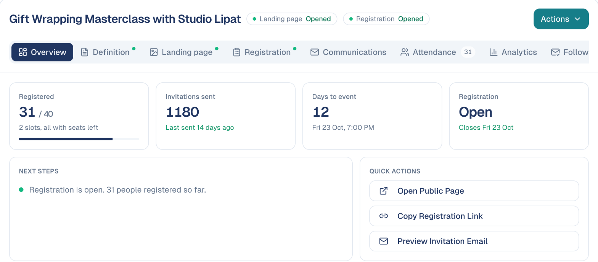

The dots on a tab show it is set up. Everything saves on its own: there is no
Save button on the event page.

## 2. Describe the event

On the **Definition** tab:

1. Set the **Event Type**, the **Format** (in person, online or hybrid) and the
   **Visibility**.

    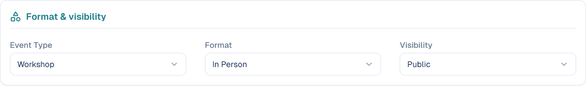

2. Under **About the event**, write a **Short Description**, the **Address**, and
   choose a **Cover Image**. These appear on the landing page and in every email.

    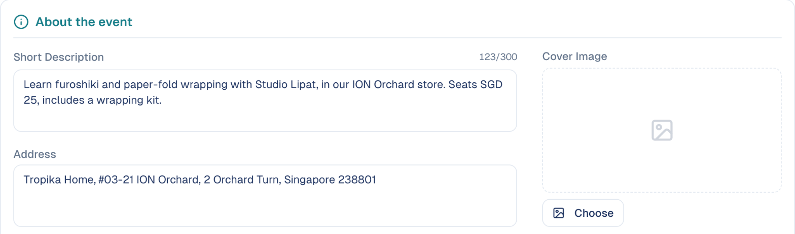

3. For an online or hybrid event, add the **Join link**. Only confirmed guests
   receive it.

The event's name, date and place in every email come from this tab. To change
them, change them here, never inside an email.

The **Landing page** tab shows the page guests register on, built from what you
just wrote. To change its layout, choose **Duplicate to customize**.

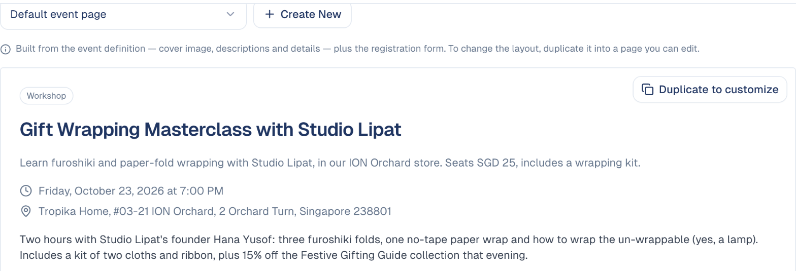

## 3. Prepare the registration

On the **Registration** tab:

1. Under **Settings**, set the **Max Capacity**, when registration opens and
   closes, and whether to **Require Approval**.
2. Turn on the **Waitlist** if the event can fill up, and choose how a freed
   seat is given: **Automatic** (the next person in line is seated and emailed)
   or **Manual** (you choose).

    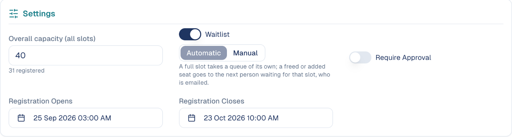

3. The blocks below are folded; click a title to open one.

    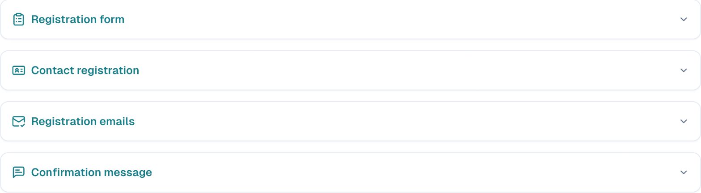

4. Under **Registration form**, keep the default form (name, email, company, job
   title) or choose one of your own. See [Forms](../marketing/forms.md).
5. Under **Contact registration**, check which form fields fill in the contact:
   email, first and last name, and anything else you want to keep with **Add
   Mapping**. Changes save on their own.

    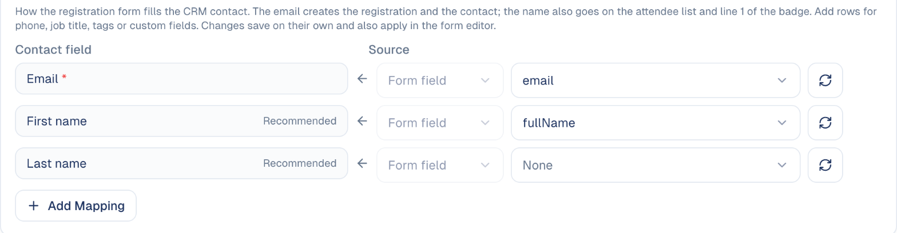

## 4. Set up the emails

Each guest receives the right email for their situation automatically. Under
**Registration emails**, the list shows the emails your event can send, and
grows when you turn on approval or the waitlist.

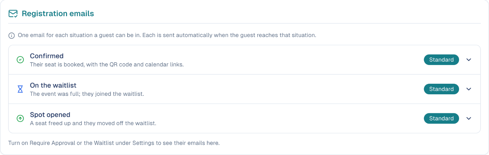

To change one:

1. Open it and choose **Edit** on the preview.
2. Change the **Subject** at the top and the text in the editor, then choose
   **Apply**.

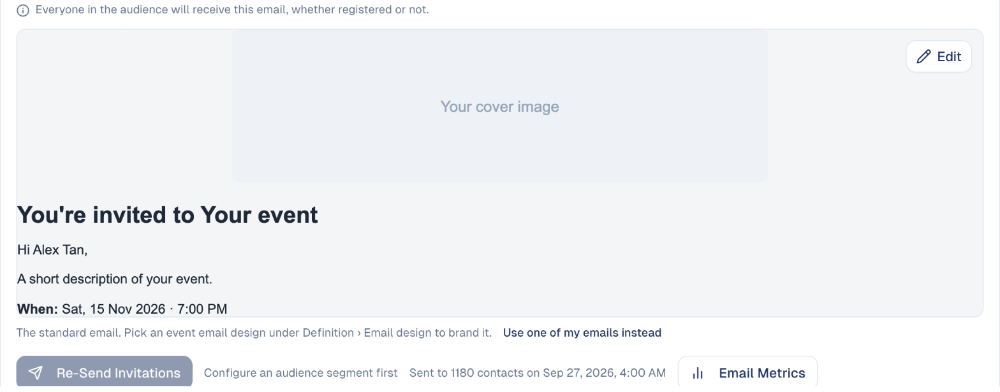

The invitation and the reminders work the same way, on the **Communications**
tab. See [Editing an email](../marketing/event-management.md#editing-an-email).

## 5. Invite your audience

1. On the **Communications** tab, under **Invitation email**, choose the audience
   to invite.
2. Choose **Send Invitations**. You can also send them from the **Actions** menu.
3. Add **Registration reminders** for people who have not registered yet, and
   **Event reminders** for guests, for example one day and one hour before.

At the bottom of the tab, **Sent emails** lists every email the event has sent,
with the number of recipients.

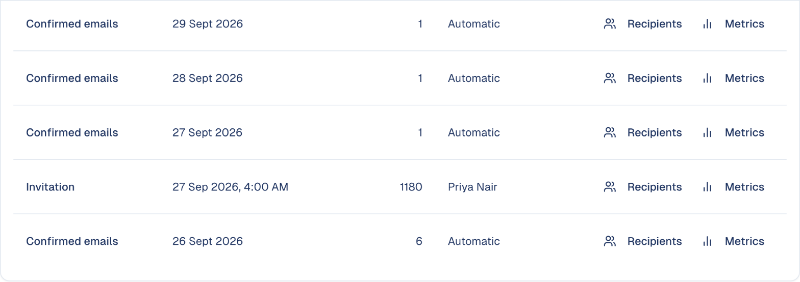

### Promote it on social media

On the **Overview** tab, **Promote On Social** writes the event's posts for
you: the announcement, a reminder, a last call and a *happening today* post,
from the event's own facts and with its cover image, for the social channels of
the campaign.

The posts arrive as **drafts** on the campaign's social tactics, each with a
suggested date counted back from the event. Nothing is published until you
schedule it. The button is not available for private events or events without a
date. See also [Social Post](../social-media/social-post.md).

### Show your events on your website

In **Marketing → Event Management**, the menu at the top right offers **Open
public page** (the page listing all your public events) and **Embed form**. The
embed gives you a code to paste into your website, with a light, dark or
automatic theme and a list or grid layout, so visitors see and register for
your events without leaving your site.

## 6. Manage registrations

The **Attendance** tab lists every guest, their status and the last email they
received.

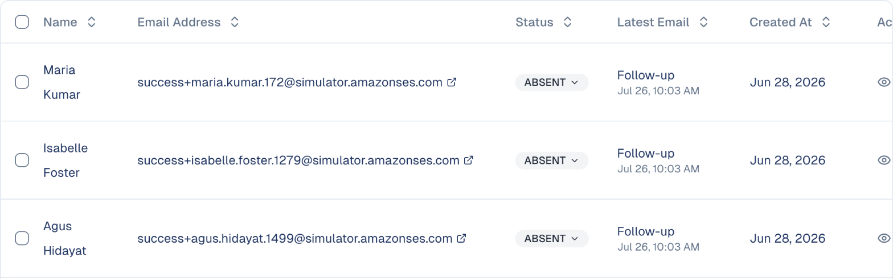

- **Approve** or decline requests when approval is on.
- **↑ Promote** a waiting guest when the waitlist is in **Manual** mode.
- **Add Attendee** to register someone yourself, for example from a phone call.
- The eye icon opens a guest's **history with this event**: what was sent,
  delivered, opened and clicked. Useful when a guest says they never got their
  confirmation.

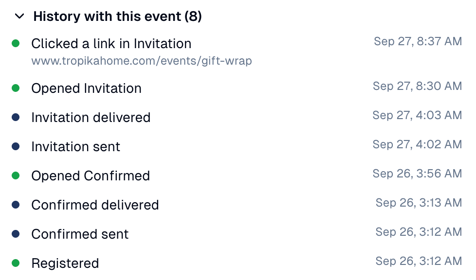

## 7. On the day

Every confirmed guest has a QR code in their confirmation and reminder emails.

1. Open the **Actions** menu.
2. Choose **Scan attendee** to check guests in with your phone or laptop camera,
   or **Kiosk mode** to let them check themselves in at the entrance.
3. To print name badges, set the format under **Attendance → Badge**, then use
   the print icon on a guest's row.

    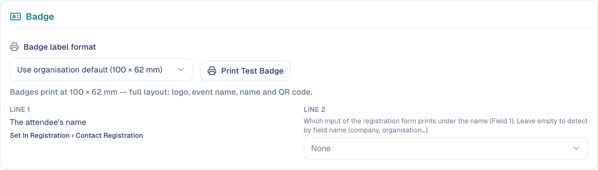

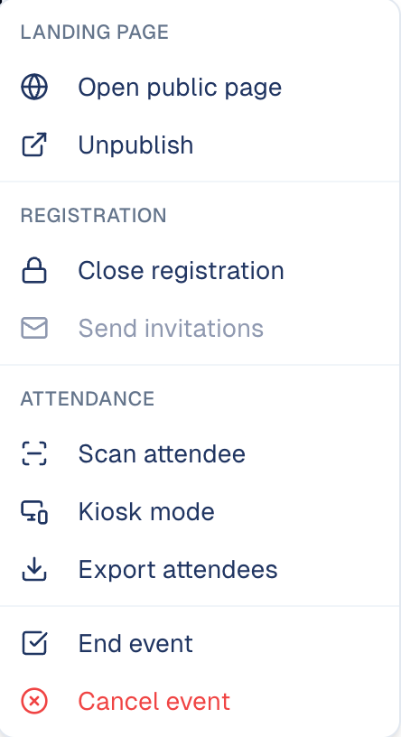

See [Check-in and badges](../events/check-in.md) for the details.

## 8. Follow up

1. When the event is over, choose **Actions → End event**. Guests who were not
   checked in are marked as absent.
2. On the **Follow-up** tab, set the email for those who attended, those who did
   not, and those you invited who never registered. Attach a survey form if you
   want feedback.
3. On the **Analytics** tab, see registrations broken down by status or by any
   form field, and choose **Email Performance** to see how every event email did.

    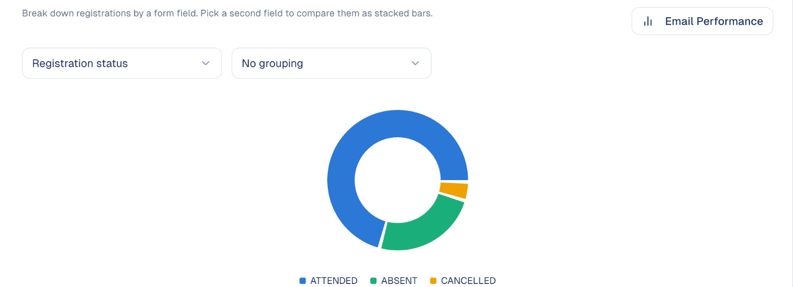

4. If you attached a survey to the follow-up, its answers appear on the
   **Follow-up** tab as charts per question, with a CSV download.

### Cancelling an event

**Actions → Cancel event** cancels it. Every registered guest is emailed that the
event is cancelled, and it cannot be undone. To stop new registrations but keep
the event, use **Close registration** instead.

## Good to know

- **Publish before you share the link.** A draft event does not accept
  registrations.
- **Cancel a registration with ⊘, not with the status menu.** ⊘ emails the guest
  and offers the seat to the waitlist; the status menu only corrects the list.
- **Every guest becomes a contact.** After the event, find them in your audience
  and follow up with a normal email or campaign.
- **Next time, duplicate.** Duplicating an event copies its settings, emails and
  form, so only the date and details change.
