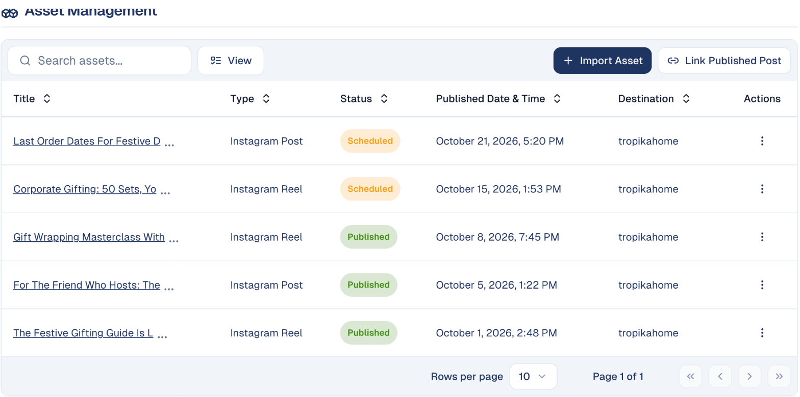
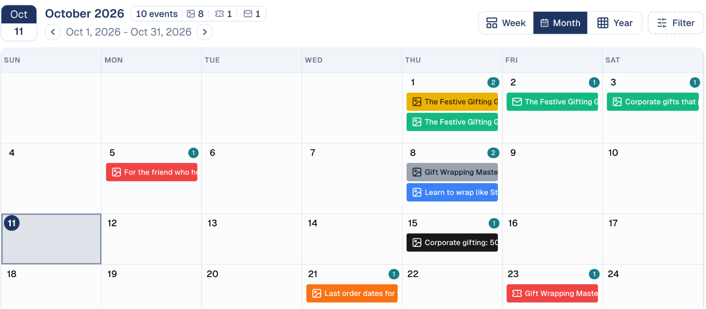

# Run a campaign on social media

Plan a series of posts around one goal, write them in your brand voice, schedule
them across your networks, and see what worked.

## What it's for

One post rarely moves anything; a series does. Running your posts as tactics of
a campaign keeps the whole series, per network, on one calendar, and puts the
results next to your emails, events and ads in the campaign report.

## Before you start

- Your social accounts connected: LinkedIn, Facebook, Instagram or X. See
  [Connections](../settings/connections.md).
- Your Brand Kit and, if you have one, a Brand Voice, so the AI writes like you.
  See [How the AI knows your brand](../settings/brand-voice-memory.md).

## 1. Set up the campaign

1. Choose **Marketing → Campaigns**, then **Create New Campaign**.
2. Fill in the objective, dates, audience, regions and description.
3. Under **Tactics**, choose **Plan With AI** to get a suggested mix of tactics
   for your objective, or **Add Tactic** to add one per network yourself, for
   example *Instagram: gift guide reels* and *LinkedIn: corporate gifting*.

See [Campaigns](../marketing/campaigns.md).

## 2. Write the posts

For each network:

1. Choose **Write Content With AI** on the campaign, or write a post in
   **Social Media → Social Post** with **New Post**.
2. Check the text, add an image, and use **AI Hashtags** and **Improve With AI**.
   The preview shows the post as it will appear on the network.
3. To turn an article into a series of posts in one go, open the article in
   **Content Hub → Content Repository** and choose **Create social posts**.

See [Social Post](../social-media/social-post.md).

## 3. Schedule them

1. Open the network's tactic. Under **Asset Management**, choose **Import
   Asset** to add your posts, or **Link Published Post** for a post you already
   published on the network yourself.
2. Give each post its date and time. The list shows each one as **Scheduled** or
   **Published**, with its destination account.

    

3. Check the whole series on the campaign's **Calendar** tab: every post, email
   and event of the campaign, by week, month or year.

    

## 4. See what worked

- **Per network:** **Social Media → Analysis** shows reach, engagement, likes,
  comments, shares and clicks, and the sentiment of the reactions. See
  [Analysis](../social-media/analysis.md).
- **For the whole campaign:** the campaign's **Analytics** tab adds up every
  tactic. See [The campaign report](../marketing/campaigns.md#the-campaign-report).

## Good to know

- **Post dates must fall within the campaign's dates.** Change the campaign's
  dates under **Campaign Details** if you need to extend it.
- **Each network has its own format and limit.** Write one post per network; the
  editor shows each network's character limit and preview.
- **Results are not live.** Network figures are collected several times a day, so
  a post's first results appear a few hours after it is published.
