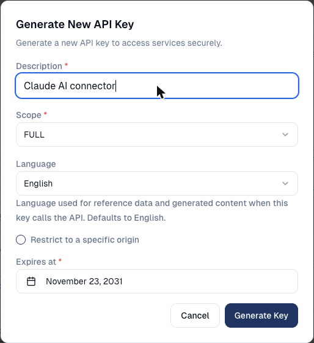
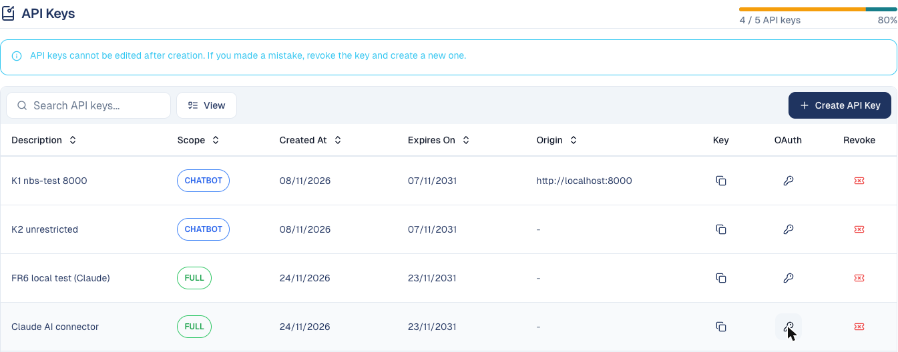
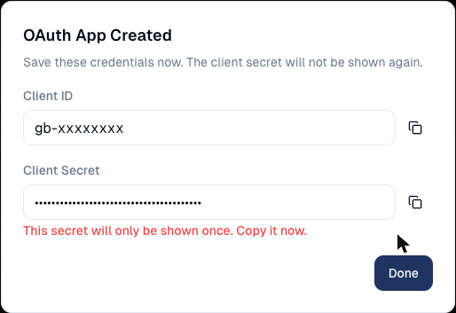
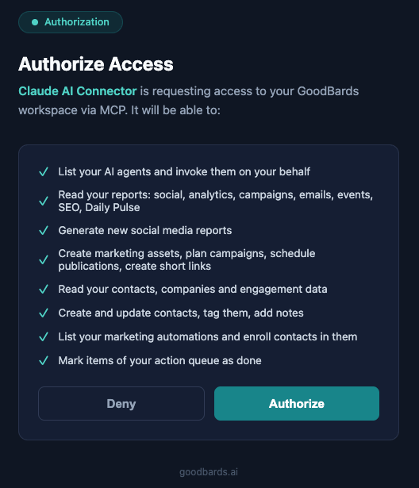

# Use GoodBards from your AI assistant (MCP)

Work with GoodBards from the AI assistant you already use, such as Claude: ask
your GoodBards agents to write or research, read your reports, keep your
contacts up to date and start your automations, without opening GoodBards.

## What MCP is

MCP (Model Context Protocol) is a standard way for an AI assistant to use outside
tools. GoodBards offers an MCP server: once your assistant is connected, it can
call GoodBards' tools for you, in your company's workspace, with your brand and
your data.

You talk to your assistant in plain words; it picks the right GoodBards tool,
shows you what it is about to do, and tells you the result.

## What your assistant can do

What it can do depends on the permissions you grant when you connect. Each
permission unlocks a set of tools; a tool outside the permissions you granted
is not even shown to the assistant.

| Permission | What the assistant can do |
| --- | --- |
| **agents:invoke** (always) | List your GoodBards agents and ask one to write, research or analyse; check a text, an email or a page against your brand guidelines. |
| **reports:read** | Read your social and Google Analytics reports, campaigns and their results, sent emails and their engagement (spam complaints included), the A/B tests of your email tactics, the report of an automation flow, events and registrations, Organic Visibility (SEO) results and the Daily Pulse. |
| **reports:write** | Start a new social report. |
| **content:write** | Save a new piece of content, plan a campaign from a brief, schedule a post, create a tracked short link. |
| **audience:read** | Find, count and rank your contacts and companies; read engagement; list who got which email of an automation flow and what they did. |
| **audience:write** | Create a contact, or update one by email (fields, custom fields); add and remove tags; add a note. |
| **automation:write** | List your marketing automations, and enroll contacts in one by email. |
| **actions:write** | Mark items of your action queue as done. |

!!! tip "Grant only what you need"
    With **agents:invoke** alone, the assistant can talk to your agents but
    cannot read reports, change contacts or start automations.

## Before you start

- **An administrator.** Only a company administrator can create the API key
  and the OAuth app in steps 1 and 2.
- **An assistant that accepts custom connectors**, such as Claude (claude.ai or
  the Claude apps).

The setup takes about five minutes and is done once per company.

## 1. Create an API key

1. In GoodBards, open **Tenant Settings** from your account menu, then the
   **Security** tab.
2. Under **API Keys**, choose **Create API Key**.
3. Give it a **Description** that says what it is for, for example
   *Claude AI connector*, and keep the **Scope** on **FULL**.
4. Choose **Generate Key**.

{ width="50%" }

See [Use the GoodBards API](use-the-api.md) for more on API keys.

## 2. Create an OAuth app on that key

1. In the list of API keys, choose the **OAuth** button on the row of the key
   you just created.

    

2. Choose **Create OAuth App**, give it a name, for example
   *Claude AI Connector*, and choose **Create**.
3. Copy the **Client ID** and the **Client Secret** somewhere safe; you paste
   them into your assistant in the next step.

{ width="50%" }

!!! warning "The secret is shown only once"
    Copy the **Client Secret** before you choose **Done**. If you lose it,
    create a new OAuth app on the same key.

## 3. Add the connector in your assistant

In Claude: **Settings → Connectors → Add custom connector**. Fill in:

| Setting | Value |
| --- | --- |
| **Name** | GoodBards (any name you like) |
| **Remote MCP server URL** | `https://mcp.goodbards.ai/mcp` |
| **OAuth Client ID** (under **Advanced settings**) | The Client ID from step 2 |
| **OAuth Client Secret** (under **Advanced settings**) | The Client Secret from step 2 |

Then choose **Add**, and **Connect** on the new connector.

!!! info "Each person connects once"
    In a Claude team or enterprise workspace, an owner adds the connector once;
    each person then chooses **Connect** and authorizes it (step 4).

## 4. Authorize the access

Your assistant opens a GoodBards page that lists everything it asks to do.
Check the list, then choose **Authorize**.

{ width="50%" }

The page closes and the GoodBards tools appear in your assistant. In Claude,
they are listed under the connector, in the tools menu of the chat.

## 5. Try it

Ask in plain words, for example:

- *"List my GoodBards automations and how many people are in each."*
- *"Add bob@example.com, first name Bob, quiz archetype Titan. He has not
  agreed to marketing emails."*
- *"Tag alice@example.com as `status: customer`."*
- *"Enroll alice@example.com and bob@example.com in the Quiz follow-up
  automation."*
- *"Add a note to alice@example.com: called today, sending the kit on
  Monday."*
- *"Ask the Brand Marketing Agent for three LinkedIn post ideas about our
  festive gifting guide."*
- *"Get the latest LinkedIn report for Tropika Home and summarise it."*

Good to know:

- **The assistant checks with you before it changes anything.** GoodBards' tools
  tell it to confirm the contact, the tags or the automation with you first.
  Read what it proposes before you say yes.
- **Contacts are created as "regular"** (no marketing emails) unless you tell
  the assistant the person agreed to receive them.
- **Tags start your automations.** A tag added by the assistant starts the
  **Tag added** automations within a minute, and a stop-rule tag such as
  `status: customer` stops a running automation before its next email, exactly
  as a tag added in GoodBards.
- **Only subscribed contacts are enrolled** in an automation. The assistant
  tells you who was left out and why (not a contact yet, not subscribed); it
  also counts those already in the automation.
- **Custom fields** are named by their key; ask *"which custom fields do we
  have?"* if you are not sure.

To continue a conversation with the same agent, keep asking in the same chat:
the assistant reuses the session.

## Connect only one module

`https://mcp.goodbards.ai/mcp` gives every tool your permissions allow. To give
an assistant a shorter list, use one module instead:

| URL | Tools |
| --- | --- |
| `…/mcp/ai` | Your agents and the brand check |
| `…/mcp/social` | Social and Google Analytics reports |
| `…/mcp/campaign` | Campaigns, content, short links, email engagement, events |
| `…/mcp/audience` | Contacts, companies, engagement, tags, notes and automations |
| `…/mcp/seo` | Organic Visibility |
| `…/mcp/home` | Daily Pulse and the action queue |

The same OAuth app works for every URL.

## For developers: connect with the API key

Instead of OAuth, an MCP client can send the API key itself, as
`Authorization: Bearer <your API key>`. The assistant then gets the agent tools
only. The list of tools and an example configuration are on
[mcp.goodbards.ai](https://mcp.goodbards.ai).

## Stay in control

!!! info "Everything happens in your company"
    The connection belongs to one company and acts as the administrator who
    created the OAuth app.

- **Check before anything is saved, scheduled or started.** Read what the
  assistant proposes before you say yes.
- **Disconnect at any time:** delete the OAuth app, or revoke the API key, on
  the **Security** tab. The assistant loses access straight away.

## If something does not work

| What you see | What to do |
| --- | --- |
| The assistant says it has no GoodBards tool for what you asked. | The permission was not granted. Disconnect the connector in your assistant and connect again, then check the list on the **Authorize Access** page. |
| An error about the client when you connect. | Check the Client ID and Client Secret. If the secret was lost, create a new OAuth app and update the connector. |
| The assistant asks you to connect again. | Access lasts 30 days; authorize again. Also check that the API key was not revoked or expired. |
| A contact is "not subscribed" when you enroll it. | Only contacts who agreed to marketing emails are enrolled. Update its status in GoodBards if they did. |
| A custom field is "not a contact custom field of this workspace". | Use the field's key as listed in **Audience → Custom Fields**. |

## Good to know

- **Access tokens last an hour** and renew on their own for up to 30 days; after
  that, authorize again.
- **Your agents work as in GoodBards**, with your brand voice and knowledge, and
  their usage counts toward your plan.

---

*Still stuck? [Contact support](../contact.md).*
