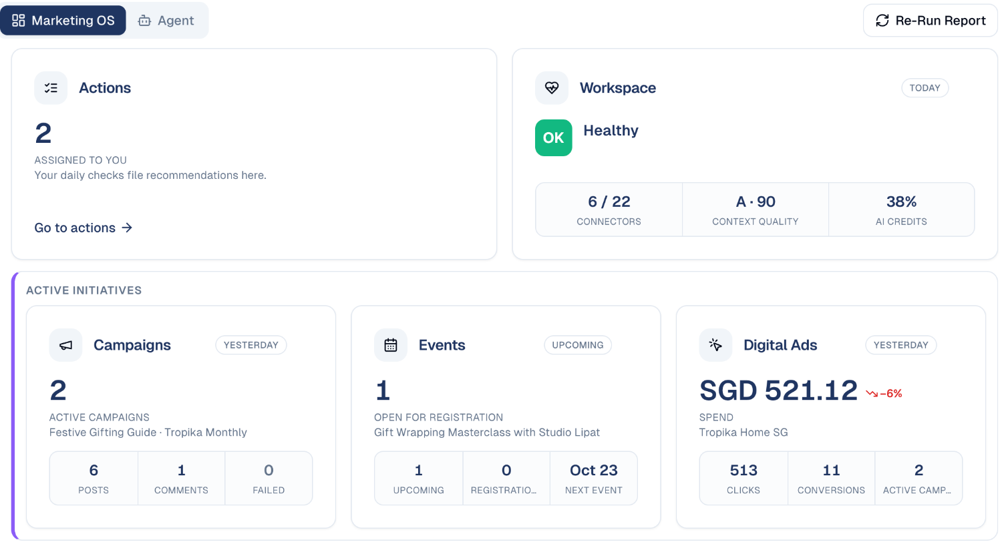
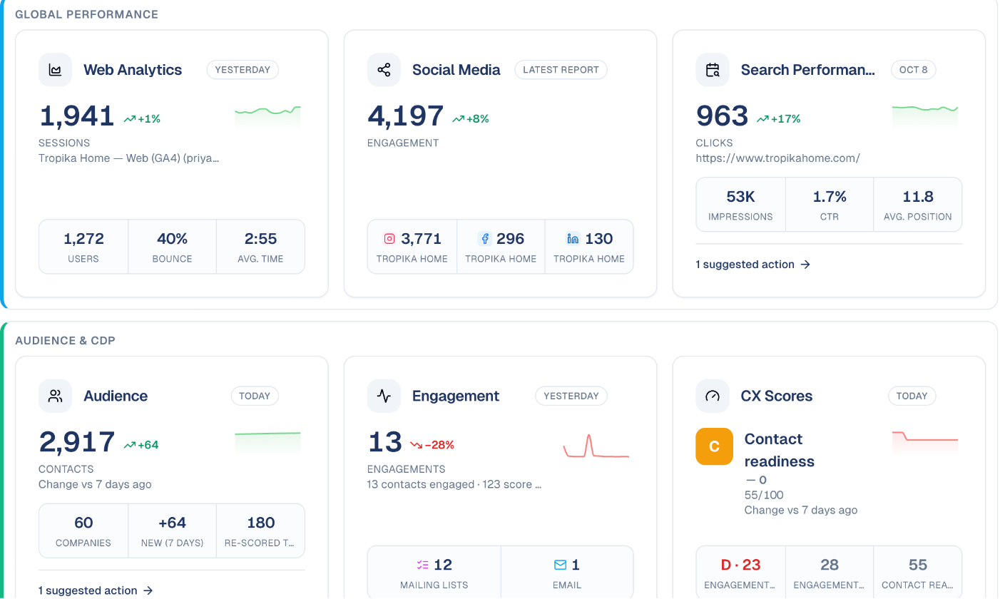
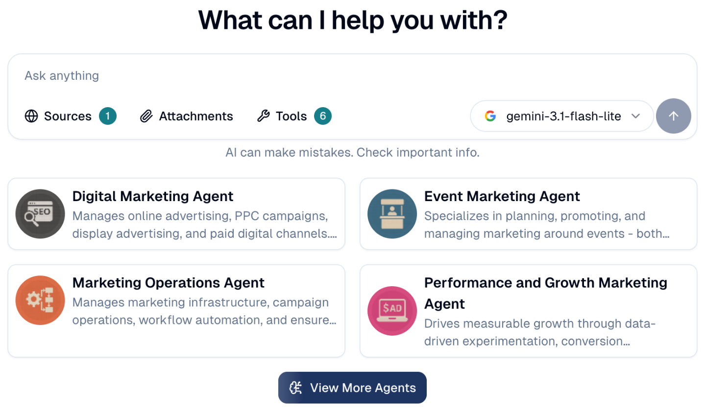

# Home and the Daily Pulse

Your dashboard: everything that moved since yesterday, on one screen, with a
link to act on each part.

## What it's for

Marketing data is spread across your website, social networks, ads, emails,
events and contacts. The **Daily Pulse** on Home sums all of it up every
morning, so you see in a minute what changed and where to look, instead of
opening ten screens.

## How to read your Home

1. In the sidebar, choose **Home**. It opens on **Marketing OS**.
2. At the top: **Actions** assigned to you, and the **Workspace** health (how many
   services are connected, how complete your company context is, how much AI
   credit is used).
3. **Active initiatives**: your running **Campaigns**, the **Events** open for
   registration, and **Digital Ads** spend and results.

4. **Global performance**: website traffic (**Web Analytics**), **Social Media**
   engagement per network, and **Search Performance** from Google Search Console.
5. **Audience & CDP**: your contacts and companies, how many engaged yesterday,
   and your contact readiness and engagement scores.

Each card shows the change against the previous period, with a small trend
chart. Click a card to open the screen behind it; **suggested action** links take
you straight to the matching item in [Actions](../workspace/actions.md).

## Ask an agent

The **Agent** tab, next to **Marketing OS**, opens a chat with your AI agents.
Ask anything, add **Sources** or **Attachments**, or pick one of the suggested
agents. See [Chat Agents](../agentic-ai/chat-agents.md).

## Good to know

- **The pulse runs once a day.** Choose **Re-Run Report** to refresh it now, for
  example after connecting a new service.
- **Cards appear when there is something to show.** A card for a service you have
  not connected stays empty; connect it under
  [Connections](../settings/connections.md).
- **Dates on each card say how fresh it is**: *Today*, *Yesterday*, or the date of
  the latest report.

---

*Still stuck? [Contact support](../contact.md).*
