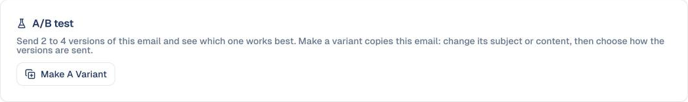
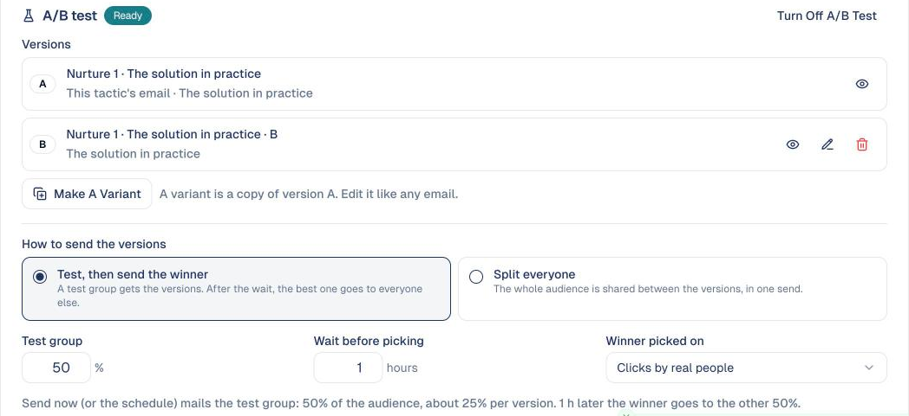
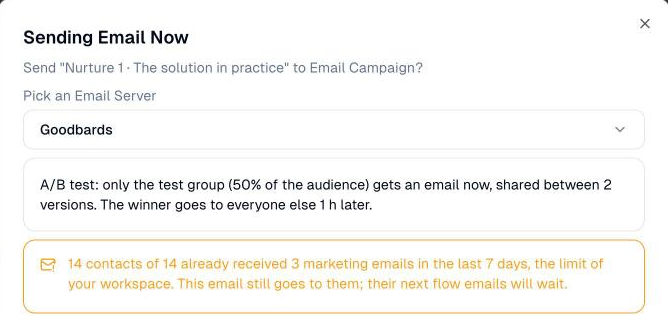
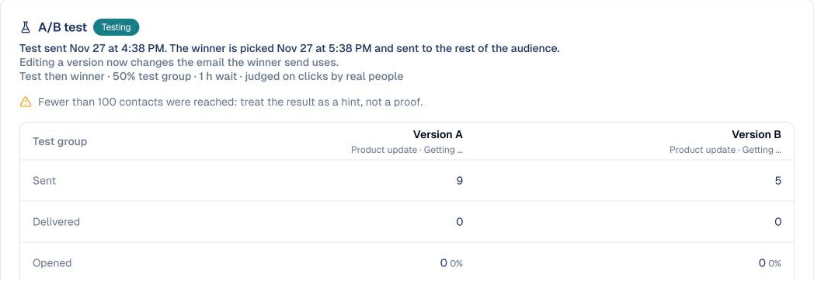
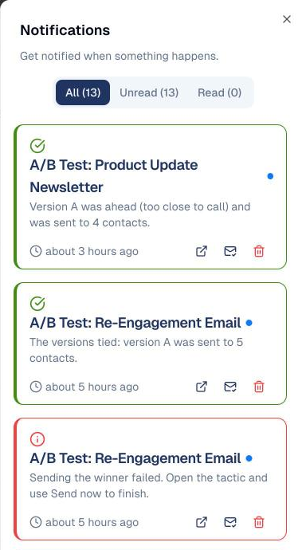
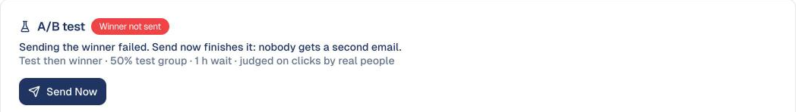
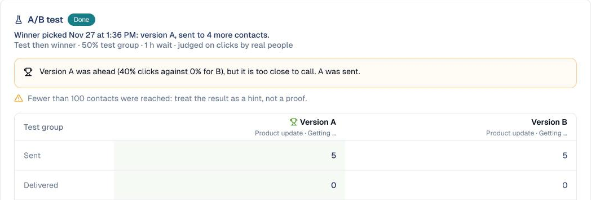
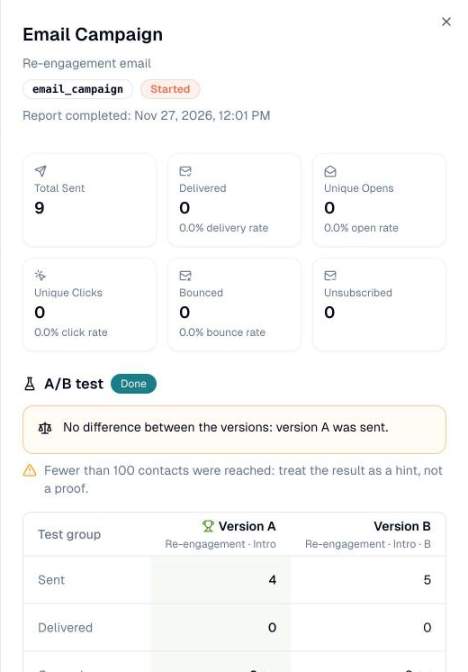

# A/B testing an email

Send two to four versions of a campaign email and let the results pick the
best one. You can test a subject, a heading, an image, an offer: anything that
differs between the versions.

## What it's for

- **Test, then send the winner:** a small test group gets the versions. After
  a wait, the version with the most clicks (or opens) goes to everyone else,
  automatically.
- **Split everyone:** the whole audience is shared between the versions, for
  example 50/50, in one send. Use it to compare designs over a whole send, or to
  keep a group out of a new design.

## Before you start

- An **email tactic** with its email attached and its audience set (see
  [Attaching an email to a tactic](emails.md#attaching-an-email-to-a-tactic)).
- The audience must be **contacts**: segments, mailing lists or addresses. A
  tactic that sends to companies cannot run an A/B test.
- Set it up **before the send**. Once the email has gone out, the test can no
  longer be changed.

## Make the versions

1. Open the tactic page. Under the email, the **A/B test** card says what a test
   does.

    

2. Choose **Make a variant**. A copy of the tactic's email is created as
   version **B**, named "*email name* · B", with the same subject.
3. Choose the **pencil** next to version B to open it in a new tab. Change what
   you want to test, for example the subject or the main image, and save.
4. Want a third or fourth version? Choose **Make a variant** again (up to D).

Version **A** is always the tactic's own email, shown on the right of the
tactic page. The sender of the tactic is used for every version, so the test is
fair. To drop a version, choose the **bin** next to it: its email stays in
Emails. With only A left, the test is turned off.

## Choose how to send them

Under **How to send the versions**, pick one:

**Test, then send the winner** (the default)

- **Test group:** the share of the audience that gets a version first, 5% to
  50% (20% by default). It is split evenly between the versions.
- **Wait before picking:** 1 to 72 hours (4 by default).
- **Winner picked on:** clicks or opens, **by real people only**: machine opens
  and link scanners are left out.

**Split everyone**

- Give each version a share of the audience, at least 5% each, adding up to
  100%. **Even split** fills in 50/50, 34/33/33 or 25 each.

Choose **Save**. The card says what Send now will do, in numbers, for example:
*"Send now mails the test group: 20% of the audience, about 10% per version.
4 h later the winner goes to the other 80%."*

## Send

Use **Send now** or **Schedule** on the email card, as for any tactic. The
dialog reminds you that it is an A/B test.

{ width="70%" }

- In **test, then send the winner** mode, only the test group gets an email now.
  The tactic shows **Testing**, with the time the winner will be picked.

    

- In **split everyone** mode, everyone gets one version now.

Each contact gets **one version only**, drawn at random and kept: a retry, a
resend or the winner send never mails them a second email.

## The winner

When the wait is over, Good Bards:

1. compares the versions on the test group (real people only);
2. sends the best one to everyone else in the audience, including people who
   joined the segment since the test;
3. tells you in the **notification bell**, with a link to the tactic.

{ width="40%" }

The result says how sure it is:

- **"Version B won … 95% sure"**: the difference is too large to be luck.
- **"Version B was ahead … too close to call"**: B was ahead, but the
  difference could be luck. B is still sent.
- **"No difference: version A was sent"**: an exact tie.

With fewer than 100 contacts reached, a note says to treat the result as a
hint.

If sending the winner fails, the tactic shows **Winner not sent** and a **Send
now** button that finishes it. Nobody gets a second email.

## Read the results

The **A/B test** card on the tactic page shows:

- the versions side by side: sent, delivered, opened, clicked (with rates),
  unsubscribed, spam complaints and bounced, for the test group;
- **Winner sent to**: how many more contacts got the winner;
- the click (or open) rate of each version, hour by hour since the test send.

Under **Performance**, the **Version A / B / C / D** tabs open each version's
full report: recipients, links clicked, and the CSV export.

In the campaign's list of tactics and on its **Analytics** tab, an **A/B**
badge marks the tactic. On the Analytics tab, open the tactic to see the same
comparison.

{ width="45%" }

## Good to know

- **While testing, the settings are locked.** You can still edit a version's
  content, but the winner is sent as the email is at that moment.
- **Send more** (to people you add by hand) waits for the winner. After that,
  it sends the winner, or in split mode each address its own version.
- **Replace email** and **Detach** are off while the test is on: the other
  versions are copies of this email. Turn the test off first.
- **Turning the test off** (before the send) keeps the variant emails in
  Emails; the tactic sends version A only.

---

*Still stuck? [Contact support](../contact.md).*
