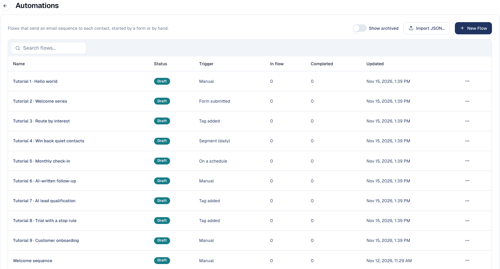
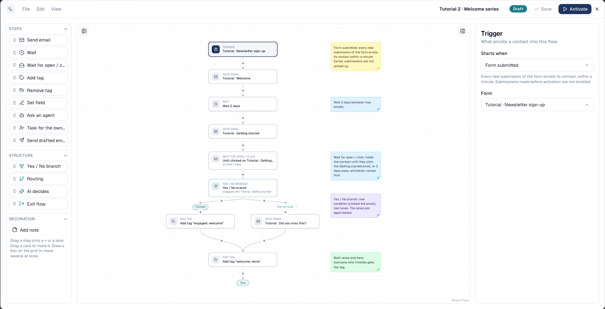
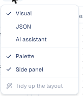
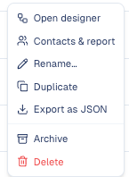

# Automations

Take each contact through emails, waits, branches, AI steps and tasks for your
team, on their own, at their own pace.

## What it's for

A flow is a path one contact walks through: a welcome email, a wait of three
days, a second email only for those who clicked the first, a task for their
owner, a tag at the end. You design it once; GoodBards then runs it separately
for every contact who enters.

Use it for welcome series after a sign-up form, nurture tracks for new leads,
win-back emails for quiet contacts, a monthly check-in with a segment, or an
AI-assisted follow-up that a colleague approves before it goes out.

!!! abstract "New here? Start with the tutorial"
    [Your first flow: Hello world](../automations/hello-world.md) builds a
    three-step flow in ten minutes and runs it on you. Then browse the
    [Sample flows](../automations/samples.md): nine ready-made flows, each
    teaching a few building blocks.

## Before you start

- **Your plan.** Automations is part of the Pro and Team plans. If
  **Automations** shows a crown in the sidebar, your plan does not include it;
  speak to your account contact.
- **Your access.** Flows sit with emails, so you need the **Emails and forms**
  access (write, to build and activate flows). See
  [Users, roles & permissions](../settings/users-roles.md).
- **An email server.** Flows send through the server connected under
  **Connections**. See [Email sending](../settings/connectors/email-sending.md).
- **The emails themselves.** Each email in a flow is one of your
  [Emails](emails.md). Create them first, or add the steps and pick the emails
  afterwards.
- **Subscribed contacts.** Only contacts whose status is **Subscribed** stay in
  a flow (see [Good to know](#good-to-know)).

## The guide, page by page

| Page | What you learn |
| --- | --- |
| [Your first flow: Hello world](../automations/hello-world.md) | Build, save, activate and test a flow, step by step. |
| [Triggers](../automations/triggers.md) | The six ways contacts enter a flow. |
| [Steps](../automations/steps.md) | Every step of the palette and its settings. |
| [Branches and conditions](../automations/branches.md) | Yes / No branches, routing, AI decides, and the conditions they check. |
| [AI and human steps](../automations/ai-steps.md) | Ask an agent, Task for the owner, Send drafted email, and the AI budget. |
| [Segments and schedules](../automations/segments.md) | Flows that run on a segment every day, week or month. |
| [Flow settings](../automations/settings.md) | Re-entry, goals, stop rules and handing a contact to another flow. |
| [Results and analytics](../automations/results.md) | Who is where, each contact's path, and the report on the canvas. |
| [Flows in a campaign](../automations/campaigns.md) | A flow as a campaign tactic. |
| [The AI assistant](../automations/ai-assistant.md) | Describe a flow, or a change to one, in your own words. |
| [Sample flows](../automations/samples.md) | Nine tutorial flows and what each one teaches. |

## The designer at a glance

Open a flow from the list (its menu, then **Open designer**). The designer has
three columns:

- **The palette** (left) lists every step. Drag one onto a **+** of the canvas,
  or choose the **+** itself.
- **The canvas** (middle) draws the flow from top to bottom. Lanes of a branch
  sit side by side and join again below. Select a card to edit it.
- **The side panel** (right) shows the settings of the selected card.

The menus at the top hold the rest: **File** (save, activate, pause,
[Flow settings](../automations/settings.md), export and import as JSON,
archive), **Edit**, and **View**, which switches between the **Visual** canvas,
the **JSON** of the flow and the [AI assistant](../automations/ai-assistant.md).

{ width="25%" }

Each flow in the list has a menu with **Open designer**, **Contacts & report**,
**Rename…**, **Duplicate**, **Export as JSON**, **Archive** and **Delete**.

{ width="25%" }

## A flow's status

| Status | What it means |
| --- | --- |
| **Draft** | Being built. Nobody enters. |
| **Active** | Running. New contacts enrol as the trigger fires. |
| **Paused** | Contacts hold where they are, and nobody new enrols until you choose **Resume**. |
| **Archived** | Finished for good. Everyone still in it leaves. It can be viewed but not edited. |

!!! info "Changing an active flow"
    Edits go into a draft; the flow keeps running as it was. Choose **Activate
    changes** to publish them. Contacts already in the flow finish on the
    version they started; new contacts get the new one.

## Good to know

!!! info "Only subscribed contacts stay in a flow"
    A contact who is not **Subscribed** (regular, unsubscribed, bounced, do not
    contact) leaves every flow within a minute, wherever they are, even if the
    flow sends no email. An unsubscribe from any email therefore ends their
    flows.

- **Several flows at once.** A contact can be in a nurture flow and an alert
  flow at the same time. They are never twice in the *same* flow at once: that
  skip is listed on the flow's **Contacts** tab under **Skipped**.
- **An email limit protects inboxes.** By default a contact gets at most 3
  marketing emails in 7 days, campaigns and flows together. A flow email over
  the limit waits; it is never lost. See
  [Email limit per contact](../automations/settings.md#email-limit-per-contact).
- **Sending hours.** New flows send Monday to Friday, 9:00 to 18:00, in each
  contact's timezone. See [Sending hours](../automations/settings.md#sending-hours).
- **Nothing is backfilled.** Only events after you activate the flow count.
  To include people from before, enrol them yourself.
- **Emails are sent as they are at send time.** Editing an email changes what
  the next contacts receive, even mid-flow.
- **A failing step is retried twice.** After the third failure, for example
  with no email server connected, the contact is marked **Failed** and leaves.
- **A flow has at most 50 steps.**

!!! warning "Archiving cannot be undone"
    You can only delete a draft, or an archived flow that never had a contact.
    Otherwise, archive it. Everyone still in an archived flow leaves it.

---

*Still stuck? [Contact support](../contact.md).*
