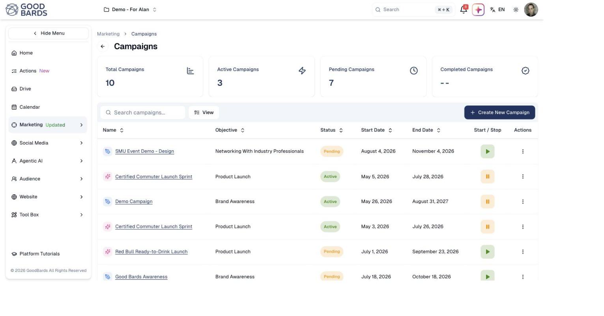
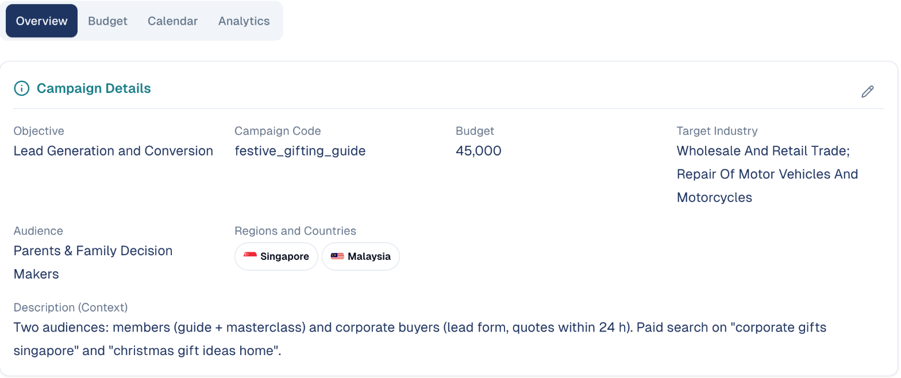
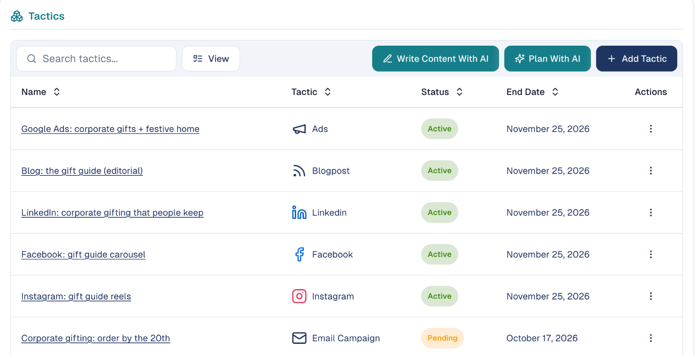
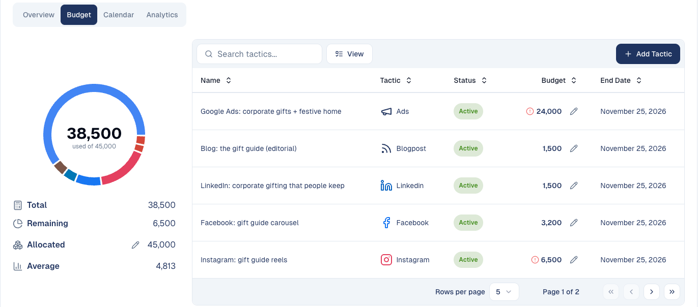
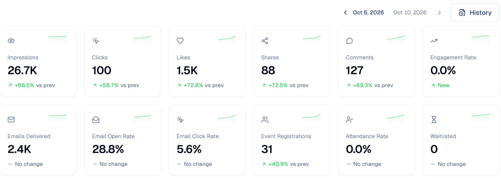

# Campaigns

Group related marketing activity under one plan, with a shared objective and a
start and end date.

## What it's for

A campaign is a container for everything you are doing towards one goal — a
product launch, an event, a seasonal push. Instead of tracking a dozen separate
posts and emails, you see them together and track whether the goal is being met.

If you only want to publish one post or one email, you do not need a campaign.
Use [Launch a Tactic](launch-tactic.md) instead.

## Before you start

- Know your **objective** — for example Product Launch, Brand Awareness, or
  Networking With Industry Professionals. You choose one when you create the
  campaign.
- Know roughly when the campaign should start and finish.

## How to create a campaign

1. In the sidebar, choose **Marketing → Campaigns**.
2. Choose **+ Create New Campaign**.
3. Give it a name, pick an objective, and set the start and end dates.
4. Add the tactics that belong to it — the posts, emails and events that work
   towards the objective.

## Reading the campaign list

The four tiles across the top summarise where things stand: **Total**,
**Active**, **Pending** and **Completed Campaigns**.

Each row in the table shows the campaign's objective, its status, and the dates
it runs between. Sort by any column using the arrows beside the heading.

| Status | What it means |
| --- | --- |
| **Pending** | Created, but not started yet. |
| **Active** | Currently running. |
| **Ended** | Finished. |

## Inside a campaign

Click a campaign's name to open it. Its tabs are **Overview**, **Budget**,
**Calendar** and **Analytics**.

**Overview** shows the **Campaign Details**: objective, budget, target industry,
audience, regions, and a description the AI uses as context whenever it writes
for this campaign. Choose the pencil to change them.

Below, **Tactics** lists everything the campaign runs: ads, blog posts, social
posts, emails and events, each with its status and end date.

- **Add Tactic** adds one yourself.
- **Plan With AI** suggests the tactics that fit the campaign's objective.
- **Write Content With AI** drafts the content of the tactics.

### Duplicating a tactic

To run a tactic again, for example last year's festive email, choose
**Duplicate** in the tactic's menu. Give the copy a name and a destination
campaign (the same one or another). The copy starts as a draft: dates, status
and figures are reset; budget, description and audience are kept.

For its emails and content, choose:

- **Reuse existing assets**: the copy uses the same emails and posts. Editing
  them later changes both tactics.
- **Create new copies**: fresh copies, so the original is never touched.

For an event, its settings are copied too, and its registration form is always
duplicated so the two events keep their registrations apart.

The copy gets its own tactic code (the original's code followed by `-copy`), so
Google Analytics never mixes the two tactics.

### Reading a social tactic's results

Once a LinkedIn, Facebook, Instagram, X or TikTok post is published, the tactic
shows a **Performance by post** card under its posts, with one colour per post in
every chart:

- **Link clicks**: people who opened the links in each post.
- **Reach & Visibility**: impressions of each post.
- **Engagement Trends**: clicks, likes, shares or comments of each post.

Reach and engagement are the network's figures, collected by the daily report:
running totals since publication, so a post appears the day after it is
published. Pick **Since publish**, **7**, **30** or **90 days** above the charts,
and click a post's name to open its analytics. The same card appears when you
open the tactic from the campaign's **Analytics** tab, where the campaign charts
keep one colour per tactic.

**View analytics** in a published post's menu opens the same view for one post:

- **Link clicks (tracked)**: people who opened the links in the post, day by day,
  and how many clicks each link got.
- The network's own figures for the post (impressions, reactions, comments,
  shares…), from the latest daily report. They appear the day after publishing.

Good to know:

- **"Clicks on LinkedIn" is a different number.** The network counts every click
  on the post (image, "see more", profile); link clicks count only the people who
  opened your links.
- **Bots are left out.** When a post is published, the network fetches its links to
  build the preview card; those visits are not counted. Switch on **Include bots**
  to see them.
- Days follow your timezone.
- A post linked from outside GoodBards has no tracked links: it shows the network
  figures only.

### Tracking links in Google Analytics

Every link GoodBards shortens in a campaign's emails and social posts carries
UTM tags, so its visits show up in your Google Analytics reports:

| Tag | Value | Example |
| --- | --- | --- |
| `utm_campaign` | the **campaign code** | `summer-sale-2026` |
| `utm_content` | the **tactic code**: tells two tactics of the same campaign apart | `launch-post` |
| `utm_source` | where the click comes from, set from the tactic type | `linkedin`, `facebook`, `newsletter` for emails, `event` for event emails |
| `utm_medium` | the channel family, set from the tactic type | `social` or `email` |

- **The codes are optional.** Leave them empty and GoodBards writes one from the
  name ("Summer Sale 2026" becomes `summer-sale-2026`) and keeps it, even if you
  rename the campaign later.
- **Format:** lowercase letters, digits, `-` and `_`, up to 50 characters. A
  campaign code is unique in your workspace, a tactic code within its campaign.
- **Source and medium can't be edited**, so every campaign is named the same way
  in your reports. The tactic form shows the tags its links get.
- **Your own tags win.** A link that already contains `utm_` tags is left as you
  wrote it.
- Ads and blog posts get no tags: Google Ads tags its own clicks, and tags on
  links to your own website would overwrite your visitors' real source.

## The Budget tab

The **Budget** tab splits the campaign's budget across its tactics. On the left,
how much is used of the total, with the remaining amount, the amount
**Allocated** (choose the pencil to change it) and the average per tactic. On the
right, every tactic with its own budget; choose the pencil on a row to change
it.

A red mark next to a tactic's budget means it is above the average budget per
tactic. The tactic budgets are your plan. For ads, Google Ads spends its own daily
budget; see [Ads in a campaign](digital-ads.md#ads-in-a-campaign).

## The campaign report

The **Analytics** tab gathers the results of every tactic in one place: reach and
engagement on social networks, email deliveries, opens and clicks, event
registrations and attendance, and ad spend and returns. Each figure shows its
change against the previous report. Use the arrows to move between report
dates, or **History** to see them all.

Below the totals, a table lists every tactic with its own figures. Choose one to
open its details: the same figures for that tactic alone, and its share of the
campaign total.

## Starting and stopping

The **Start / Stop** column controls whether a campaign is running:

- **▶ Start** begins a pending campaign.
- **⏸ Pause** stops an active one.

Pausing does not delete anything — it stops further activity until you start it
again.

## Good to know

- **A campaign is a plan, not a channel.** Publishing still happens through the
  individual tactics inside it.
- **Name campaigns so you can find them later.** Something like
  `Q4-2026-Product-Launch` is easier to search than `New campaign`.
- **End dates are not deadlines.** A campaign past its end date stays visible in
  the list; the date describes the plan, it does not stop work by itself.

---

*Still stuck? [Contact support](../contact.md).*
