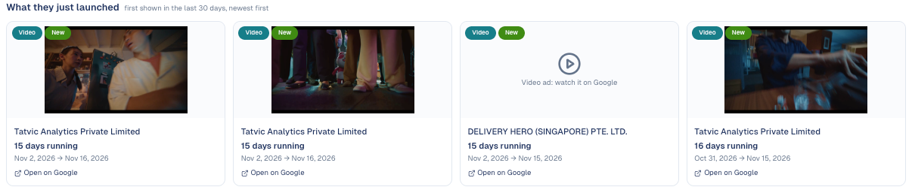
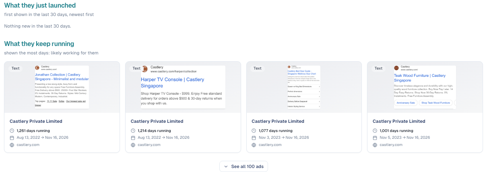
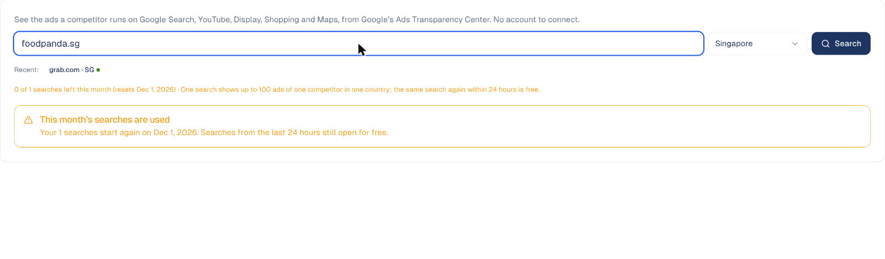

# Competitor ads

See the ads a competitor is running on Google right now (Search, YouTube,
Display, Shopping and Maps), straight from Google's Ads Transparency Center. In
the app: **Marketing → Digital Ads → Competitor ads**.

## What it's for

Before you write an ad, it helps to know what your competitors are saying, which
formats they use and which ads they keep paying for. Google publishes every
advertiser's ads; this tab puts them in front of you without leaving GoodBards.

## Before you start

!!! note "Experimental"
    Competitor ads is an experimental feature, switched on company by company.
    If you don't see the **Competitor ads** tab (marked *Experimental*), ask
    GoodBards to switch it on for your company.

- **Nothing to connect.** The ads are public, so you don't need a Google Ads
  account.
- **Your competitors saved.** Add them once under
  [Settings → Company → Competitors](../settings/company-settings.md#competitors):
  each one is listed in the **Competitor** list at the top of the tab. Until you
  have some, the tab shows an **Add competitors** link and a field to type any
  brand.

## How to look up a competitor

The bar at the top of the tab says what the whole page is about: one
competitor, in one country.

1. In **Competitor**, choose one of your competitors. Their ads load at once.
2. In **Country**, choose where to look. Singapore is selected first, every
   South-East Asian country is in the list, plus **All countries**.
3. For a brand you haven't saved, choose **Other brand…** at the bottom of the
   list. In the window that opens, type its **website** (`castlery.com`, or
   paste any page of the site) or its **name**, then **Search**.

Brands you looked up this way are listed under **Other searches** in the same
list, so you can open them again in one click. A green dot means opening it is
free (searched in the last 24 hours). To tidy the list, click the **✕** next to
a search: it disappears from the list but still counts in this month's
searches. **Manage competitors** at the bottom opens your Competitors page.

Under the bar, the competitor's name, website and country head the page, and
every section below is titled with their name.

!!! tip "Search the website rather than the name"
    A website finds every account advertising that site, whatever the company is
    called in each country. A brand name only finds advertisers whose name
    matches.

## How to read the results

The four tiles at the top:

- **Ads shown**: the ads in the list (the 100 most recently shown), out of
  everything Google holds for this competitor.
- **New ads**: ads first shown in the last 30 days, so what they have just
  launched.
- **Longest running**: the ad that has been shown the most days.
- **Text · Image · Video**: how many ads of each format.

Then two short rows answer the two questions that matter:

- **What *competitor* just launched**: up to 4 ads first shown in the last 30
  days, newest first. This is what the competitor is starting or testing now.
- **What *competitor* keeps running**: the 4 older ads shown for the most days.
  These are probably working for them.

Each card shows the ad's picture, the advertiser's legal name, how many days it
has run, its first and last day and the website it sends people to. Click a card
to open the ad on Google's own page. Video ads play there only.

!!! tip "Look at who runs the ads"
    The advertiser on a card can be an agency rather than the brand itself. That
    tells you who handles their campaigns.

Click **See all … ads** to open the full list. There, show only **Text**,
**Image** or **Video** ads, sort by **Longest running** or **Newest**, and, when
a competitor advertises from several companies (one per country, say), pick one
**advertiser**.

!!! warning "Longest running is a hint, not a result"
    Google shares no spend, clicks or sales for these ads. An ad that has run for
    months tells you the advertiser kept paying for it, which usually means it
    works, but it isn't proof. A short promotion can perform better and still
    stop after two weeks.

## Your monthly searches

Each search uses one of your company's monthly searches. The line under the
search field shows how many are left and when they start again (on the 1st of
each month).

- Opening the same competitor and country again **within 24 hours is free**: the
  result is kept, and its label says *Saved result, no search used*. Your recent
  searches appear as buttons; a green dot means they are still free.
- **Refresh** fetches the ads again from Google and uses one search.
- A search that finds no ads uses nothing.

!!! info "When competitor ads are unavailable"
    If the red message *Competitor ads are unavailable* appears, the service
    behind this tab has used its allowance for the whole platform, not just yours.
    It comes back when it renews. Contact your administrator.

## Good to know

- **The list holds the 100 most recently shown ads.** A large advertiser can
  have thousands. Narrow it down by choosing a country.
- **Ad wording isn't extracted as text.** Text ads appear as a picture of the
  ad, just as Google shows them.
- **Competitor ads works for Google only.** Meta (Facebook, Instagram) has its
  own public Ad Library.
