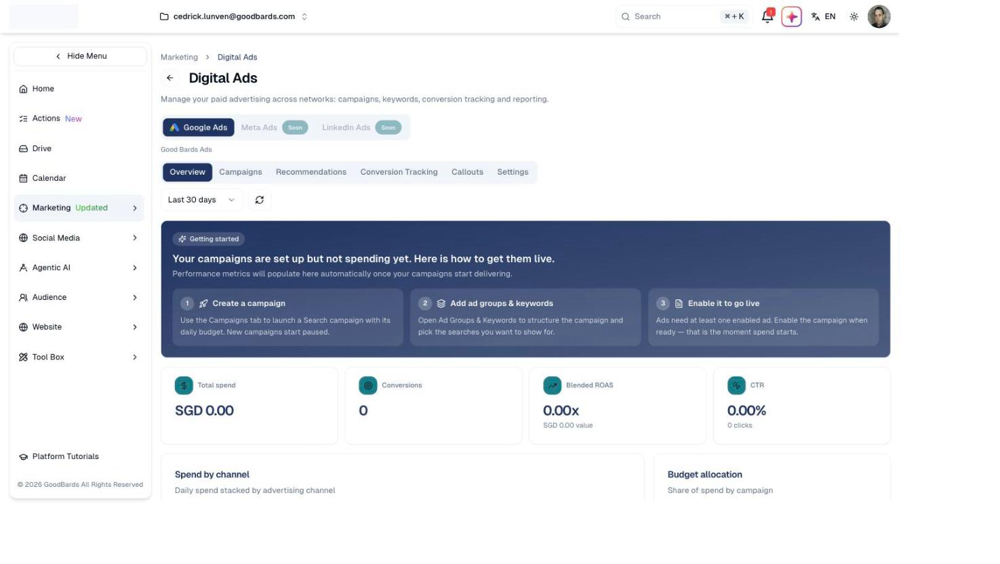

# Digital Ads

Manage your paid advertising — campaigns, keywords, conversion tracking and
reporting — without leaving GoodBards.

## What it's for

Paid advertising is where marketing budget turns into traffic, and where it
disappears fastest if nobody is watching. This brings your ad campaigns and their
performance in beside the rest of your marketing, so spend can be judged against
everything else you are doing.

## Before you start

Your Google Ads account must be connected. See
[Connections](../settings/connections.md).

!!! note "Google Ads today; Meta and LinkedIn to follow"
    **Google Ads** is available now. **Meta Ads** and **LinkedIn Ads** appear
    marked *Soon* and cannot be used yet.

## Getting your first campaign live

New campaigns do not start spending on their own. The three steps are:

1. **Create a campaign** — on the **Campaigns** tab, launch a Search campaign with
   its daily budget. New campaigns start **paused**.
2. **Add ad groups & keywords** — structure the campaign and choose the searches
   you want to appear for.
3. **Enable it to go live** — a campaign needs at least one enabled ad. Enabling it
   is the moment spend starts.

!!! warning "Nothing spends until you enable it"
    A campaign sitting at zero spend is usually paused rather than broken. That
    is deliberate — it stops half-built campaigns burning budget. Check the
    campaign is enabled and has at least one enabled ad.

## Reading the overview

Set the period with the date selector, then read the four headline figures:

| Metric | What it means |
| --- | --- |
| **Total spend** | What you have spent, in your account currency. |
| **Conversions** | How many people did the thing you were paying for. |
| **Blended ROAS** | Return on ad spend — revenue divided by spend. `2.00x` means two dollars back for every one spent. |
| **CTR** | Click-through rate: the share of people who clicked after seeing your ad. |

**ROAS** is the number that decides whether a campaign continues. **CTR** tells
you whether the ad itself is working — a low CTR usually means the ad copy or the
keywords are wrong, not the budget.

Below, **Spend by channel** shows daily spend stacked by channel, and **Budget
allocation** shows how spend is split across campaigns.

## The tabs

| Tab | What it covers |
| --- | --- |
| **Overview** | The summary above. |
| **Campaigns** | Create and manage campaigns, ad groups and keywords. |
| **Recommendations** | Suggested improvements to your account. |
| **Conversion Tracking** | Defining what counts as a conversion. |
| **Callouts** | Extra text shown alongside your ads. |
| **Settings** | Account-level configuration. |

## Good to know

- **Conversion tracking first.** Without it, ROAS and conversions stay at zero and
  you are flying blind. Set it up before spending.
- **Start with a small daily budget.** Raise it once you can see which keywords
  convert. It is much easier to increase spend than to recover it.
- **Check your currency.** Spend is shown in the account currency — SGD in the
  example above.
- **Judge over weeks, not days.** Early figures are noisy; give a campaign enough
  clicks to mean something before rewriting it.

---

*Still stuck? [Contact support](../contact.md).*
