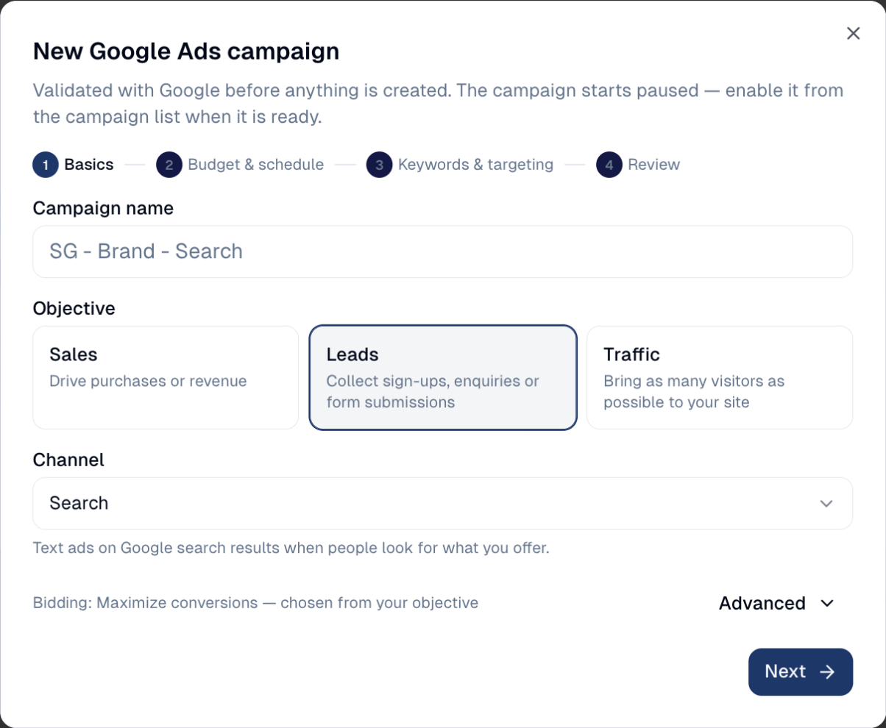
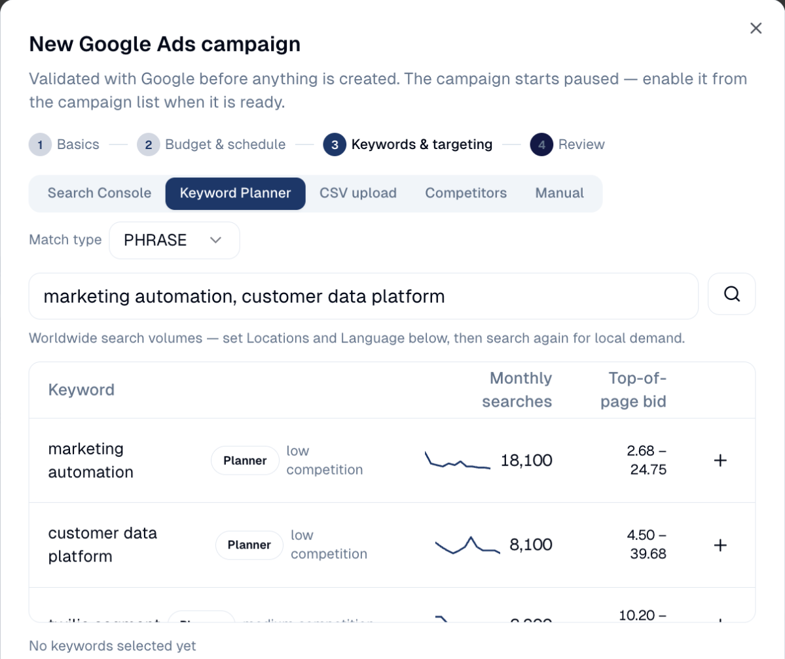
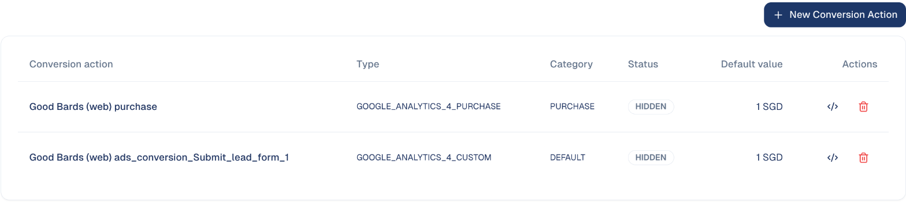
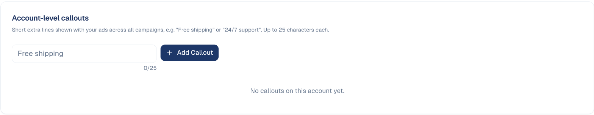
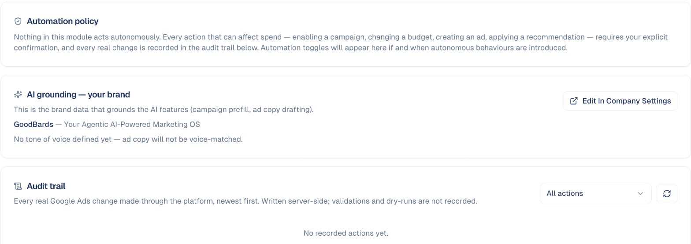

# Digital Ads

Manage your paid advertising — campaigns, keywords, conversion tracking and
reporting — without leaving GoodBards.

## What it's for

Paid advertising is where marketing budget turns into traffic, and where it
disappears fastest if nobody is watching. This brings your ad campaigns and their
performance in beside the rest of your marketing, so spend can be judged against
everything else you are doing.

## Before you start

Your Google Ads account must be connected. See
[Connections](../settings/connections.md).

!!! note "Google Ads today; Meta and LinkedIn to follow"
    **Google Ads** is available now. **Meta Ads** and **LinkedIn Ads** appear
    marked *Soon* and cannot be used yet.

## Getting your first campaign live

New campaigns do not start spending on their own. The three steps are:

1. **Create a campaign** — on the **Campaigns** tab, launch a Search campaign with
   its daily budget. New campaigns start **paused**.
2. **Add ad groups & keywords** — structure the campaign and choose the searches
   you want to appear for.
3. **Enable it to go live** — a campaign needs at least one enabled ad. Enabling it
   is the moment spend starts.

## Creating a campaign

On the **Campaigns** tab, choose **New Campaign**. The wizard has four steps, and
Google checks the campaign before anything is created:

1. **Basics**: the name, the objective (**Sales**, **Leads** or **Traffic**) and
   the channel. The bidding follows from the objective.

    

2. **Budget & schedule**: the daily budget, and optional start and end dates.
3. **Keywords & targeting**: the searches to appear for, the locations and the
   language (see below).
4. **Review**: check everything, then create. The campaign starts paused.

### Choosing keywords

Step 3 offers five ways to find keywords:

| Source | What it gives you |
| --- | --- |
| **Search Console** | The searches that already bring people to your site. |
| **Keyword Planner** | Ideas from Google, with monthly searches, competition and the top-of-page bid. |
| **CSV upload** | Your own list, from a spreadsheet. |
| **Competitors** | Ideas taken from a competitor's website. |
| **Manual** | Type them yourself. |

In **Keyword Planner**, type a few seed keywords separated by commas and search.
Choose **+** to add an idea to the campaign.

Volumes are worldwide until you set **Locations** and **Language**; search again
afterwards for local demand, for example Singapore only.

!!! warning "Nothing spends until you enable it"
    A campaign sitting at zero spend is usually paused rather than broken. That
    is deliberate — it stops half-built campaigns burning budget. Check the
    campaign is enabled and has at least one enabled ad.

## Reading the overview

Set the period with the date selector, then read the four headline figures:

| Metric | What it means |
| --- | --- |
| **Total spend** | What you have spent, in your account currency. |
| **Conversions** | How many people did the thing you were paying for. |
| **Blended ROAS** | Return on ad spend — revenue divided by spend. `2.00x` means two dollars back for every one spent. |
| **CTR** | Click-through rate: the share of people who clicked after seeing your ad. |

**ROAS** is the number that decides whether a campaign continues. **CTR** tells
you whether the ad itself is working — a low CTR usually means the ad copy or the
keywords are wrong, not the budget.

Below, **Spend by channel** shows daily spend stacked by channel, and **Budget
allocation** shows how spend is split across campaigns.

## Managing a campaign

On the **Campaigns** tab, choose a campaign to open its panel.

- **Overview:** its performance and spend over the period, and what stops it
  from serving, for example *no ad groups* or *an ad group with no ads*. Change
  the name, daily budget and dates; changes apply immediately in Google Ads.
  **Enable** starts serving and spending; **Remove** is permanent in Google Ads.
- **Ad groups:** each group's **Keywords** and **Ads**. New ads start paused. An
  ad's text, and a keyword's text and match type, cannot be changed once
  created: pause it and add a corrected one.
- **Negatives:** searches the campaign must not show on, for example *free* or
  *jobs*. A single ad group can also have its own negative keywords; the two
  lists are independent.

Video campaigns are managed in Google Ads itself: GoodBards shows their
performance but cannot edit them.

## Ads in a campaign

To count an ad campaign in a marketing campaign's results, add an **Ads** tactic
to the marketing campaign, open it, and pick the Google Ads campaign to link it
to. The tactic then shows the ad campaign's last 30 days: spend and results.

Two budgets appear side by side on purpose: the **tactic budget** is what you
planned for this tactic in the marketing campaign; the **daily budget** is what
Google Ads spends. Neither changes the other. To create the Google Ads campaign
itself, use **Marketing → Digital Ads**; the tactic only links to it. **Unlink**
removes the link without touching the ad campaign.

## Recommendations

Google's own suggestions for your account. You can **apply** keyword
recommendations: they add keywords within your existing budget and bidding.
Budget and bidding suggestions can only be **dismissed** here; handle them in
Google Ads if you want them.

Applying cannot be undone, and a dismissed suggestion may come back later.
When Google has nothing to suggest, the tab says *All caught up*.

## Conversion Tracking

What counts as a result for your ads: a purchase, a lead form sent. Without it,
conversions and ROAS stay at zero.

- **New Conversion Action** creates one.
- The **code** icon shows the tag to put on your website for that conversion.
- Actions imported from Google Analytics need no tag: Google Analytics already
  tracks them.

## Callouts

Short extra lines shown with your ads across all campaigns, such as *Free
shipping* or *24/7 support*, up to 25 characters each. Type one and choose **Add
Callout**.

## Settings

- **Automation policy:** nothing in Digital Ads acts on its own. Every action
  that can affect spend (enabling a campaign, changing a budget, creating an ad,
  applying a recommendation) asks for your confirmation.
- **AI grounding:** the brand data the AI uses to prefill campaigns and draft
  ad copy. Without a tone of voice, ad copy is not matched to your voice; choose
  **Edit In Company Settings** to add one.
- **Audit trail:** every real change made to Google Ads through GoodBards,
  newest first. Filter it by kind of action.

## Good to know

- **Conversion tracking first.** Without it, ROAS and conversions stay at zero and
  you are flying blind. Set it up before spending.
- **Start with a small daily budget.** Raise it once you can see which keywords
  convert. It is much easier to increase spend than to recover it.
- **Check your currency.** Spend is shown in the account currency — SGD in the
  example above.
- **Judge over weeks, not days.** Early figures are noisy; give a campaign enough
  clicks to mean something before rewriting it.

---

*Still stuck? [Contact support](../contact.md).*
