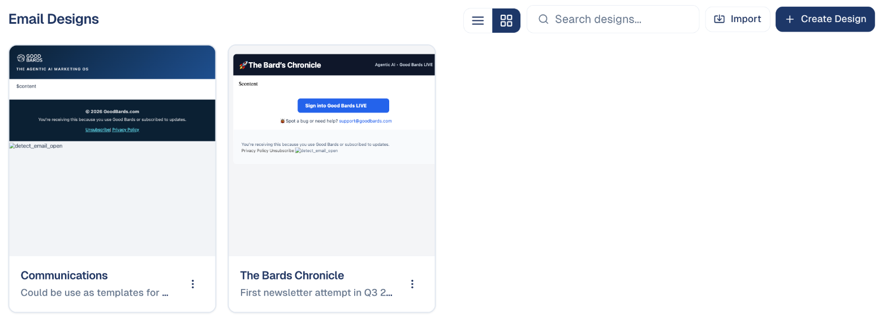

# Email designs

The frame around your emails: the header with your logo, the footer with your
address and unsubscribe link, and your colours and fonts. Make it once, and every
email you write sits inside it.

## What it's for

Every email needs the same header, footer and legal lines. A design holds them,
so you only write the message. Change the design once, for example a new logo,
and the next emails use it.

## How to create a design

1. In the sidebar, choose **Marketing → Emails**, then the **Email Designs** tab.
2. Choose **Create Design** and start from a template, or **Import** your own
   HTML.
3. Edit the header and footer. The middle part, shown as `$content` in the
   preview, is where each email's text goes.
4. Save. The design appears in the list, ready to pick when you write an email.

## Where designs are used

- **Emails:** pick the design when you create an email. See
  [Emails](emails.md).
- **Events:** pick one under the event's **Definition → Email design**; all its
  invitations, confirmations and reminders use it.
- **Forms:** the confirmation email of a form uses the design you choose for it.

## Good to know

- **Keep the unsubscribe link.** The footer's unsubscribe and privacy links are
  required for marketing emails; they are filled in for each recipient.
- **Use your Brand Kit.** Colours and fonts from your
  [Brand Kit](../settings/brand-kit.md) keep every email on brand.
- **Editing a design does not change emails already sent.**

---

*Still stuck? [Contact support](../contact.md).*
