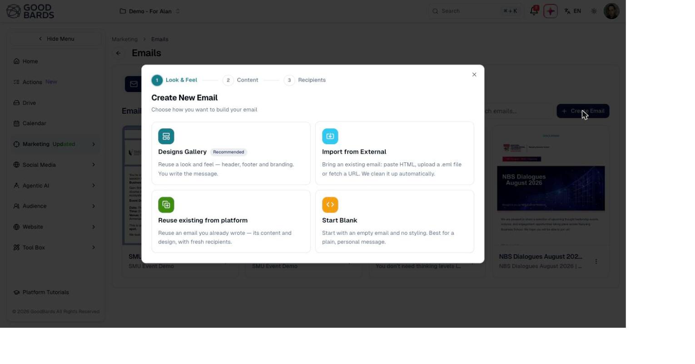
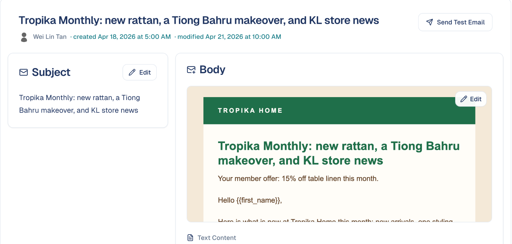
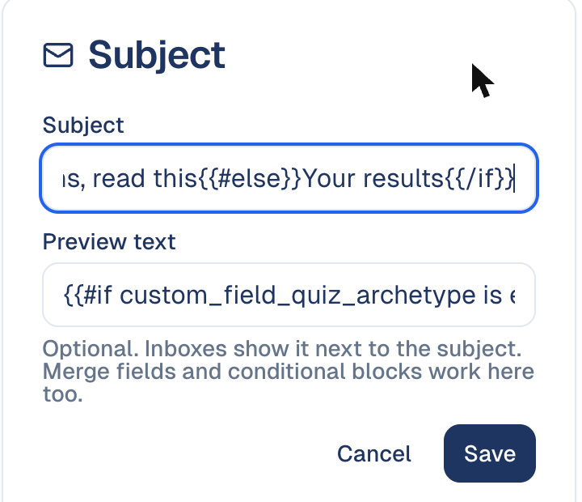
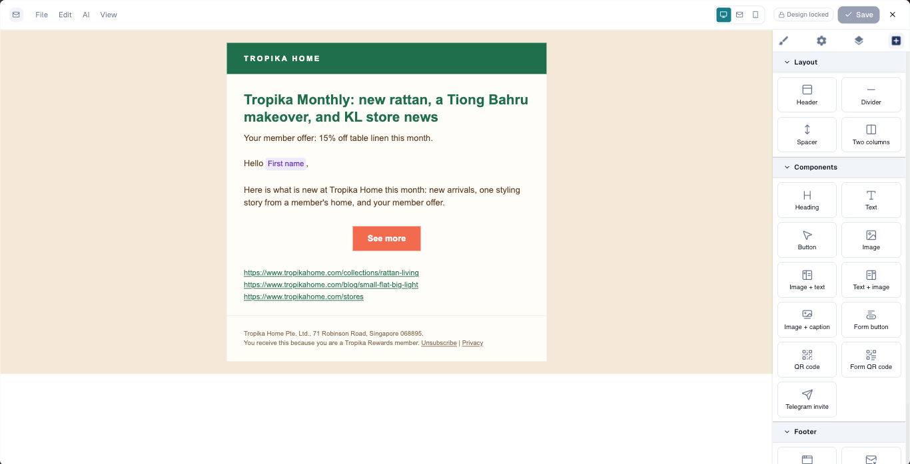
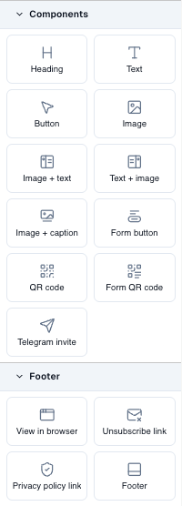
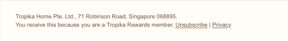
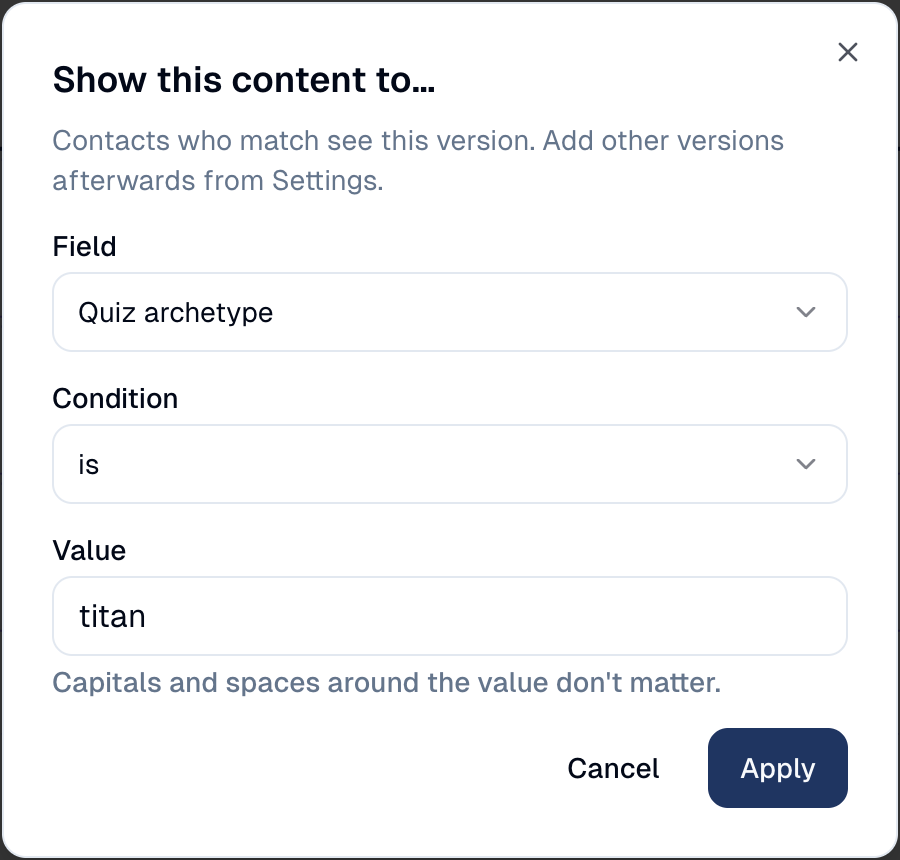
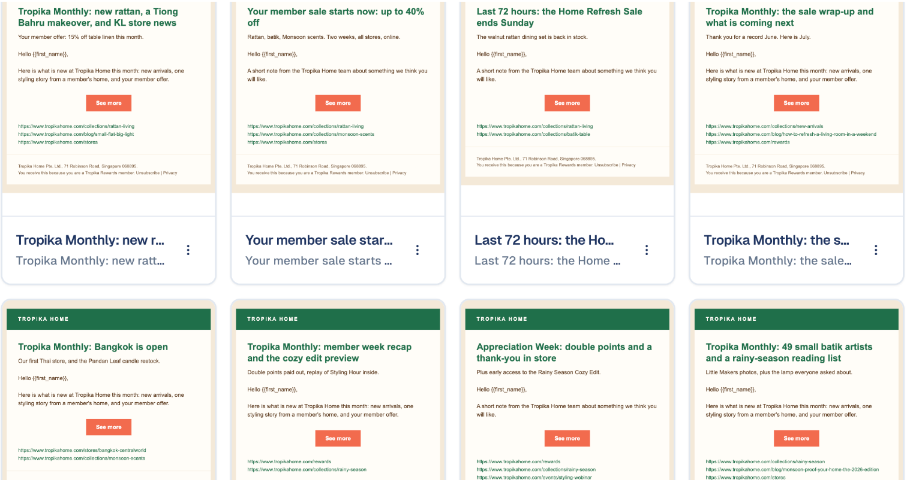
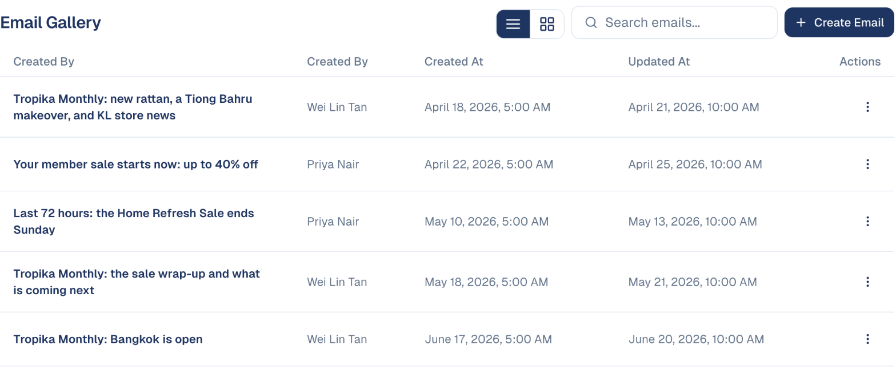

# Emails

Design, send and track the emails you send to your contacts — from a one-off
announcement to a regular newsletter.

## What it's for

Email is where most marketing plans still start. GoodBards keeps the whole job in
one place: you pick a look, write the message, choose who receives it, and see how
it performed — without exporting lists or switching to a separate email tool.

Because your emails sit alongside your contacts, anything you already know about
your audience is available when you choose recipients.

## Before you start

- At least one contact in **Audience → Contacts**, or a mailing list to send to.
- Your **Brand Kit** set up, if you want emails to pick up your colours and logo
  automatically. See [Brand Kit](../settings/brand-kit.md).

## How to create an email

1. In the sidebar, choose **Marketing → Emails**.
2. Choose **+ Create Email**.
3. Pick how you want to start. GoodBards offers four options:



| Option | When to use it |
| --- | --- |
| **Designs Gallery** | The usual choice. Reuse a look and feel — header, footer and branding — and just write the message. Marked *Recommended*. |
| **Import from External** | You already have the email elsewhere. Paste HTML, upload a `.eml` file, upload a `.zip` export (for example from Canva), or fetch a URL. |
| **Reuse existing from platform** | Send something you have written before, with fresh recipients. |
| **Start Blank** | An empty email with no styling. Best for a plain, personal message. |

4. Work through the three steps at the top of the dialog:
   **Look & Feel**, then **Content**, then **Recipients**.
5. Preview your email before sending, and send yourself a test if you can.

!!! tip "Reuse beats starting over"
    If you send a similar email regularly, **Reuse existing from platform** keeps
    the content and design and only asks for new recipients — usually faster than
    building it again.

### Importing a design from Canva

Canva exports an email as a `.zip` holding the email's HTML and its images.

1. In Canva, export your email design. Keep the `.zip` as it is; there's no
   need to unzip it.
2. In **Create Email**, choose **Import from External**, then the
   **ZIP (Canva)** tab, and drop the `.zip`. Any `.zip` with one HTML file and
   its images works the same way.
3. Choose **Analyze & clean up**. The report lists what the file contained:
   the images found, any image the HTML uses but the `.zip` lacks, and files
   that won't be used.
4. Check the **Import name**. It names the email and the folder its images go
   to.
5. Continue through **Scope** and **Images**. The images are copied to
   **Drive › My Documents › Images › *your import name*** and made public so
   recipients can see them; the email points at those copies.

Good to know:

- The plain-text version of the email is created from the HTML, with its
  links. The `.txt` file in Canva's export is not used.
- Canva's unsubscribe link is converted automatically. If an email has no
  unsubscribe link, the report warns you: add one, or use a Design whose
  footer has it, before sending.
- If the design uses a font recipients don't have (Canva's brand fonts, for
  example), the report names it and the font they'll see instead.
- SVG images are not imported: Gmail and Outlook don't display them. Export
  them from Canva as PNG instead.
- An imported email's hidden preview line (the "preheader") becomes its
  [preview text](#preview-text).

## Editing an email

Choose an email's preview in the gallery to open it. Its page shows the subject
and the body as recipients will see it, with an **Edit** button on each, and
**Send Test Email**.



**Edit** on the body opens the editor. The design (header and footer) is locked:
you edit only your content inside it.

### Preview text

The preview text is the grey line inbox lists show after the subject. Without
one, inboxes show the first words of the email, often "View in browser".

1. On the email's page, choose **Edit** on the **Subject** card.
2. Type the line under **Preview text**, then choose **Save**.

{ width="40%" }

It is optional. Personal fields and
[conditional content](#showing-content-to-some-contacts-only) work in it, as
in the subject.



Across the top of the editor are the menus **File**, **Edit**, **AI** and
**View**. On the right are the width buttons, **Save** and **✕**.

The **View** menu switches between three ways of working:

- **Visual editor**: click any text to change it; drag blocks from the right
  (heading, text, button, image, two columns, divider…). Personal fields such as
  **First name** are filled in for each recipient; see
  [Personalising an email](#personalising-an-email).
- **HTML code**: edit the HTML directly.
- **AI assistant**: describe the change, for example *make it shorter and
  warmer*. You can also paste links: *write a newsletter from these posts*
  followed by up to three web addresses builds a section per post, with a
  "Read more" link to each. The pages are read before the AI writes, and the
  panel tells you which ones it could read; a page whose owner blocks automated
  access is named, not guessed at. **AI → Improve with AI** (or ⌘J) opens it too.

### Building your email with blocks

An email is built from blocks stacked one under the other. The panel on the
right lists them in three groups. Drag a block onto the email where you want it,
then click into it to change the text, or select it to change its settings.

| Group | Blocks | Use them for |
| --- | --- | --- |
| **Layout** | **Header**, **Divider**, **Spacer**, **Two columns** | The structure: your logo at the top, side-by-side content, space between parts. |
| **Components** | **Heading**, **Text**, **Button**, **Image**, **Image + text**, **Text + image**, **Image + caption**, **Form button**, **QR code**, **Form QR code**, **Telegram invite** | The message itself. **Form button** and **Form QR code** ask you which of your forms to open. |
| **Footer** | **View in browser**, **Unsubscribe link**, **Privacy policy link**, **Footer** | The links every marketing email needs, ready to drop in. |

{ width="25%" }

!!! info "Your brand is applied for you"
    Blocks take the colours, fonts and logo of your [Brand Kit](../settings/brand-kit.md)
    as you drop them. You can still change any of them in the block's settings.

### The footer: unsubscribe and privacy links

The **Footer** block is the quickest way to end an email properly. It holds, in
one block:

- your company name and address, taken from your Brand Kit;
- an **Unsubscribe** link, personal to each recipient;
- a **Privacy policy** link to your default privacy statement.

{ width="60%" }

When your email uses a design, its footer is part of the design and is locked
(**Design locked** at the top of the editor): it already has these links.

Building your own footer instead? Drop the **Unsubscribe link** and
**Privacy policy link** blocks into it one by one. **View in browser** goes at
the very top of the email, for recipients whose email app does not display it
well.

!!! warning "Never send without an unsubscribe link"
    People must always be able to stop your emails (PDPA in Singapore, and
    Gmail and Yahoo require it from bulk senders). If an email has no
    unsubscribe link, its page warns you: add the **Footer** or the
    **Unsubscribe link** block before sending.

!!! note "The links are filled in when the email is sent"
    In the editor the links are placeholders. Each recipient gets their own
    unsubscribe link when the email goes out. **View in browser** works only in
    emails sent from a campaign tactic, and without a default privacy statement
    the **Privacy policy** link is left out.

Opens are tracked automatically: there is nothing to add to your email for
that.

In the visual editor, **Desktop**, **Email width** and **Mobile** show the email
at each size. In the other two views, a **Visual editor** button takes you back
to the canvas. **View** also offers **Show outlines** and **Preview**, and
**Edit** has **Undo** and **Redo**.

Choose **Save** (or ⌘S) to keep your changes; *Unsaved changes* shows while
there is something to save. **✕** (or Esc) closes the editor: if you changed
something, it asks **Discard changes?** first. When you are writing a new email,
the button reads **Apply** instead of **Save**: the body goes back into the
email, which you then save.

The card menu in the gallery also offers **Show Tactics** (where the email is
used), **Duplicate**, **Attach to tactic** and **Delete**.

## Personalising an email

A personal field is a placeholder between double curly braces, such as
`{{contact_firstname}}`. When the email is sent, each recipient gets their own
value in its place. Fields work in the **subject** as well as in the body.

1. Open the email and choose **Edit** on the subject or the body.
2. Type the field where the value should appear, braces included. In the
   **Visual editor**, type it into any text; in **HTML code**, anywhere in the
   HTML.

    ```
    Hi {{contact_firstname}}, here is what's new this month.
    ```

3. Choose **Save**, then **Send Test Email** to check it.

The fields you can use:

| Field | Filled with |
| --- | --- |
| `{{contact_firstname}}` | The recipient's first name |
| `{{contact_lastname}}` | The recipient's last name |
| `{{contact_email}}` | The recipient's email address |
| `{{contact_phone}}` | The recipient's phone number |
| `{{contact_job_title}}` | The recipient's job title |
| `{{company_name}}` | The company name, when the tactic sends one email per company |
| `{{unsubscribe_url}}` | The link to unsubscribe. Every design's footer already has it. |
| `{{privacy_policy_url}}` | The link to your privacy statement |
| `{{view_in_browser_url}}` | The link to open the email in a browser |

Good to know:

- **Add a default for empty fields.** `{{contact_firstname | default: "there"}}`
  gives *Hi there,* to a contact without a first name, and their name to the
  others. It works for every field, custom fields included
  (`{{custom_field_quiz_archetype | default: "your archetype"}}`), in the
  subject, the body and links. Without a default, an empty field is left blank:
  *Hi ,*.
- **Custom fields work too:** `{{custom_field_<key>}}`, for example
  `{{custom_field_quiz_archetype}}`. The key is the field's key on the
  [Custom Fields](../audience/contacts.md#custom-fields) tab of
  **Audience → Contacts**.
- **Test emails use your own contact record.** The field is filled only when
  the address you send the test to exists in **Audience → Contacts**. Otherwise
  it shows blank in the test, and works for real recipients. To see what one
  contact will get, choose them under **Test as contact** (see
  [Testing as a contact](#testing-as-a-contact)).
- **Spell fields exactly as above.** `{{first_name}}` or `{{FirstName}}`, which
  other tools use, are not recognised and show as `???` in the sent email. If
  you import an email from Canva or another tool, replace its fields with the
  ones in the table.

## Showing content to some contacts only

One email can say something different to each kind of contact: a paragraph
for quiz *Titans*, another for *Sages*, a default for everyone else. Each
contact receives only the first version whose condition is true for them.

1. Open the email and choose **Edit** on the body.
2. From **Components**, drag **Show if…** where the content goes.
3. Choose who sees it: a **Field** (your custom fields, or first name, last
   name, email, phone, job title), a **Condition** and, for *is* and *is not*,
   a **Value**. Choose **Apply**.

    { width="40%" }

4. Write the version's content in the framed block. Drop any block into it:
   text, images, buttons.
5. To add the next version, select the block's title. In **Settings**:
    - **Add another version** asks for its condition and adds it below.
    - **Add "everyone else"** adds the version for all the others. Without
      it, they get nothing in that place.
    - **Edit condition** changes who sees this version.
    - **Remove this version** deletes it with its content.
6. Choose **Save**, then [test it as a contact](#testing-as-a-contact) of each
   kind.


### Writing conditions by hand

The editor saves each block as text, which you can also type yourself: in the
subject, the [preview text](#preview-text), the **HTML code** view, or inside a
sentence or a link, where the visual block cannot go.

```
{{#if custom_field_archetype == "titan"}}
  Titans like you go straight for results…
{{#elseif custom_field_archetype == "sage"}}
  Sages like you want to understand first…
{{#else}}
  Here is what your results say…
{{/if}}
```

A block typed on its own lines shows as framed versions the next time the
visual editor opens.

The conditions you can write:

| Condition | True when |
| --- | --- |
| `field == "value"` (or `field is "value"`) | The field is that value |
| `field != "value"` (or `field is not "value"`) | The field is anything else, empty included |
| `field is empty` | The contact has no value |
| `field is not empty` | The contact has a value |

The field is a custom field (`custom_field_<key>`) or a contact field
(`contact_firstname`, `contact_lastname`, `contact_email`, `contact_phone`,
`contact_job_title`, `contact_code`).

Good to know:

- **Capitals and spaces don't matter.** `"titan"` matches *Titan* and
  *TITAN*.
- **As many versions as you need:** add an `{{#elseif …}}` per version. A block
  can also sit inside another one.
- **It works everywhere in the email:** the subject, the
  [preview text](#preview-text), the body, and inside links. A button can take
  each archetype to its own page:
  `https://example.com/{{#if custom_field_archetype == "titan"}}titan{{#else}}kits{{/if}}`.
- **Personal fields work inside a version:**
  `{{#if contact_firstname is not empty}}Hi {{contact_firstname}},{{#else}}Hi there,{{/if}}`.
- **Mistakes are caught when you save.** A block without its `{{/if}}`, a value
  without quotes or an unknown field stops the save, and the message says what
  to fix.

## Naming a link and tagging on click

Every link in an email is tracked per recipient: a click is counted and shows
in the contact's history. Name a link to use it in automations, and give it
tags to set on click.

1. Open the email and choose **Edit** on the body.
2. Select the link or button, then open **Settings** (the gear on the right).
3. Fill in what you need:
    - **Link name:** a short name, for example `kit`. Flows can then start on
      a click on this link, or branch and wait on it (see
      [Triggers](../automations/triggers.md#link-clicked)).
    - **Add tag on click:** the tag the contact gets when they click it, for
      example `clicked: kit`.
    - **Remove tag on click:** a tag taken off when they click it.
4. Choose **Save**.

Good to know:

- **Only people count.** Clicks by link scanners, by Apple Mail opening the
  email on its own, or by suspected bots never add or remove a tag. A click
  waits about 30 seconds before its tags are applied, long enough to tell a
  scanner from a person.
- **A tag on click can start a flow.** It counts as any other tag, so a flow
  that starts on **Tag added** with `clicked: kit` takes that contact in.
- **Two links to the same page can have different names**, for example the
  *kit* button in the body and a *kit* link in the footer named `footer-kit`.
  Each counts on its own.
- **Names and tags apply to emails sent from now on.** Emails already sent keep
  the links they went out with.

## Testing as a contact

**Send Test Email** has an optional **Test as contact**. Choose a contact and
the test is written as they would receive it: their name, their custom fields,
and the versions of [conditional content](#showing-content-to-some-contacts-only)
they get. The test still goes only to the recipients you entered, never to the
contact.

To check every version, send one test per kind of contact: a Titan, a Sage,
and a contact with the field empty.

## Attaching an email to a tactic

An email is sent from a campaign tactic: the tactic holds the audience, the
sender and the send button. **Attach to tactic** in the card menu links the
email to one, in three ways:

- **Existing tactic**: pick a campaign, then one of its email tactics. Only
  tactics that can still take the email are listed: a tactic sends one email,
  so those that already sent theirs, and closed tactics, are left out. A tactic
  whose email is still a draft, failed, or scheduled is listed with that email's
  name; attaching replaces it after you confirm. The audience and the sender stay;
  a scheduled send is cancelled, and you schedule the new email again from the
  tactic page.
- **New tactic in a campaign**: pick a campaign and name the tactic; it is
  created as a draft with the email attached.
- **New campaign**: name the campaign, choose its objective and name the tactic;
  both are created with the email attached.

Each option opens the tactic page, where you set the recipients and send.

To send two to four versions of the email and keep the best, see
[A/B testing an email](ab-testing.md).

## Finding your emails

Everything you have created is listed under **Email Gallery**, on the **Emails**
tab. Use the search box to find one by name, and the buttons beside it to switch
between grid and list view.



{ width="80%" }

The **Email Designs** tab holds the reusable looks — headers, footers and
branding — rather than individual messages.

## Good to know

- **Emails and designs are separate.** A design is the wrapper you reuse; an email
  is one message you send. Editing a design does not rewrite emails already sent.
- **Check the preview before every send.** Email clients vary, and a layout that
  looks right in the editor can shift in Gmail or Outlook.
- **Sent emails cannot be recalled.** Confirm your recipient list before the final
  step.

---

*Still stuck? [Contact support](../contact.md).*
