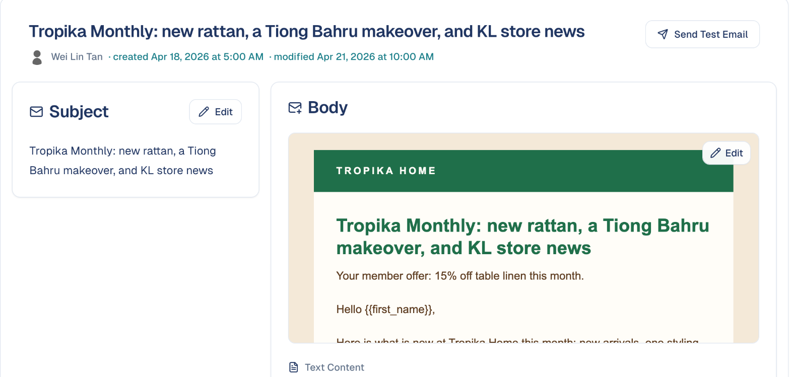
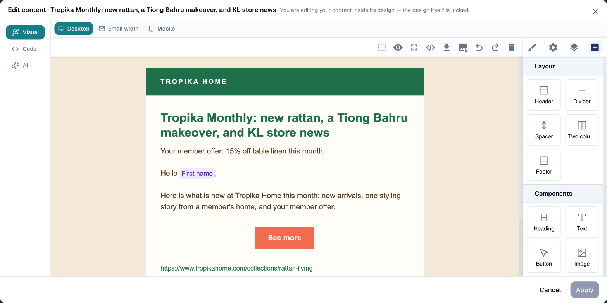
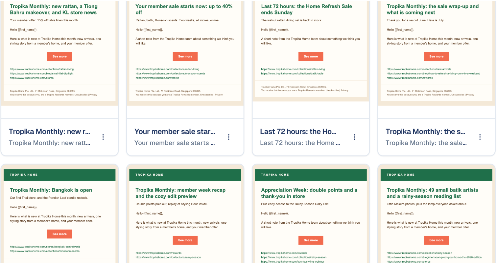
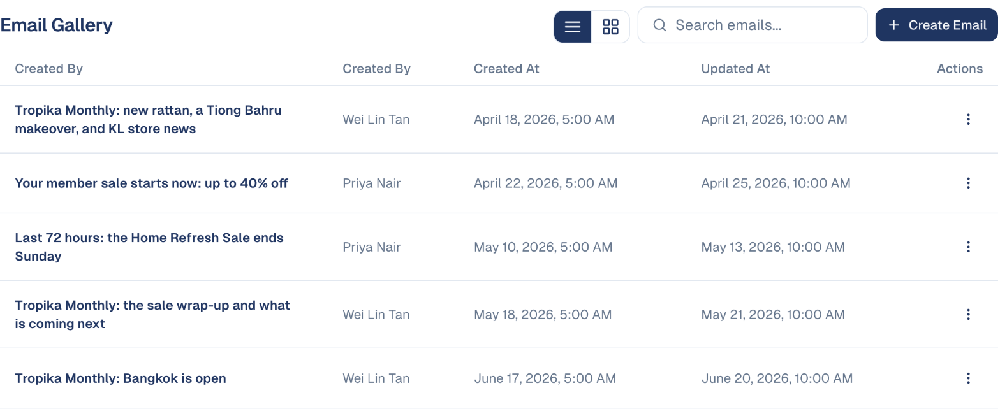

# Emails

Design, send and track the emails you send to your contacts — from a one-off
announcement to a regular newsletter.

## What it's for

Email is where most marketing plans still start. GoodBards keeps the whole job in
one place: you pick a look, write the message, choose who receives it, and see how
it performed — without exporting lists or switching to a separate email tool.

Because your emails sit alongside your contacts, anything you already know about
your audience is available when you choose recipients.

## Before you start

- At least one contact in **Audience → Contacts**, or a mailing list to send to.
- Your **Brand Kit** set up, if you want emails to pick up your colours and logo
  automatically. See [Brand Kit](../settings/brand-kit.md).

## How to create an email

1. In the sidebar, choose **Marketing → Emails**.
2. Choose **+ Create Email**.
3. Pick how you want to start. GoodBards offers four options:


| Option | When to use it |
| --- | --- |
| **Designs Gallery** | The usual choice. Reuse a look and feel — header, footer and branding — and just write the message. Marked *Recommended*. |
| **Import from External** | You already have the email elsewhere. Paste HTML, upload a `.eml` file, upload a `.zip` export (for example from Canva), or fetch a URL. |
| **Reuse existing from platform** | Send something you have written before, with fresh recipients. |
| **Start Blank** | An empty email with no styling. Best for a plain, personal message. |

4. Work through the three steps at the top of the dialog:
   **Look & Feel**, then **Content**, then **Recipients**.
5. Preview your email before sending, and send yourself a test if you can.

!!! tip "Reuse beats starting over"
    If you send a similar email regularly, **Reuse existing from platform** keeps
    the content and design and only asks for new recipients — usually faster than
    building it again.

### Importing a design from Canva

Canva exports an email as a `.zip` holding the email's HTML and its images.

1. In Canva, export your email design. Keep the `.zip` as it is; there's no
   need to unzip it.
2. In **Create Email**, choose **Import from External**, then the
   **ZIP (Canva)** tab, and drop the `.zip`. Any `.zip` with one HTML file and
   its images works the same way.
3. Choose **Analyze & clean up**. The report lists what the file contained:
   the images found, any image the HTML uses but the `.zip` lacks, and files
   that won't be used.
4. Check the **Import name**. It names the email and the folder its images go
   to.
5. Continue through **Scope** and **Images**. The images are copied to
   **Drive › My Documents › Images › *your import name*** and made public so
   recipients can see them; the email points at those copies.

Good to know:

- The plain-text version of the email is created from the HTML, with its
  links. The `.txt` file in Canva's export is not used.
- Canva's unsubscribe link is converted automatically. If an email has no
  unsubscribe link, the report warns you: add one, or use a Design whose
  footer has it, before sending.
- If the design uses a font recipients don't have (Canva's brand fonts, for
  example), the report names it and the font they'll see instead.
- SVG images are not imported: Gmail and Outlook don't display them. Export
  them from Canva as PNG instead.

## Editing an email

Choose an email's preview in the gallery to open it. Its page shows the subject
and the body as recipients will see it, with an **Edit** button on each, and
**Send Test Email**.



**Edit** on the body opens the editor. The design (header and footer) is locked:
you edit only your content inside it.



- **Visual**: click any text to change it; drag blocks from the right (heading,
  text, button, image, two columns, divider…). Personal fields such as **First
  name** are filled in for each recipient; see
  [Personalising an email](#personalising-an-email).
- **Code**: edit the HTML directly.
- **AI**: describe the change, for example *make it shorter and warmer*. You
  can also paste links: *write a newsletter from these posts* followed by up
  to three web addresses builds a section per post, with a "Read more" link to
  each. The pages are read before the AI writes, and the panel tells you which
  ones it could read; a page whose owner blocks automated access is named, not
  guessed at.
- **Desktop**, **Email width** and **Mobile** preview the email at each size.

Choose **Apply** to keep your changes, or **Cancel**.

The card menu in the gallery also offers **Show Tactics** (where the email is
used), **Duplicate**, **Attach to tactic** and **Delete**.

## Personalising an email

A personal field is a placeholder between double curly braces, such as
`{{contact_firstname}}`. When the email is sent, each recipient gets their own
value in its place. Fields work in the **subject** as well as in the body.

1. Open the email and choose **Edit** on the subject or the body.
2. Type the field where the value should appear, braces included. In the
   **Visual** editor, type it into any text; in **Code**, anywhere in the HTML.

    ```
    Hi {{contact_firstname}}, here is what's new this month.
    ```

3. Choose **Apply**, then **Send Test Email** to check it.

The fields you can use:

| Field | Filled with |
| --- | --- |
| `{{contact_firstname}}` | The recipient's first name |
| `{{contact_lastname}}` | The recipient's last name |
| `{{contact_email}}` | The recipient's email address |
| `{{contact_phone}}` | The recipient's phone number |
| `{{contact_job_title}}` | The recipient's job title |
| `{{company_name}}` | The company name, when the tactic sends one email per company |
| `{{unsubscribe_url}}` | The link to unsubscribe. Every design's footer already has it. |
| `{{privacy_policy_url}}` | The link to your privacy statement |
| `{{view_in_browser_url}}` | The link to open the email in a browser |

Good to know:

- **A field the recipient has no value for is left blank.** *Hi
  {{contact_firstname}},* becomes *Hi ,* for a contact without a first name.
  Keep names for lists you know are complete, or write the greeting so it reads
  well without one: *Hello {{contact_firstname}}* rather than *Dear
  {{contact_firstname}},*.
- **Test emails use your own contact record.** The field is filled only when
  the address you send the test to exists in **Audience → Contacts**. Otherwise
  it shows blank in the test, and works for real recipients.
- **Spell fields exactly as above.** `{{first_name}}` or `{{FirstName}}`, which
  other tools use, are not recognised and show as `???` in the sent email. If
  you import an email from Canva or another tool, replace its fields with the
  ones in the table.

## Attaching an email to a tactic

An email is sent from a campaign tactic: the tactic holds the audience, the
sender and the send button. **Attach to tactic** in the card menu links the
email to one, in three ways:

- **Existing tactic**: pick a campaign, then one of its email tactics. Only
  tactics that can still take the email are listed: a tactic sends one email,
  so those that already sent theirs, and closed tactics, are left out. A tactic
  whose email is still a draft, failed, or scheduled is listed with that email's
  name; attaching replaces it after you confirm. The audience and the sender stay;
  a scheduled send is cancelled, and you schedule the new email again from the
  tactic page.
- **New tactic in a campaign**: pick a campaign and name the tactic; it is
  created as a draft with the email attached.
- **New campaign**: name the campaign, choose its objective and name the tactic;
  both are created with the email attached.

Each option opens the tactic page, where you set the recipients and send.

## Finding your emails

Everything you have created is listed under **Email Gallery**, on the **Emails**
tab. Use the search box to find one by name, and the buttons beside it to switch
between grid and list view.





The **Email Designs** tab holds the reusable looks — headers, footers and
branding — rather than individual messages.

## Good to know

- **Emails and designs are separate.** A design is the wrapper you reuse; an email
  is one message you send. Editing a design does not rewrite emails already sent.
- **Check the preview before every send.** Email clients vary, and a layout that
  looks right in the editor can shift in Gmail or Outlook.
- **Sent emails cannot be recalled.** Confirm your recipient list before the final
  step.

---

*Still stuck? [Contact support](../contact.md).*
