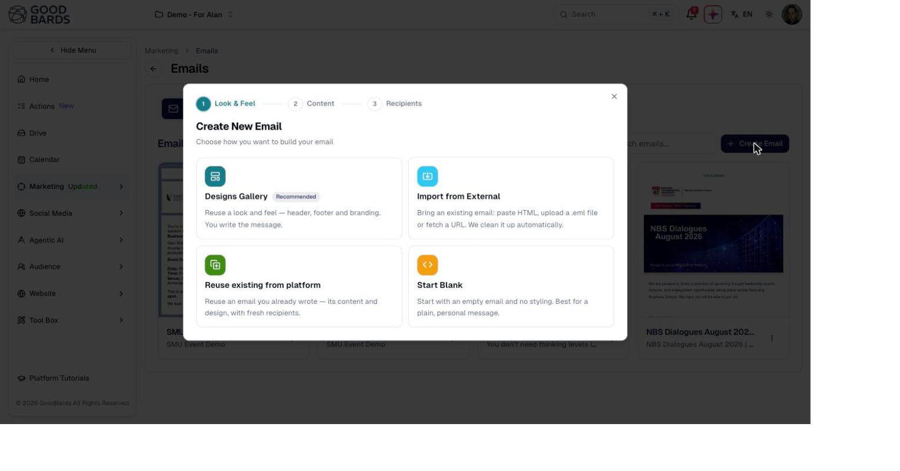

# Emails

Design, send and track the emails you send to your contacts — from a one-off
announcement to a regular newsletter.

## What it's for

Email is where most marketing plans still start. GoodBards keeps the whole job in
one place: you pick a look, write the message, choose who receives it, and see how
it performed — without exporting lists or switching to a separate email tool.

Because your emails sit alongside your contacts, anything you already know about
your audience is available when you choose recipients.

## Before you start

- At least one contact in **Audience → Contacts**, or a mailing list to send to.
- Your **Brand Kit** set up, if you want emails to pick up your colours and logo
  automatically. See [Brand Kit](../settings/brand-kit.md).

## How to create an email

1. In the sidebar, choose **Marketing → Emails**.
2. Choose **+ Create Email**.
3. Pick how you want to start. GoodBards offers four options:

| Option | When to use it |
| --- | --- |
| **Designs Gallery** | The usual choice. Reuse a look and feel — header, footer and branding — and just write the message. Marked *Recommended*. |
| **Import from External** | You already have the email elsewhere. Paste HTML, upload a `.eml` file, or fetch a URL. |
| **Reuse existing from platform** | Send something you have written before, with fresh recipients. |
| **Start Blank** | An empty email with no styling. Best for a plain, personal message. |

4. Work through the three steps at the top of the dialog:
   **Look & Feel**, then **Content**, then **Recipients**.
5. Preview your email before sending, and send yourself a test if you can.

!!! tip "Reuse beats starting over"
    If you send a similar email regularly, **Reuse existing from platform** keeps
    the content and design and only asks for new recipients — usually faster than
    building it again.

## Finding your emails

Everything you have created is listed under **Email Gallery**, on the **Emails**
tab. Use the search box to find one by name, and the buttons beside it to switch
between grid and list view.

The **Email Designs** tab holds the reusable looks — headers, footers and
branding — rather than individual messages.

## Good to know

- **Emails and designs are separate.** A design is the wrapper you reuse; an email
  is one message you send. Editing a design does not rewrite emails already sent.
- **Check the preview before every send.** Email clients vary, and a layout that
  looks right in the editor can shift in Gmail or Outlook.
- **Sent emails cannot be recalled.** Confirm your recipient list before the final
  step.

---

*Still stuck? [Contact support](../contact.md).*
